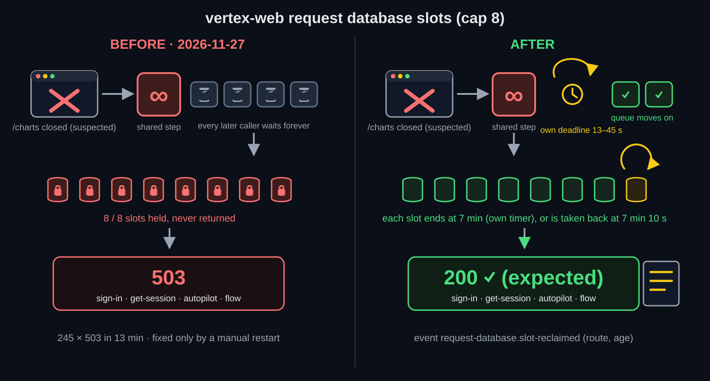

# Goldfish Annotated Review Report

**Target:** `docs/vertex-rebuild/designs/vertex-web-request-slot-leak-cancel/plan.md` (full file, first draft)

**Resolution gate:** Auto accept (owner rule 2026-11-13): every PROPOSE FIX is applied to `plan.md` (and, where the finding is about behavior, to the code); CONTEST and DECLINE entries stay as recorded here. No finding needed an owner fact, so there is no ESCALATE.

**Counts:** 10 reports, grouped into 19 issues: 15 issues fixed (Issues 1-14 and 17; Issue 15 fixed except its contested part), Issue 16 declined (advisory additions, reasons in the plan's Alternatives), Issue 18 Nits declined or fixed, and 7 contested items (Issue 15 M5 and the 6 items of Issue 19).

## Prioritized findings and suggestions

Findings are grouped where several reviewers raised the same issue. Reviewer keys refer to the files in [review/](review/).

### [Issue 1] Fix D used an idle-under-pressure reclaim, a URL-prefix order exemption and a cross-request socket destroy — Blocker

- **Raised by:** Design7 B2, M3, M4; Catalyst5 M1, M2; ZoomOut5 #3; ZoomOut8 B1; Readiness9 M7, M8; Codebase9 B1, M7, M8, M10; Comprehension6 #5; Style7 M12, M14.
- ***AI Suggestion:*** PROPOSE FIX (applied).
- ***Justification:*** The idle rule can end live requests (order submits wait up to 160 s on the bridge between writes, collectors wait on providers), needs activity tracking that raw `$client` queries bypass, and needs an order exemption by URL text. The harness measured that a socket destroy from another request does not close the Postgres connection, so reclaim could add connections above 8.
- ***Proposed Edit:*** Layer 2 rewritten: the owner request ends its own client at 420 s with its own timer (closes the Postgres connection, measured); another request frees a lease only at 430 s, when the owner's timer could not run. No idle rule, no exemption, no cross-request destroy. Order safety is the assertion in `packages/api/src/request-slot-age.test.ts`. Alternatives records the rejected designs.

### [Issue 2] Which request's sink reports the reclaim — Blocker

- **Raised by:** Readiness9 B1; Codebase9 B2; Design7 M5; ZoomOut5 #4.
- ***AI Suggestion:*** PROPOSE FIX (applied).
- ***Justification:*** A gone request cannot report.
- ***Proposed Edit:*** The owner reports through its own sink at 420 s; at 430 s the requesting request reports through its own sink with the freed lease's route label and age. Event shape (`outcome`, `errorCategory`, attribute keys and types) stated in Layer 2.

### [Issue 3] Shared in-flight promises not all bounded — Blocker

- **Raised by:** ZoomOut5 #1; ZoomOut8 B2; Design7 N2.
- ***AI Suggestion:*** PROPOSE FIX (applied, one part moved).
- ***Justification:*** `instant-backtest.ts#columnsFor` and `golive-live-quotes.ts` share in-flight promises across requests.
- ***Proposed Edit:*** `columnsFor` gets a 30 s `waitAtMost` and loads with its own repository on timeout (code and test added). `golive-live-quotes.ts` is on the go-live path, which `scripts/ci/merge-conditions.ts` treats as an owner-decision path; it moves to a follow-up card, and the age limit bounds it meanwhile (Alternatives).

### [Issue 4] No Alternatives section — Blocker

- **Raised by:** Structural7 B1; Design7 B1; ZoomOut8 M4.
- ***AI Suggestion:*** PROPOSE FIX (applied).
- ***Proposed Edit:*** "Alternatives considered" lists idle reclaim, cross-request destroy, lazy acquisition, removing sharing, request deadlines, raising the cap, a watchdog, `idle_session_timeout`, per-site telemetry and `golive-live-quotes.ts`, each with its reason.

### [Issue 5] Deploy step did not deploy the new build — Blocker

- **Raised by:** Style9 B1; Readiness9 M11.
- ***AI Suggestion:*** PROPOSE FIX (applied).
- ***Proposed Edit:*** Step 8: full manual CI on the merged SHA (`browser_tests: on`), then build, stage and `restart-when-idle.sh` with the deploy option for that SHA, per `infra/quantvps/README.md`.

### [Issue 6] Reclaimed-slot hand-off and the admission API were undefined — Blocker

- **Raised by:** Readiness9 B2; Codebase9 M7.
- ***AI Suggestion:*** PROPOSE FIX (applied).
- ***Proposed Edit:*** Layer 2 states FIFO hand-off (a freed slot goes to the first waiter; with none it stays free for the requester), `acquireRequestSlot({ route, onReclaim })`, `releaseRequestSlot(lease)` once per lease, and the reset seam.

### [Issue 7] Three hand-written races instead of one primitive; no stated rule — Major

- **Raised by:** ZoomOut5 #2; ZoomOut8 M1, M2, N2; Comprehension6 #8, #9; Style7 M13; Codebase9 M6; Design7 M2 (45 s basis).
- ***AI Suggestion:*** PROPOSE FIX (applied).
- ***Proposed Edit:*** Layer 1 names `waitAtMost` once, a table gives each site's deadline basis and timeout behavior, the rule "redo where local and cheap, fail fast where redoing spends upstream quota" is stated, and ARCHITECTURE.md gets the shared-promise rule next to the `basket-history.ts` precedent.

### [Issue 8] Yahoo: many waiters start many sessions; a late failure clears the new session — Major

- **Raised by:** Design7 M7; Readiness9 M3; Codebase9 M5.
- ***AI Suggestion:*** PROPOSE FIX (applied in code and plan).
- ***Proposed Edit:*** A timed-out waiter renews only when the session is still the stale start, else waits (bounded) for the newer one; the failure handler clears `session` only when it is still that start. Test: two reads time out together and start one session; a late failure keeps the new session.

### [Issue 9] QuantData turn: clock and late-finish guard unspecified — Major

- **Raised by:** Readiness9 M1, M2; Codebase9 M3, M4; Style7 M9; Catalyst5 N6.
- ***AI Suggestion:*** PROPOSE FIX (applied).
- ***Proposed Edit:*** Wall clock and global timer (not the injected `now`/`sleep`); identity-guarded release; wake order follows the order of the waits; test with a fetch double that ignores its signal and fake `Date`.

### [Issue 10] Route path could carry a password-reset token — Major (security)

- **Raised by:** Design7 M6; Codebase9 M9; Style7 N14.
- ***AI Suggestion:*** PROPOSE FIX (applied in code and plan).
- ***Proposed Edit:*** `requestRouteLabel`: oRPC procedure paths; other paths keep 3 segments; non-name segments become `:param`; no query string. Tests cover `/api/auth/reset-password/<token>`.

### [Issue 11] Claims stated more firmly than the evidence — Major

- **Raised by:** Comprehension6 #1, #2, #3, #4; Style7 M1, M2, M3, M4, M5, M6, M7, M8, M11; Design7 M1, N1.
- ***AI Suggestion:*** PROPOSE FIX (applied).
- ***Proposed Edit:*** Title and image mark the trigger as suspected; Evidence marks each bullet's status, gives the 245 count and its source, explains 8 slots versus 5 connections, says "consistent with" for 714 s, links `/charts` to `optionsChain.*`/`optionsAnalytics.*`, names the harness location; Cause keeps verified and hypothesis apart; the 30 s statement becomes "not cut off in `workerd` as run on QuantVPS"; the waiter fixes are marked defensive.

### [Issue 12] Goals, Risks and mitigations, security — Major

- **Raised by:** Structural7 M2, M3; Design7 M2, M9; Style7 M12; ZoomOut8 N6.
- ***AI Suggestion:*** PROPOSE FIX (applied).
- ***Proposed Edit:*** "Goals and non-goals" with the outage bounds; "Risks and mitigations" with order placement (350 s vs 420 s, test), max-age headroom (121 s over the longest live request), chain-read `UNAVAILABLE`, the 45 s full-admission window, spacing, security and connections.

### [Issue 13] Test paths, doubles, clocks and coverage — Major

- **Raised by:** Style9 M2, N9; Readiness9 M5, M6; Codebase9 M2, M10, M11.
- ***AI Suggestion:*** PROPOSE FIX (applied).
- ***Proposed Edit:*** Verification names the real files (`packages/api/src/options-analytics.test.ts`, `options-chain.test.ts`, `instant-backtest.test.ts`, `packages/db/src/server/client.test.ts`, new `request-slots.test.ts` and `request-slot-age.test.ts`); the db request-scope test is not used for lease behavior; fake timers include `Date`; 100% coverage of the changed db files is measured.

### [Issue 14] File list incomplete; revert statement wrong — Major

- **Raised by:** Comprehension6 #6, #7; Style9 M3, M4, M5, M6, M7; Readiness9 M4, M9; Codebase9 M1, M12; ZoomOut8 N3, N4.
- ***AI Suggestion:*** PROPOSE FIX (applied).
- ***Proposed Edit:*** Step 1 lists every created and modified file; Revert says: revert the merge commit, or commits 4, 3, 2, 1 in that order.

### [Issue 15] Structure and template form — Major

- **Raised by:** Structural7 M5 (named Problem Statement / Proposed Architecture sections), M4 (list nesting), N6-N11.
- ***AI Suggestion:*** PROPOSE FIX for M4 and the nesting Nits (applied); CONTEST for M5.
- ***Justification (M5):*** `plan.md` is a one-page bug-fix plan (flow.md, Full flow step 3: "a one-page plan doc (cause, fix, files, risks)"), not a feature specification; "Overview", "Evidence", "Cause" and "Design" carry the same content. ZoomOut8 M3 also recommends against the full template.

### [Issue 16] Advisory additions that add machinery — Major (advisory)

- **Raised by:** Catalyst5 M1 (lazy acquisition), M3 (request deadline `AbortSignal`), M4 (watchdog, circuit breaker), N5 (typed reclaimed error); Design7 M8 (per-site telemetry), M10 (re-justify the cap), B1 options 2-6.
- ***AI Suggestion:*** DECLINE (recorded with reasons in Alternatives).
- ***Justification:*** Each adds new API or signature churn for a case the age limit already bounds (ZoomOut8 M3). Lazy acquisition is recorded as the known structural coupling.

### [Issue 17] Codebase9 Nit "a skipped late waiter gets a 503" and Design7 N4 — Nit

- ***AI Suggestion:*** PROPOSE FIX (code changed).
- ***Justification:*** In the first implementation a skipped live waiter would have waited for good. `handOff` now ends it with `null` (`DATABASE_CAPACITY`); the test asserts it.

### [Issue 18] Remaining Nits — Nit

- ***AI Suggestion:*** DECLINE for wording-only Nits that the rewrite made moot (Style7 N1-N13, N15-N21 where the sentence no longer exists; Style9 N10-N13; Codebase9 nits about `logQuery`, the order prefix and `drizzleDatabase`); PROPOSE FIX for the image Nits (applied: suspected trigger, 245 cited in the image and text, label overlap fixed, deadline range 13-45 s, "expected" on the after result).

### [Issue 19] Contested items

- **Codebase9 B1 (submit sequence):** CONTEST in part. The reviewer is right that the intent is written between the two bridge calls; the plan no longer describes the sequence, and the age-limit test uses the 350 s placement lease, which the reviewer confirmed.
- **Codebase9 M11 (Graphify):** CONTEST. AGENTS.md: "Graphify is optional ... never committed or required"; recorded as not run.
- **Design7 M1 (170 s scheduler timeout vs 714 s):** CONTEST in part. The plan now says "consistent with" and does not claim the 714 s request is the `flow/collect` run.
- **Style7 N15 (role sharing for `idle_session_timeout`):** CONTEST. The rejection no longer depends on role sharing: the leaked connections belonged to live, waiting requests, which the age limit ends.
- **Catalyst5 N6 (FIFO loss):** CONTEST. Waiters wake in the order of their waits and the loop re-reads the running step synchronously (ZoomOut8 M3).
- **Readiness9 M7 (semantic reader activity):** CONTEST. Moot without activity tracking; the reader now passes the route label `semantic-layer/reader`.
