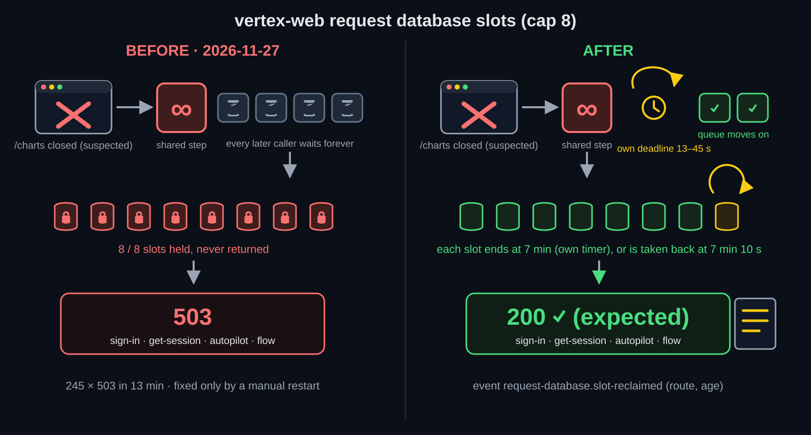

# vertex-web: request database slots stay taken when a request waits for good

- **Author:** job agent of card `vertex-web-request-slot-leak-cancel`
- **Status:** Approved after EGM review (consolidated report, all rubrics; resolve: auto accept), 2026-11-27
- **Date:** 2026-11-27

## Overview

On 2026-11-27 from 21:15:46 to 21:28:40 UTC, `vertex-web` (the Vertex web app; it runs `vite preview` on QuantVPS, `127.0.0.1:3450`, build `6db354c97a`) answered every database-backed request with `503 DATABASE_CAPACITY`. Sign-in, `get-session`, every oRPC procedure and the QuantVPS timers that call it (autopilot tick, research screen tick, OpenBB freshness, flow collect) failed. A manual restart of `vertex-web` restored service after 13 min.

This plan bounds the outage in two layers:

1. **Bounded shared waits.** Six places let one request wait for a promise that another request started; this change bounds five of them (the sixth, `golive-live-quotes.ts`, has a follow-up card). Each waiter gets its own deadline, from a timer that the waiter creates (`packages/api/src/server/bounded-wait.ts#waitAtMost`).
2. **Slot age limit.** A request holds its database slot for at most 7 min. At that age the request ends its own client and frees the slot. If its request context is gone, so that its timer cannot run, the next request that asks for a slot takes it back at 7 min 10 s. Both report the event `request-database.slot-reclaimed`.

## Goals and non-goals

- **Goal:** a shared step that never ends delays other callers by at most its deadline (10–45 s), not until a restart.
- **Goal:** a leak that layer 1 does not catch fills admission for at most about 7 min, and each such slot is named in the journal.
- **Goal:** no manual restart for this failure mode.
- **Non-goal:** changing the cap (8 slots), the 2 s admission wait, the `503 DATABASE_CAPACITY` body or `retry-after: 1`.
- **Non-goal:** any change to trading units, orders, arming, risk settings, the trading engine, Nautilus, the IB gateway or the exec node.
- **Non-goal:** Postgres settings. `idle_session_timeout` is not set (see Alternatives).

## Terms

- **Slot:** one of the 8 admissions per isolate (`REQUEST_DATABASE_POOL_MAX_CONNECTIONS`). A request takes one slot before it connects and frees it after its connection closes.
- **Isolate:** the one long-lived `workerd` JavaScript instance that `vite preview` runs. Module-level variables are shared by all its requests.
- **Request context:** the `workerd` I/O context of one incoming request. Timers, sockets and `fetch` calls belong to the context that created them.
- **Shared wait:** a request awaits a promise that another request started (a shared queue turn, session or in-flight read).
- **Lease:** the record of one taken slot: its route label, its start time, and whether it is free.

## Evidence

- **Journal (verified, read on QuantVPS; a copy is in the job's private evidence folder, outside the repository):**
  - 245 responses with status 503 in the 21:00 UTC hour, the first at 21:15:46; in the two weeks before, at most 6 per hour.
  - The `flow/collect` timer request starts at about `hh:mm:00.3` every minute and completed every minute until the run of 21:14:00 (14.4 s). The run of 21:15:00 never logged a completion.
- **Proxy log (verified, `vertex-web-tailnet` Caddy error log):** one request, `POST /api/orpc/optionsChain/chain` from the browser check, was reset at 21:26:13 UTC after 721 s, so it started at about 21:14:12. This is the request to `:3450` that was open for 714 s when the outage was examined, and it matches the oldest idle Postgres connection (open since about 21:14). `optionsChain.chain` waits on all three shared sites of Layer 1 (QuantData step turn, Yahoo session, chain cache).
  - A headless browser check (`live-check.mjs` of card `vertex-charts-legend-overlap-375-deploy`) signed in and loaded `/charts` at 21:13:41, 21:13:51, 21:14:57, 21:15:32 and 21:15:44, and navigated away after 10 s each time. `/charts` calls `optionsChain.*` and `optionsAnalytics.*`, which use the same QuantData client as `flow.collect`. The first 503 came at 21:15:46.
  - `vite preview` logs only completed requests and no `workerd` warnings, so requests that never finished are not visible in the journal.
- **Postgres (verified, `vertex-postgres` at 21:26 UTC):** 5 app connections `idle` (waiting for the client), the oldest open since about 21:14 UTC, and no active app query. All 8 slots were taken (every admission failed after its 2 s wait), so 3 slots were held without an open connection.
- **Code (verified):**
  - `quantdata-client.ts`: one client per configuration (`options-analytics.ts#quantDataClientFor`) ran every QuantData call of the isolate through one promise chain (`queue.then(step)`). A step that never ends stops every later call, and each stopped caller holds its slot.
  - `options-chain-yahoo.ts`: one Yahoo adapter per isolate keeps one session promise. A session start that never ends stops every later Yahoo read.
  - `options-chain.ts`: a module-level cache keeps the in-flight chain read for 60 s; other requests await it.
  - `options-chain.ts`: a module-level cache keeps the in-flight Nasdaq open-interest read for 60 s; other `optionsChain.chain` requests await it. Base commit `8f1c2c9c` added it after the incident.
  - `instant-backtest.ts#columnsFor`: a module-level cache keeps the in-flight bar column load; other requests await it.
  - `golive-live-quotes.ts`: a module-level reader keeps in-flight quote reads for up to 100 s (handled by a follow-up card; see Alternatives).
- **`workerd` behavior (measured with a Miniflare harness on the rig, `workerd` 1.20261023.1 as on QuantVPS, real `packages/db` code, local Postgres; files in the job's private evidence folder):**
  - A client cancel during a query, a timer, an upstream `fetch`, a stalled response body, a slot wait, or a hand-off to a canceled waiter leaves 0 slots taken.
  - `waitUntil` work is not cut off after 30 s in `workerd` as run on QuantVPS (a 40 s task finished, also after a client cancel).
  - Requests that wait for good (an upstream that never answers), with or without a client cancel, keep all 8 slots and 8 idle Postgres connections with the old code. This is the incident signature.
  - A socket destroy from another request does not close that socket's Postgres connection. A request's own timer that ends its own client does close it.

## Cause

- **Verified:** from 21:15 on, all 8 slots were held by requests that waited on something that never finished, and admission had no way to take slots back. The first of them was an `optionsChain.chain` request of the browser check (21:14:12, open 721 s). The shared QuantData chain turns one stuck step into a permanent stop of all QuantData callers.
- **Hypothesis (not reproduced on demand):** what made the first step stop. The candidate is a shared step whose request context ended while other requests waited on it. `workerd` then drops continuations that belong to the ended context ("handle_cross_request_promise_resolution" compatibility flag, on by default since 2024-10-14; this app uses compatibility date 2026-07-22), and the ended context's own abort timer never fires. The fix does not depend on the exact trigger.

## Design

### Layer 1: bounded shared waits

Rule (also recorded in `ARCHITECTURE.md`): share plain data across requests. When an in-flight promise is shared to avoid duplicate work, other requests await it only through `waitAtMost(promise, ms)`. The waiter creates the timer, so the deadline runs even when the request that owns the promise is gone. This follows the existing rule in `basket-history.ts` (only plain data is shared between requests); a shared in-flight promise is kept where it saves upstream quota or a large load.

On timeout a site redoes the work where it is local and cheap, and fails fast where redoing would spend upstream quota in a burst.

| Site | Deadline and its basis | On timeout |
| --- | --- | --- |
| QuantData step turn (`quantdata-client.ts`) | 13 s: `minIntervalMs` 1 s + `timeoutMs` 10 s + 2 s | The waiter takes the turn; a late end of the old step does not end the new turn |
| Yahoo session (`options-chain-yahoo.ts`) | 22 s: two fetch timeouts (cookie, crumb) of 10 s + 2 s | One waiter starts a new session; the others wait for that one |
| Options chain in-flight read (`options-chain.ts`) | 45 s: above the slowest live read (Yahoo session 22 s + options fetch 10 s; QuantData two steps of up to 13 s) | The entry is dropped; the request fails with `UNAVAILABLE` "Options chain read did not finish in time; retry" |
| Bar column load (`instant-backtest.ts`) | 30 s: one bars query (10 s query timeout) plus decoding | The entry is dropped; the request waits (bounded) for a newer load that another waiter started, else loads with its own connection |
| Nasdaq open-interest read (`options-chain.ts`) | 10 s: the Nasdaq source ends its own read after 8 s (one timeout for both asset classes) + 2 s | The entry is dropped; the chain is served with the Nasdaq source `failed` ("Nasdaq open interest read did not finish in 10 s; chain shown without it"), because Nasdaq only adds open interest |

The QuantData turn uses a time lease, the same pattern as `vertex-orders.ts#onePlacementAtATime`: one record `{ startedAt }` of the running step and a first-come-first-served line of waiters. A finished step hands the turn to the first waiter at once, so a caller that calls again right away queues behind it. The handed-over turn is a 2 s claim: a waiter whose request context ended never claims it, and the next waiter takes over after those 2 s (every waiter is woken to measure the claim). A waiter waits while the running step is younger than 13 s, then takes the turn. After a takeover two steps can run at once; the 1 s spacing and the per-minute budget are still checked before every start, because `send` reads `lastStart` and the `starts` window synchronously.

### Layer 2: slot age limit (`packages/db`)

- `packages/db/src/server/request-slots.ts` owns admission: the cap of 8, FIFO waiters, the 2 s wait, and leases.
- **Owner ends its own slot.** `createRequestDatabase` starts a timer in the request's own context. At `REQUEST_DATABASE_SLOT_MAX_AGE_MILLISECONDS` (420 s) it destroys its own socket, frees the slot and reports `REQUEST_DATABASE_SLOT_RECLAIMED` through its own diagnostic sink. A normal close clears the timer. A late close after the age limit ends nothing more.
- **Another request takes back a slot whose owner is gone.** When a slot is requested, and again when a waiter's 2 s wait ends, every lease older than `REQUEST_DATABASE_SLOT_RECLAIM_AFTER_MILLISECONDS` (430 s) is freed. Its owner's timer did not run, so its request context ended, and `workerd` ended its sockets with it. The requesting request reports the event through its own sink, with the route label and age of the freed lease. A freed slot goes to the first waiter (FIFO); with no waiter it stays free for the requester.
- **Release once per lease.** A late close of a freed lease does not free a second slot.
- **Waiter fixes.** A waiter's timeout removes only that waiter. (`clearTimeout` from the releasing request does nothing in `workerd`, so the timer of a waiter that got a slot still fires; the old `splice(-1, 1)` then removed the last waiter in the queue.) A release skips a waiter that waits longer than 3 s: its own 2 s timer did not run, so its request is gone, and the slot goes to the next waiter. The skipped waiter is ended with `null` (`DATABASE_CAPACITY`): a live request whose timer only ran late on a busy event loop gets the 503 instead of waiting for good. This is defensive; the harness did not show a leak from it.
- **Event.** `apps/web/src/lib/request-database-diagnostics.ts` maps the code to `request-database.slot-reclaimed`: `outcome: "failure"`, `errorCategory: "REQUEST_DATABASE_SLOT_RECLAIMED"`, attributes `reclaimedRoute` (string) and `ageSeconds` (number), correlated to the reporting request.
- **Route label without secrets.** `withRequestScope` passes `requestRouteLabel(request.url)`: oRPC paths keep their procedure names (up to 6 segments); other paths keep 3 segments, so Better Auth's `/api/auth/reset-password/<token>` becomes `/api/auth/reset-password`. A segment that is not a plain name becomes `:param`. The query string is never used. The semantic-layer reader passes `semantic-layer/reader`; the operator app passes no route and is reported as `route-not-given`.

## Alternatives considered

- **Reclaim a slot after 60 s without a query when all 8 are taken.** Rejected. An order submit waits up to 160 s on the order bridge between database writes, and timer collectors wait on providers. It needed activity tracking and a route exemption for orders, and it can end a live request.
- **Destroy the socket of another request on reclaim.** Rejected: measured in the harness, the Postgres connection stays open. Only the owner's own timer closes it.
- **Take the slot lazily, on the first query, and give it back during external waits.** Larger change (the 503 can then come after external side effects; release is unsafe inside transactions). Recorded as a known structural coupling: a request holds its slot during non-database waits. Not in this fix.
- **Remove all sharing of in-flight promises (claim and poll, as `basket-history.ts`).** Rejected for these sites: it loses deduplication of QuantData quota and large bar loads and adds polling delay.
- **Pass a request deadline (`AbortSignal`) through procedures and adapters.** Rejected for this fix: signature changes across `packages/api` for a backlog that was not observed.
- **Raise the cap.** Rejected: it hides the leak and adds Postgres connections.
- **Restart watchdog or circuit breaker.** Deferred: the age limit bounds the outage. Revisit if `request-database.slot-reclaimed` events recur.
- **Postgres `idle_session_timeout` for the app role.** Rejected: the leaked connections belong to live but waiting requests, and closing pooled idle connections of other clients of the role can fail them.
- **Telemetry for each shared-wait timeout.** Deferred: the isolate-wide clients have no event sink. The reclaim event names any slot that layer 1 misses.
- **`golive-live-quotes.ts` in this change.** Moved to a follow-up card: it is on the go-live path, which the merge conditions treat as an owner-decision path. Until then the age limit bounds it.

## Risks and mitigations

- **A live request older than 7 min loses its slot.** Mitigation: the age is above the longest live request seen in two weeks (`sectorRotation/collect` 299 s, 121 s headroom; `researchScreen/tick` 117 s; `vertexOrders/status` 64 s; `flow/collect` 47 s; journal 2026-11-13 to 2026-11-27).
- **Order placement.** An order submit makes two bridge calls of up to 160 s each, with database writes before, between and after (`vertex-orders.ts#PLACEMENT_LEASE_MS` = 350 s). Mitigation: `packages/api/src/request-slot-age.test.ts` keeps the age at least 60 s above that. This change edits no order, execution, arming or risk code.
- **Chain read waiters fail with `UNAVAILABLE` when a live read takes longer than 45 s.** Mitigation: the deadline is above the slowest live read; the client retries.
- **Up to 45 s of full admission when 8 requests wait on one stuck chain read.** Accepted: bounded, then the requests end.
- **QuantData spacing after a takeover.** Accepted: see Layer 1.
- **Security.** The event holds only a route label and an age, never a query string or a path token (see Route label). No secret, no query text and no user data.
- **Postgres connections.** No change to the bound: each slot's connection ends with its owner's own timer.

## Verification

- **Failing tests first** (each fails on the current code by hanging, and passes after the fix):
  - `packages/api/src/options-analytics.test.ts`: a QuantData step that never ends; the next request runs after 12 s of fake time.
  - `packages/api/src/options-chain.test.ts`: a Yahoo session start that never ends (two reads time out together and start one session; a late failure of the old start keeps the new session); a chain read of another request that never ends (`UNAVAILABLE` after 45 s, entry dropped, next read fresh).
  - `packages/api/src/instant-backtest.test.ts`: a shared column load that never ends; the next run loads its own columns after 30 s.
  - `packages/db/src/server/client.test.ts` ("slot leases"): owner timer at the age limit; reclaim by another request when the owner's timer never ran (at request time and during a wait); unknown route and a throwing sink; waiter timeout with a `clearTimeout` that does nothing; a waiter whose own timer never ran is skipped; a client constructor failure frees the slot.
- **Other tests:** `packages/db/src/server/request-slots.test.ts`, `packages/api/src/request-slot-age.test.ts`, `apps/web/src/server/request-scope.test.ts` (route label), `apps/web/src/lib/request-database-diagnostics.test.ts` (event). 100% coverage of `request-slots.ts`, `client.ts` and `request-scope.ts` (db).
- **`workerd` harness (local evidence):** hung requests with and without client cancel: old code 503 ×8 and 8 idle Postgres connections after the age; new code (age shortened to 4 s for the harness) 200 ×8 and 0 connections.
- **CI:** the required `ci-gate` on the PR head; before deploy, a full manual CI run on the merged SHA.
- **Live check after deploy** (outside market hours, the deploy guard's window): run the `/charts` navigate-away check 3 times, then confirm within 1 min that sign-in, `get-session`, the autopilot tick and the research screen tick answer 200 in the journal, that no `DATABASE_CAPACITY` 503 burst appears, and grep the journal for `request-database.slot-reclaimed`.

## Detailed Implementation Plan

1. **Files.** Create: `packages/api/src/server/bounded-wait.ts`, `packages/db/src/server/request-slots.ts`, `packages/db/src/server/request-slots.test.ts`, `packages/api/src/request-slot-age.test.ts`. Modify: `packages/api/src/server/quantdata-client.ts`, `options-chain-yahoo.ts`, `options-chain.ts`, `instant-backtest.ts`; `packages/api/src/options-analytics.test.ts`, `options-chain.test.ts`, `instant-backtest.test.ts`; `packages/db/src/server/client.ts`, `client.test.ts`, `request-scope.ts` (comment), `semantic-layer.ts`, `semantic-layer.test.ts`, `index.ts`; `apps/web/src/server/request-scope.ts`, `request-scope.test.ts`, `apps/web/src/lib/request-database-diagnostics.ts` and its test; `docs/debugging.md`, `ARCHITECTURE.md`; this folder.
2. **Commit 1, shared waits (`packages/api`).** `waitAtMost` and its four sites with their tests; a later commit adds the fifth, the Nasdaq open-interest read, which arrived with a base merge. Clocks: the QuantData turn uses `Date.now` and the global timer (not the injected `now`/`sleep`, so a test clock that jumps cannot hand the turn early); tests use `vi.useFakeTimers({ toFake: ["setTimeout", "clearTimeout", "Date"] })`.
3. **Commit 2, slot age limit (`packages/db`).** `request-slots.ts` (`acquireRequestSlot({ route, onReclaim })`, `releaseRequestSlot(lease)`, `resetRequestSlotsForTesting()`), `client.ts` (`manageRequestClient`: close and the age timer; `route` option; the diagnostic union member `{ code: "REQUEST_DATABASE_SLOT_RECLAIMED", route, ageSeconds }`; re-export of the constants), `semantic-layer.ts` route, `index.ts` export of `REQUEST_DATABASE_SLOT_MAX_AGE_MILLISECONDS`, tests.
4. **Commit 3, web wiring.** `requestRouteLabel`, the `route` option in `withRequestScope`, the event mapping, tests.
5. **Commit 4, docs.** `docs/debugging.md` (503 row: the age limit and the event; event row: `request-database.slot-reclaimed` and its attributes) and `ARCHITECTURE.md` (connection cap paragraph: the age limit; the shared-promise rule; "the 30 s `waitUntil` limit is not enforced by `workerd` as run on QuantVPS").
6. **Verify.** Focused Vitest runs per changed test file, `bun run check`, the pre-push gate.
7. **PR.** Draft PR to `vertex/rebuild-darkfactory-20260921` with the before/after graphic; fresh-context review of the full diff; `Agent review: <head SHA>`; `Owner decision: not needed (no order, execution, arming, risk or sizing behavior changes)`; `gh pr ready`; required `ci-gate` green; merge with `scripts/merge-pr <PR> --card vertex-web-request-slot-leak-cancel --head <reviewed SHA>`.
8. **Deploy.** Full manual CI on the merged SHA (`browser_tests: on`), then the steps in `infra/quantvps/README.md`: build the merged SHA in this worktree (detached checkout), stage, and `infra/quantvps/restart-when-idle.sh` with the deploy option for that SHA, outside market hours.
9. **Live check** as in Verification.

### Revert

Revert the merge commit of the PR (one revert). Commits 3 and 4 depend on commit 2 (the `route` option and the diagnostic code); revert in the order 4, 3, 2, 1 to go back in steps. No migration, no schema change and no new dependency.
