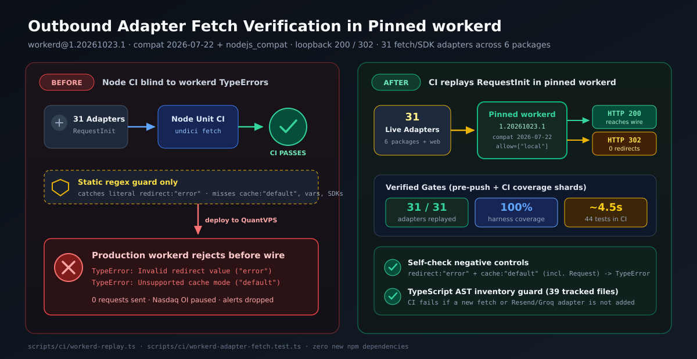

# Workerd outbound adapter RequestInit runtime test

## Goal

Run every workerd-reachable fetch-based and fetch-SDK outbound HTTP adapter's actual `RequestInit` inside the repository's pinned `workerd` runtime (configured with `compatibility_date` and `compatibility_flags` from `apps/web/wrangler.jsonc`) against a loopback `200`/`302` HTTP server during CI (`verify:prepush` and `verify:coverage`), and fail if a new tracked outbound fetch/SDK file is added without coverage.

## Background

Card `vertex-workerd-adapter-runtime-test` is the follow-up gap from `docs/vertex-rebuild/designs/workerd-fetch-redirect/plan.md`. Unit tests run under Node, which accepts `RequestInit` values that Cloudflare `workerd` rejects with a `TypeError` before sending any request:

- `redirect: "error"` -> `TypeError: Invalid redirect value, must be one of "follow" or "manual"`
- `cache: "default"`, `"force-cache"`, `"only-if-cached"`, `"reload"` -> `TypeError: Unsupported cache mode`

`scripts/ci/fetch-redirect.test.ts` blocks single-line literal `redirect: "error"` statically, but cannot catch variable/multi-line redirect modes, SDK-built `RequestInit` objects, or non-redirect options such as `cache` modes.

## Design

1. **`scripts/ci/workerd-replay.ts` (100% covered helper):**
   - Reads `compatibility_date` (`2026-07-22`) and `compatibility_flags` (`["nodejs_compat"]`) from `apps/web/wrangler.jsonc` using `jsonc-parser` and Zod.
   - Resolves the pinned `workerd` binary (`workerd@1.20261023.1`) from `apps/web/package.json` through `wrangler` -> `miniflare` -> `workerd` (zero new npm dependencies, zero lockfile changes).
   - Starts a loopback-only `workerd` worker (`globalOutbound = "loopback"` with `network = (allow = ["local"])`) and a Node loopback HTTP server supporting `200` and `302` (`Location: /__workerd-redirect-target?rid=<id>`) responses with per-request hit/redirect isolation.
   - Tracks explicit `cache` options on `new Request(input, init)` (including across `clone()` and `new Request(req)`) via `withCapturedRequestCache`, serializes `RequestInit` fields (method, headers with Fetch-spec replacement, body, redirect, credentials, cache, referrer, referrerPolicy, mode, integrity, keepalive, AbortSignal presence/abort state, and any additional own properties), replays the call inside `workerd`, and returns the real `Response` or rethrows `workerd`'s `TypeError`/`Error`.
   - Uses a TypeScript AST scanner (`typescript-api`) to find tracked non-test source files under `packages/` and `apps/` with runtime `fetch`/`fetcher`/`fetchImpl`/`fetchRequest` calls, global `fetch` references, or `new Resend(...)`/`new Groq(...)` SDK constructors.
2. **`scripts/ci/workerd-adapter-fetch.test.ts` (Vitest `operations` project):**
   - Self-checks that the running `workerd` rejects `redirect: "error"` and `cache: "default"` before touching loopback (`serverHits === 0`).
   - Replays all 31 workerd-reachable fetch-based and fetch-SDK outbound adapters across 6 packages (`packages/analytics`, `packages/email`, `packages/notifications`, `packages/ai`, `packages/api`, and `apps/web`) against both `200` and `302` loopback responses, including GET and POST paths on multi-method adapters (`ibkr-recovery.ts`, `nautilus-arm.ts`, `vertex-orders-gateway.ts`, `server-theme-api.ts`).
   - Verifies zero `workerd` errors on all 31 adapters, and verifies that all 28 first-party manual-redirect adapters send `redirect: "manual"`, receive `302`, and never hit `/__workerd-redirect-target`.
   - Enforces the AST inventory invariant against `discoverOutboundFetchFiles()` (39 tracked files: 31 replayed adapters + 8 documented non-workerd/browser files).
   - Scope note: `packages/observability/src/server/otel.ts` uses `@opentelemetry/exporter-*-otlp-http`, which selects Node's `node:http` transport under Node/Vitest rather than `fetch`, so it is outside this `fetch` replay harness.
3. **`scripts/ci/workerd-replay.test.ts` (Vitest `operations` project):**
   - Unit and runtime tests covering `workerd-replay.ts` at 100% lines, branches, functions, and statements, including `new Request(url, { cache: "default" })`, concurrent replay isolation, AST regression checks, and child-process/socket fault cleanup.

## Acceptance Check

1. `scripts/ci/workerd-replay.test.ts` and `scripts/ci/workerd-adapter-fetch.test.ts` pass in the `operations` project with 100% coverage on `scripts/ci/workerd-replay.ts`.
2. Negative mutation checks confirm that reintroducing `redirect: "error"` in `packages/api/src/server/options-chain-nasdaq.ts` or introducing `cache: "default"` in `packages/analytics/src/server/posthog.ts` or `new Request(..., { cache: "default" })` fails with `workerd`'s real `TypeError`.
3. `bun run verify:prepush` and hosted PR CI (`ci-gate`) pass cleanly.

## Rollback

Revert the PR commits. No database migrations, runtime code, or production deployments are affected.
