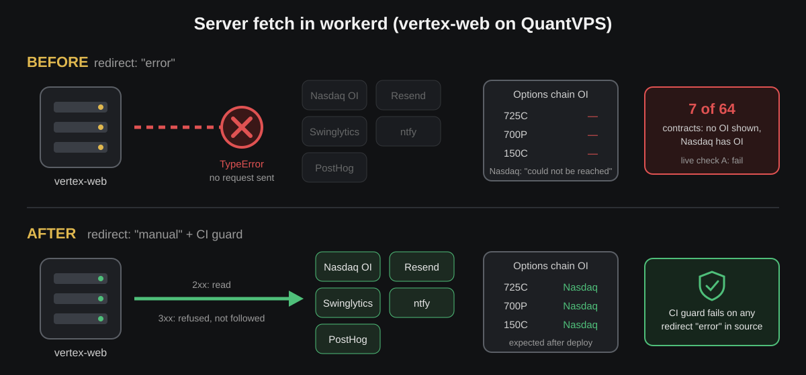

# Plan: server fetch calls use `redirect: "manual"` because workerd rejects `redirect: "error"`

- Card: `vertex-chain-oi-quantdata-zero-deploy`. That card deploys PR #461 and PR #491 (both from card `vertex-chain-oi-quantdata-zero` and its follow-up `vertex-chain-oi-yahoo-false-zero`) to QuantVPS and runs their live check.
- Found: during live check A of that card, 2026-11-28 01:26 UTC (2026-11-27 20:26 New York time).
- Fixed in the same job under the owner rule "fix on the spot" (rule dated 2026-11-15: a job that finds a bug it can fix safely inside its authorized scope fixes it in the same job, with its own commit and the same gates).
- Kind: bug fix in five outbound HTTP adapters, plus one CI guard test. No contract, schema, migration or UI change.
- Base branch: `vertex/rebuild-darkfactory-20260921` (`b101b659`).
- EGM plan review: `review/consolidated_review_report.md` and `review/goldfish_review_report.md`.

## Terms

- **QuantVPS host:** the server that runs `vertex-web.service`. The rig is the separate build machine that deploys to it.
- **workerd:** the Cloudflare Workers runtime. `vertex-web.service` runs the web app and its oRPC server code in workerd through `infra/quantvps/run-preview.mjs`, with compatibility date `2026-07-22` and flag `nodejs_compat` (`apps/web/wrangler.jsonc`).
- **Redirect mode:** the `redirect` field of the `fetch` options. `"follow"` follows a 3xx response, `"manual"` returns the 3xx response to the caller, `"error"` makes `fetch` fail on a 3xx response.
- **Adapter:** a module that calls one external HTTP service (for example Nasdaq, PostHog, Resend, ntfy).
- **Acceptance (email and ntfy):** the adapter result for one send. `accepted` means the provider confirmed the message; `rejected` means the provider refused it; `unknown` means the result is not known, and the message is never sent again.
- **Order-flow print:** one trade record from the Quant Data order-flow feed. Live check A looks only at contracts with at least one print in the last 24 hours.
- **False zero:** a contract shown with OI `0` while the provider's real OI is above 0.
- **Live check A:** `live-check.mjs` of card `vertex-chain-oi-quantdata-zero` (PR #461 acceptance check 5). For SPY and NVDA contracts with a print, it compares the open interest (OI) that `optionsChain.chain` shows with Yahoo Finance OI and Nasdaq OI. It passes (exit 0) only when no OI from Quant Data prints is shown while Yahoo has one, no OI from Quant Data prints is `0`, the shown OI equals Yahoo OI where Yahoo has one, and the shown OI equals Nasdaq OI where Nasdaq has one. Its script and output stay on the rig.
- **Off-hours deploy:** a deploy outside US market hours, as the market hours guard in `infra/quantvps/README.md` defines.

## Goals and non-goals

Goal: every non-test `.ts` or `.tsx` file under `packages/` and `apps/` that passed `redirect: "error"` to `fetch` sends `redirect: "manual"` instead, so the call works in workerd, and the adapter still refuses a 3xx response without following it. A CI test stops a new single-line literal `redirect: "error"` in those files.

Non-goals (each is a known gap, not fixed here):

- Server fetches that set no `redirect` field and so use the default `"follow"`. Two of them send the `x-vertex-bridge-token` header: `packages/api/src/server/golive-live-quotes.ts` and `packages/api/src/server/vertex-orders-gateway.ts`. They are on order and go-live paths, which need their own PR and full review, so they get the follow-up card `vertex-bridge-token-fetch-follows-redirect`.
- Running adapter unit tests in workerd. The guard covers only the redirect mode; other `fetch` options that Node accepts and workerd rejects are not checked in CI. Follow-up card: `vertex-workerd-adapter-runtime-test`.
- A new error code that keeps a programming error thrown by `fetch` apart from a network error. Dropped, no separate card: in workerd both are a `TypeError`, so only the message text tells them apart, which is fragile; the workerd test of card `vertex-workerd-adapter-runtime-test` finds this kind of fault before deploy instead.
- Browser code and Bun scripts (see "Affected adapters").

## Problem and evidence

1. Build `8909e65c3e60717edbd3872f1f383cc359c19275` (PR #491, which drops Yahoo OI `0` and adds the Nasdaq OI fallback) was deployed to `vertex-web` at 2026-11-28 01:17:38 UTC. Live check A at 01:26 UTC returned `fail`. It found 0 false zeros, so the Yahoo part of PR #491 behaved as intended in this run. But 7 of 64 compared contracts showed no OI while Nasdaq had an OI, so the Nasdaq part did not work. Evidence on the rig: `~/Documents/reports/web/vertex-chain-oi-quantdata-zero/live-after-fix/live-check.json`.
2. In all 21 chain responses of that run, the `nasdaq` source status is `failed` ("Nasdaq options could not be reached", 3 chains) or `off` ("Nasdaq temporarily paused after repeated upstream failures", 18 chains).
3. From the QuantVPS host, `curl` with the adapter's user-agent fetched the same Nasdaq URL with HTTP 200 in 1.9 s (2026-11-28 about 01:30 UTC). Nasdaq did not block that request.
4. A test worker in the workerd binary of the repository (`workerd@1.20261023.1`, compatibility date `2026-07-22`, `nodejs_compat`) shows the cause: `fetch(url, { redirect: "error" })` throws `TypeError: Invalid redirect value, must be one of "follow" or "manual" ("error" won't be implemented since it does not make sense at the edge; use "manual" and check the response status code).` before it sends a request. The same Nasdaq request with `redirect: "manual"` returns HTTP 200. A POST with `credentials: "omit"`, `cache: "no-store"`, `referrerPolicy: "no-referrer"` and `redirect: "manual"`, the other options the five adapters send, reached the server. So only `redirect` must change.
5. The Nasdaq adapter catches every `fetch` exception as `UNAVAILABLE` ("could not be reached"). After 3 consecutive `UNAVAILABLE` results it pauses for 5 minutes. So from the deploy to the live check the Nasdaq fallback did not send one request.
6. Unit tests run under Node, which accepts `redirect: "error"`, so CI did not see the fault. `packages/api/src/server/arxiv.ts` and `packages/api/src/server/deploy-status.ts` already send `"manual"`, with comments that name this workerd limit.

### Affected adapters

At `b101b659` these are the only non-test files under `packages/` and `apps/` that pass `redirect: "error"`:

| File | Service | Result in workerd before the fix |
| --- | --- | --- |
| `packages/api/src/server/options-chain-nasdaq.ts` | Nasdaq option-chain OI | Every read `UNAVAILABLE`, then paused; OI fallback never used |
| `packages/api/src/server/research-screen-evidence.ts` | Swinglytics start page | Every read `provider-timeout` "request failed" |
| `packages/analytics/src/server/posthog.ts` | PostHog capture | Every capture `failed`, category `network` |
| `packages/email/src/server/notification.ts` | Resend notification email | Every send `acceptance: "unknown"` |
| `packages/notifications/src/server/ntfy.ts` | ntfy push (price, connectivity and OpenBB-overdue alerts through `price-alerts-ntfy.ts`) | Every send `acceptance: "unknown"` |

The Yahoo chart read in `research-screen-evidence.ts` (`readChart`) already sent `"manual"`; its behavior does not change. `apps/web/src/features/experience/browser-provider.test.tsx` and `scripts/golive/collect.ts` also contain `redirect: "error"`. The first is a test input for browser code, and the second runs under Bun. Browsers and Bun accept `"error"`, so both stay unchanged.

## Design

- Each affected adapter sends `redirect: "manual"`. workerd, Node and Bun then return a 3xx response to the adapter without following it. No adapter reads the `Location` header, so no credential reaches a second host.
- 3xx result per adapter:
  - Nasdaq: a new condition maps a 3xx to `UNAVAILABLE` "Nasdaq options returned HTTP 3xx", like 403, 429 and 5xx, because a redirect is often a bot wall. It counts toward the 5-minute pause.
  - Swinglytics: the existing non-2xx check gives `provider-http` "returned HTTP 3xx".
  - PostHog: the existing non-2xx check gives category `provider-rejected`, `retryable: false`.
  - Resend email and ntfy: a 3xx is not in the reject list (400, 401, 403, 404, 413, 422, 429), so it gives `acceptance: "unknown"`, with no retry.
- The internal request type of the research-screen reader no longer lets a caller choose the redirect mode; the shared reader always sends `"manual"`.
- CI guard `scripts/ci/fetch-redirect.test.ts`: it lists tracked `.ts` and `.tsx` files under `packages/` and `apps/` with `git ls-files`, skips test files, and fails with `file:line` for every line that matches the pattern. Browser source under `apps/` is included on purpose: `"manual"` works there too, and one rule for all files is simpler than a split between server and browser files. Comment lines are matched too, so comments must not write the forbidden form with a colon. The guard runs in the Vitest project `operations`, which runs in `verify:prepush` and in the CI coverage shards (`verify:coverage`); docs-only light-lane PRs skip it.

## Alternatives considered

| Alternative | Decision and reason |
| --- | --- |
| Remove the `redirect` field (default `"follow"`) | Rejected. Resend, ntfy and PostHog send keys or tokens; a followed 3xx could send them to another host. |
| `"follow"` and then check `response.redirected` | Rejected. The request with its credentials has already reached the redirect target. |
| Pick the mode by runtime (`"error"` in Node, `"manual"` in workerd) | Rejected. It adds a branch with no benefit; `"manual"` works in workerd, Node, Bun and browsers. |
| One shared server fetch helper that always sends `"manual"` | Deferred. It adds a dependency from `analytics` and `email` to a shared package (`notifications` already uses `@darkfactory/shared`) and touches about 20 more adapters that already send `"manual"`. The guard gives the same protection for the literal form now. |
| Run adapter tests in workerd (Workers Vitest pool or a workerd smoke test) | Deferred to a follow-up card. It closes the Node and workerd gap for every `fetch` option, but the repository has no workerd test setup today, and it needs the platform workerd binary in CI. |
| A Biome lint rule | Rejected for now. Biome has no built-in rule for this; a GritQL plugin is new tooling for one pattern. A Vitest invariant test follows the existing `scripts/ci/*.test.ts` convention. |

## Risks and mitigations

| Risk | Effect | Mitigation |
| --- | --- | --- |
| A provider answers with a 3xx | The failure category can change: PostHog `network` (retryable) becomes `provider-rejected` (not retryable); email and ntfy stay `unknown` | No redirect is followed. Tests cover a 3xx for Nasdaq, Swinglytics, PostHog, email and ntfy. |
| Email and ntfy sends that failed in workerd now arrive | The owner can get notification emails (Resend is enabled on QuantVPS: `EMAIL_PROVIDER=resend`) and ntfy alerts that did not arrive before | This is the intended behavior. Enable flags, recipients and dispatch rules are unchanged. `unknown` results are never retried, so no backlog is flushed. The job receipt tells the owner. |
| The Nasdaq adapter sends requests where it sent none before | More requests to Nasdaq | It runs only when Yahoo lacks a positive OI for a contract of the shown expiry. After 3 consecutive `UNAVAILABLE` answers (network error, 3xx, 403, 429, 5xx) it pauses for 5 minutes. |
| The guard misses a form | A new fault can pass CI | The pattern matches single-line literal forms in tracked non-test `.ts`/`.tsx` files under `packages/` and `apps/`. It misses a value on the next line, a value in a variable, and `.mjs`, `.js`, `scripts/` and `infra/` files. Live check A checks Nasdaq end to end; the other four adapters rely on unit tests and on evidence item 4. |

## Acceptance check

1. `scripts/ci/fetch-redirect.test.ts` passes on the branch and fails with the file and line when one `redirect: "error"` line is put back in an affected adapter.
2. The unit tests of the five adapters pass, including a 3xx case for Nasdaq, Swinglytics, PostHog, Resend email and ntfy, a test that three Nasdaq 3xx answers start the pause, and assertions that the requests use `redirect: "manual"`.
3. Full CI dispatched on the exact merge commit SHA passes all four verification checks: core, coverage, integration and browser (`browser_tests=on`).
4. After an off-hours deploy of the merge commit to `vertex-web` and at least 6 minutes of wait (the wait of the original check; the restart already clears the in-memory Quant Data chain cache and the Nasdaq pause, so the wait is a safety margin), `bun ~/Documents/reports/web/vertex-chain-oi-quantdata-zero/live-check.mjs ~/Documents/reports/web/vertex-chain-oi-quantdata-zero/live-after-fix2` exits 0, and no chain response has the `nasdaq` source status `failed` with "Nasdaq options could not be reached" or `off` with "Nasdaq temporarily paused after repeated upstream failures". An `off` status whose message starts with "Not asked:" is normal (Yahoo had a positive OI for every contract). If one chain fails with a network error, rerun the check once before calling it a fail.

## Implementation Plan

Each changed `redirect` line gets a comment that names the workerd limit. No file outside this list changes.

Phase A: adapters and their tests (checkpoint: the focused Vitest run passes).

1. Modify `packages/api/src/server/options-chain-nasdaq.ts`: in `readDocument`, change `redirect: "error"` to `redirect: "manual"`, and add `(response.status >= 300 && response.status < 400)` to the `UNAVAILABLE` condition before the `!response.ok` check.
2. Modify `packages/api/src/options-chain-nasdaq.test.ts`: in "normalizes symbols, falls back from stocks to etf…", assert that both requests (stocks, then the etf fallback) use `redirect: "manual"`; in the case list of "rejects bad inputs, maps HTTP and parse errors safely…", add `Response.redirect("https://example.test/", 302)` with expected code `UNAVAILABLE`; add the test "pauses after repeated 3xx answers, like other UNAVAILABLE answers" (3 × 302 gives 3 × `UNAVAILABLE`, then `OptionsChainSourceOff`, with 3 fetch calls).
3. Modify `packages/api/src/server/research-screen-evidence.ts`: remove `redirect` from `BoundedRequest` and from the `readChart` and `readSwinglytics` request objects; `boundedRead` sends `redirect: "manual"`.
4. Modify `packages/api/src/server/research-screen-evidence.test.ts`: expect `redirect: "manual"` in the Swinglytics request; add `302` to the `refuses HTTP %i` cases (Yahoo chart uses the same `boundedRead`).
5. Modify `packages/analytics/src/server/posthog.ts`: send `redirect: "manual"`. Modify `packages/analytics/src/server/posthog.test.ts`: expect it in "maps one allowlisted capture…" and in "fails closed instead of forwarding a redirect response" (which keeps `provider-rejected` for 307).
6. Modify `packages/email/src/server/notification.ts`: send `redirect: "manual"`. Modify `packages/email/src/server/notification.test.ts`: expect it, and in "reports rejected versus unknown…" add a 302 case that expects `acceptance: "unknown"` (fetch call count 5).
7. Modify `packages/notifications/src/server/ntfy.ts`: send `redirect: "manual"`. Modify `packages/notifications/src/server/ntfy.test.ts` and `packages/notifications/src/server/dispatch/dispatch.test.ts`: expect it; the existing 302 case in `ntfy.test.ts` keeps `acceptance: "unknown"`.

Phase B: guard (checkpoint: positive and negative run).

1. Create `scripts/ci/fetch-redirect.test.ts`:
   - File list: `git ls-files -z -- packages/*.ts packages/*.tsx apps/*.ts apps/*.tsx`, minus files that match `/(^|\/)(test|tests|__tests__)\/|\.(test|spec)\.tsx?$/u`; assert more than 100 files.
   - Pattern: `/\bredirect\s*[:=]\s*["'`]error["'`]/u`, per line; expected hit list `[]`.
   - Pattern test: the lines `redirect: "error",`, `redirect: 'error',`, `` init.redirect = `error`; ``, `redirect: "manual",`, `redirect: "follow",`, `const mode = "error";` give the line numbers `[1, 2, 3]`.

Phase C: docs (checkpoint: `bun run docs:check`).

1. Modify `docs/vertex-rebuild/designs/research-screen/design.md`: in the Swinglytics request line, change `redirect: "error"` to `redirect: "manual"` and state that workerd rejects `"error"` and that a 3xx is refused as `provider-http`.
2. Modify `docs/vertex-rebuild/designs/vertex-chain-oi-yahoo-false-zero/plan.md`: in the Nasdaq error matrix, map HTTP 3xx to `UNAVAILABLE` and add a "Superseded" note that points to this plan.
3. Create `docs/vertex-rebuild/designs/workerd-fetch-redirect/plan.md`, `before-after.svg`, `before-after.png` and the `review/` reports.

Phase D: verification, PR and deploy.

 1. Run:
    - `pnpm exec vitest run --config vitest.config.ts scripts/ci/fetch-redirect.test.ts packages/api/src/options-chain-nasdaq.test.ts packages/api/src/server/research-screen-evidence.test.ts packages/analytics/src/server/posthog.test.ts packages/email/src/server/notification.test.ts packages/notifications/src/server/ntfy.test.ts packages/notifications/src/server/dispatch/dispatch.test.ts`
    - Negative guard check: put `redirect: "error"` back in `options-chain-nasdaq.ts`, run the guard test alone, confirm that it fails and names `packages/api/src/server/options-chain-nasdaq.ts:<line>`, then restore the file.
    - `biome lint` and `biome format` (check only) on the changed files.
    - `bunx --no-install turbo run typecheck --filter=@darkfactory/api --filter=@darkfactory/analytics --filter=@darkfactory/email --filter=@darkfactory/notifications` and `tsc --noEmit -p scripts/tsconfig.json`.
    - `bun run verify:prepush` (runs on `git push`), PR CI, and then acceptance check 3 on the merge commit.
 2. Card `vertex-chain-oi-quantdata-zero-deploy` deploys the merge commit outside US market hours with the steps of "Deploy a new web build" in `infra/quantvps/README.md` (`stage-build.sh`, `stage-runtime.sh`, `restart-when-idle.sh --deploy <sha>`), then runs acceptance check 4.

## Rollback

Prefer a fix forward. A rollback brings the fault back: the Nasdaq OI fallback, Swinglytics, PostHog, Resend notification email and ntfy fail in workerd again. If only unexpected email or ntfy traffic is the problem, turn off that sender's enable setting instead.

To roll back: revert the merge commit through a PR, run full CI on the revert commit, and deploy it off-hours with `stage-build.sh`, `stage-runtime.sh` and `restart-when-idle.sh --deploy <revert-sha>`. Do not redeploy the old SHA directly: the version guard refuses an older build (exit 9) unless `--allow-older "<reason>"` is given. The change has no schema, migration or stored-data effect. Emails, ntfy alerts and PostHog events sent while the change was live stay sent.
