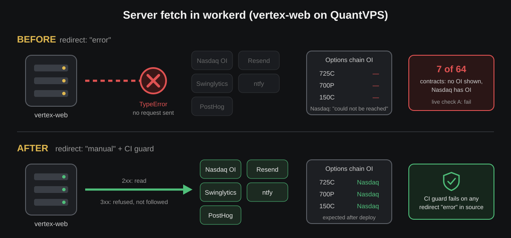

# Consolidated EGM review: `workerd-fetch-redirect/plan.md`

Mode: "Consolidated report with all review rubrics" (standing owner choice). Stages 5, 6, 7 and 9 ran in parallel on the first draft; the plan was revised; Stage 8 ran on the revised plan. Resolution: auto accept (standing owner rule). Details per finding: `goldfish_review_report.md`.

## Stage reports

| Stage | Reviewers | Report | Raw findings |
| --- | --- | --- | ---: |
| 5 Initial zoom out | egm-zoom-out, egm-inventive-catalyst | `zoom_out_report.md` | 17 |
| 6 Comprehension | egm-comprehension | `comprehension_report.md` | 11 |
| 7 Critic | egm-design, egm-structural, egm-style | `critic_report.md` | 34 |
| 8 Intermediate zoom out | egm-zoom-out | `intermediate_zoom_out_report.md` | 5 |
| 9 Implementation readiness | egm-implementation-readiness, egm-codebase-details, egm-style | `implementation_readiness_report.md` | 29 |

## Action items by priority

### 🔴 Blocker (all resolved)

1. Nasdaq 3xx gave `UPSTREAM_ERROR` and skipped the 5-minute pause. Resolved in code: 3xx maps to `UNAVAILABLE`; new test.
2. Goal claimed every `fetch` works and refuses 3xx. Resolved: Goal narrowed; Non-goals list with follow-up cards.
3. No alternatives section. Resolved: six alternatives with decisions.
4. Steps 1-2 did not match the code. Resolved: steps rewritten; sibling plan corrected.

### 🟡 Major (all resolved)

1. Guard lane, scope and limits not stated. Resolved in Design, step 8 and Risks.
2. Node vs workerd root cause left open. Deferred with card `vertex-workerd-adapter-runtime-test`.
3. Bridge-token fetches follow redirects. Deferred with card `vertex-bridge-token-fetch-follows-redirect` (order and go-live paths need their own PR).
4. Email and ntfy start to send. Risks row names Resend on QuantVPS and the ntfy alert callers; receipt tells the owner.
5. Acceptance check 4 gaps (`off` pause, "Not asked:" status, network blip). Resolved.
6. Rollback not executable. Resolved: revert-commit deploy steps, version guard, fix-forward preference.
7. Verification commands and negative guard run missing. Resolved in step 12.

### 🟢 Nit (resolved or recorded)

 1. Dates, terms, host names, wording, headings, image, paths, phases. Resolved.
 2. Shared fetch helper (contested: deferred), `MISCONFIGURED` error code (contested: dropped with reason), logging the `Location` origin (declined), quoting rig-only evidence (declined).

## Traceability

| Action item | Raw findings |
| --- | --- |
| 1 | IC-4, CF F3, SF F3, DF F3, ST S7, CD F1 |
| 2 | CF F1, ZO-2, IC-7, SF F2, DF F2, ST S1, CD F3 |
| 3 | SF F1, DF F1 |
| 4 | CD F2, IR F7, ZO-4 |
| 5 | CF F9, ZO-7, IC-8, SF F5, DF F7, ST S6, ST S8, IR F2, CD F4, CD F9 |
| 6 | ZO-1, IC-1, DF F4, N2 |
| 7 | SF F2, DF F2, CD F3, N2 |
| 8 | CF F4, DF F6, ST S9, CD F7 |
| 9 | CF F8, DF F5, N1, N5 |
| 10 | CF F11, ZO-3, IC-9, IS S1, IS S2, IR F1, CD F5, DF F10 |
| 11 | IS S3, IS S4, IR F3, IR F4, CD F8 |
| 12 | CF F2, CF F5-F7, CF F10, ZO-6, ZO-8, SF F4, SF F7-F9, DF F8, DF F9, ST S2-S5, ST S10-S14, IR F5, IR F6, IR F8, CD F6, CD F10, IS S5-S11, N3, N4 |
| 13 | IC-2, IC-3, ZO-5, IC-6, IC-5, SF F10 |
