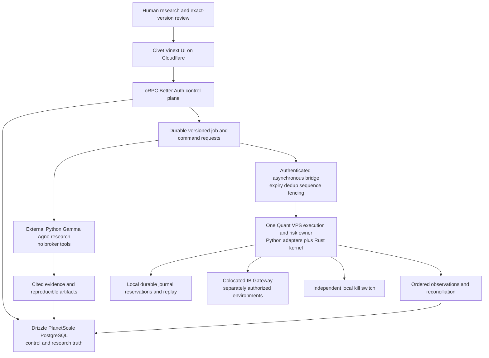
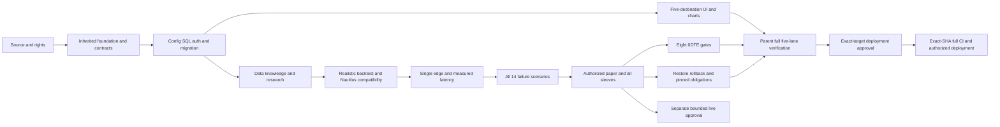

# Vertex Research — complete rebuild implementation plan

**Decision date:** 2026-09-21. **Status:** implementation plan, not platform readiness. Every domain/runtime gate is pending unless a later exact-revision receipt explicitly supersedes this document. No scope is relabeled “MVP.”

**Destination:** `/home/jeffscottward/Github/trading/vertex-research-platform` on `vertex/rebuild-darkfactory-20260921`, based on DarkFactory `c7f3c36f69fff40444a556ef2b478328744f55ea`. Original repositories, worktrees, deployments, private journals and research collections remain untouched.

## Read this set, not the old stack recommendation

| Artifact | Purpose |
| --- | --- |
| [deliverables.json](deliverables.json) / [schema](deliverables.schema.json) | Exhaustive source-item, user-request and builder-handoff acceptance ledger; owner, source pointer/hash, target, gate, state and empty receipt for each row |
| [migration-matrix.json](migration-matrix.json) | All 13 application rows and 15 trading roots, assets, license boundaries and latest 0DTE evidence |
| [provenance-baseline.json](provenance-baseline.json) | Exact foundation SHA; hashed original report inputs and latest 43-file 0DTE supplement; source versus runtime caveats |
| [verification-dag.json](verification-dag.json) | Parent-owned dependency DAG; all 14 failure scenarios, eight 0DTE gates and six vendor acceptance gates |
| [architecture-decisions.md](architecture-decisions.md) | Hard-to-reverse decisions, trade-offs, domain vocabulary and explicit historical overrides |
| [risks.json](risks.json) | Concrete open risks, owners, mitigation, gate, rerun trigger and stop condition |

Ledger `sourceValue` is preserved evidence, **not current authority**. In particular, historical Next.js, TypeScript-worker, optional-slice and deferred-feature language cannot override the current full request. Source `implemented` means code was found, not that the destination has an implementation, tests, rights, a deployment or permission to trade. `implementationEvidence` and acceptance receipts intentionally remain null. Logical target paths are planned ownership boundaries, not a claim every directory already exists.

The full original `builder-handoff.md` was read, including every WP0–WP8 target, acceptance, regression, rollback, deferred item and optional research-worker slice. Every nonempty obligation is represented with its original line range in the ledger. The original report and user brain dump remain at `../vertex-research/plans/platform-consolidation-2026-09-11/`; only sanitized requirements, provenance and plan metadata belong here, never raw account/corpus/worksheet data.

## Current decisions and actual evidence

- **Use the current DarkFactory stack:** Civet, Vite/Vinext, official `@vinext/cloudflare`, oRPC, Better Auth, Drizzle and PostgreSQL. The current user instruction replaces the old real-Next.js/TypeScript compatibility spike. Preserve inherited contract/test-first, modular, security, CI, coverage, generated-artifact and Graphify rules.
- **Superseded 2026-11-03 (ADR-V02 amendment): Gamma Forge code is native Vertex code, not an outside source.** Original text: **Gamma Forge is authoritative for trading-domain source**, not its frontend, old AI-era navigation, terminal SQLite ledger or legacy BFF. Retain source modules and selectively incorporate characterized improvements from the other applications. Do not merge application shells or install several competing writers.
- **Required native exceptions:** separately deployable Python Gamma/Agno domain/research/data and engine-adapter services, plus a Rust latency-sensitive kernel. Native local tests/packaging are included. Web/control code and public schema ownership remain Civet. Existing Go helpers are characterization/security references, not an additional authoring exception.
- **Cloudflare is the web/control plane; Quant VPS owns one execution/risk authority.** PlanetScale PostgreSQL is the control/research SQL target. No synchronous Cloudflare, model or PlanetScale dependency may enter the tick/callback loop.
- **Nautilus release lines are different:** `1.231.0` is the observed latest non-prerelease distribution, called Beta upstream; `2.0.0rc5` is the observed Rust/PyO3 prerelease. They have breaking APIs and event schemas. Evaluate rc5 in isolated research/paper with an explicit prerelease exception, not as silently stable production software.
- **TanStack Charts `0.18.0` is real and Alpha.** Exact-pin its release group behind a replaceable renderer. The user confirmed the intended Charan renderer is **KLineCharts `9.8.12`**. Characterize that actual source/API/license/runtime before deciding retention or substitution. Query/Table/Virtual and optional client DB do not dictate renderer or own SQL state. No speculative 3D.
- **Historical breakout worksheet:** preserve privately, **unconfirmed, with no quantities**. Do not copy its contents into Git, reports, fixtures, prompts, strategies or executable intents. Its existence does not authorize a trade or establish a strategy.
- **VPS trust blocker:** the user selected provider-console fingerprint verification. The fingerprint is pending; the rig and verified Mac default `known_hosts` lack this VPS entry. No trust-on-first-use, host-key bypass, inferred fingerprint or automated key acceptance. Trusted console fingerprint comparison precedes authorized SSH metadata checks; SSH connectivity still would not prove broker readiness.
- **No legal/status claim:** Vertex Research is software and a brand. Legal fund formation, regulated advice, custody, solicitation, entity/tax obligations and representations of returns are separate qualified-review work, not software deliverables or established facts.

## Target architecture

Research cannot turn its output into permission. Every trade proposal is a non-executable draft until an authenticated human reviews the exact version and the deterministic edge later admits bounded authority under current state. A successful research approval is not trading approval. Initial work stays read-only/research; even a paper connection requires its separately approved account/environment/scope.

### Ownership and public interfaces

| Owner | Target | Owns / forbidden |
| --- | --- | --- |
| Experience | `apps/web/src/features/{today,portfolio,strategies,research,agents,charts,connections}` | Five decision destinations, secondary settings/audit/data utilities, cited existing chat, review and freshness states; no broker SDK, secrets or direct DB |
| Contracts | `@darkfactory/api/vertex`, `@darkfactory/shared/vertex` | Named public runtime schemas/types and pure decimal/hash helpers; generated native interoperability, no deep imports |
| Control | `packages/api`, `packages/auth`, `packages/config` | oRPC auth/account/environment authorization, review versions, scoped settings, jobs/outbox and truthful capability states; no alternate REST/BFF |
| Database/artifacts | `packages/db`, `packages/storage` | Drizzle control/research migrations, source/claim/collection/run metadata and rights-scoped immutable object manifests; no raw ticks in generic JSON OLTP |
| Research/data | `services/research`, `services/market-data` | Python Gamma/Agno adapters, collection ingestion, provider evidence, deterministic strategies and realistic simulation; no broker credential or permission |
| Execution | `services/execution`, `services/execution-kernel` | Single fenced native owner, deterministic risk, durable cash/share reservations, local submission journal, receipts/replay/reconciliation and kill switch |
| Gateway | `services/gateway` | Identity/readiness observations and explicit-human recovery workflow; not autonomous login or trading rearm |
| Communications | `packages/notifications`, `packages/email` | Provider-neutral ntfy phone alerts and email; explicit enablement/recipient permission, dedup/cooldown/dry-run and safe failure |

The contract foundation names `DatasetManifest`, `ResearchEvidence`, `KnowledgeImport`, `StrategySpec`, `BacktestRun`, non-executable `TradeIntent`, `RiskDecision`, read-only `ExecutionReceipt`, `AgentRun`, `EventEnvelope`, module manifest/status, quote/candle/trade-flow/volume-profile, and broker-recovery status/request. Version `1.0.0` schema work is not an allocator, route, deployed service, 0DTE implementation or live permission. Recovery confirmation shape is not authentication proof; bind a fresh authenticated human challenge server-side. Preserve Gamma original digests separately from new canonical identity, including replay-manifest v2 provenance.

Every event must retain the report envelope fields: event/type/schema IDs, occurred/received times, correlation/causation, actor/module version, environment and payload. Add account/stream/sequence/owner-epoch binding where the concrete execution contract needs it. Preserve literal separate fields, decimal strings, UTC plus exchange-calendar identity, valid time intervals, order-price combinations and independent token/USD budgets. Native validators derive from the public schema, not handwritten lookalikes.

### The non-negotiable execution protocol

1. Control durably enqueues a versioned proposal/job and returns **queued**, not submitted. Include environment/account alias, actor, exact reviewed hash, policy version, expiry, idempotency identity and bounded permission; never send secret values or raw account identity into model context.
2. A single VPS owner holds a fenced epoch. It rejects stale/unknown portfolio readiness, wrong permissions, ambiguous instruments, invalid order-price/tick combinations, closed market, stale quote, exhausted cash/covered shares or mismatched policy/spec. An unready feed is **unknown**, never zero exposure.
3. Atomically persist the qualified submission key, payload hash, reservation, lifecycle transition and outbound submission record before broker send. A dedicated native I/O boundary acknowledges crash-safe admission; the synchronous tick/callback does not block on disk, cloud SQL, network control requests, LLMs or backtests.
4. Send from that one authority. Duplicate delivery returns prior state; changed payload under the same key rejects. Broker timeout/crash after possible acceptance produces **unknown**, retaining reservation and blocking resubmission until broker observations resolve it. No exactly-once network claim substitutes for this protocol.
5. Deduplicate executions; reconcile fills, remaining quantities, cancels, cash, positions, option assignment, exercise/settlement and corporate-action identity. Fill/cancel races are resolved from broker observations, not UI optimism. Research stop text is not confirmed protective orders.
6. On restart, verify checkpoint/journal integrity, replay ordered transitions, recover reservations, reconcile open orders/positions/cash/fills and fence the previous epoch before admitting new risk. A local model/UI/Cloudflare/PlanetScale outage cannot disable required reconciliation or already-authorized protection.
7. Asynchronously project execution facts to PlanetScale with stream sequence/high-water mark and source/as-of/received times. Cloud SQL is **not a second execution/cash authority**. Only the edge spends/releases execution reservations. Control changes to budgets are versioned expiring grants accepted/fenced by the edge; projections cannot allocate the same capital again.
8. Kill actions are distinct: pause-new-risk, cancel eligible orders, separately authorized liquidation. The durable local switch does not require UI/model/cloud availability. Reset requires explicit authority plus reconciliation; recovery/login never implies live rearm.

The local durable journal is a narrow measured latency/offline-safety exception to cloud PostgreSQL ownership, not permission for per-sleeve databases, Redis by default or the old Gamma SQLite command ledger. Its implementation, persistence guarantees, failure benchmark and complete restoration remain required work. Measure callback latency separately from asynchronous durable-admission and broker latency; set instrument/strategy-specific limits before promotion, not invented universal numbers.

## Complete product scope and feature ownership

| Scope / ledger IDs | Required result | Principal gates |
| --- | --- | --- |
| Decision UI, brand, chat — U07–U09/U20/U44 | Today inbox, unified reconciled portfolio, cited natural-language research and exact-version review; gray/gold/white source logo; source/as-of/stale/unknown states; no fake data, terminal clutter, voice or playback | G-ui, G-auth, G-storage |
| Wheel — U10 | Secured put → assignment/expiry → shares → covered call → call-away/expiry, explicit rolls; dividend/early-exercise/settlement and collateral/share obligations | G-sleeves, F07, F10 |
| Fundamental — U11 | Point-in-time dossier/valuation/thesis, allocation caps, revision/rebalance and exit rules | G-research, G-sleeves |
| Swing/momentum — U12 | Characterized Gamma features plus session/reel/optical improvements, completed-bar/regime logic, sizing, confirmed protection and exits | G-backtest, G-sleeves |
| Macro rotation — U13 | Measured release/vintage-aware series distinct from news, deterministic regime/weights/turnover/risk/rebalance | G-data, G-sleeves; exact source links blocked |
| Quant Lab / SSRN — U14/U27/U37 | Paper-to-hypothesis sandbox, immutable experiments, OOS/walk-forward/stress, realistic economics, forward-paper observations; no research notional in NAV | G-research, G-backtest, G-paper |
| Dedicated 0DTE — U15 | Separate approved strategy owner, all eight gates and intraday option evidence; no automatic funded sixth sleeve | Z01–Z08, G-zeroDte; live separate |
| Market/news/charting — U16–U19 | Provider-normalized quotes/chains/bars/news, actual orderflow and volume profiles, advanced renderer-independent financial views | G-data, G-charts |
| Gamma/Agno/agents — U03/U21 | Cited bounded research and typed output from source modules; budgets, retry/cancel, errors, trace/provenance, no execution authority | G-characterization, G-agent |
| All four attributed corpora — U22–U26 | DeltaTrend, Verrillo/Aleks, Crown and DefineYourRisk, collection generation isolation, source/segment/rights/quality and unavailable records | G-knowledge, G-rights |
| Providers/configuration — U28–U31 | QuantPad historical, QuantData live analytics, Financialdatasets, IBKR/data sources; names-only logical registry and least-privilege scoped references | G-config, G-data, V01–V06 |
| Gateway/recovery/watchers — U32/U33/U46 | Actual identity and readiness dimensions; console-verified host trust; explicit human IBKR recovery; no financial-page JEV upload | G-gateway |
| Notifications/email — U38 | ntfy-only phone, provider-neutral email/Resend, useful source cooldowns and delivery status, no silent fallback | G-notifications |
| Modularity — U35 | Manifest compatibility → fixture replay → shadow → drain → pin open obligations → atomic activation → rollback | G-contracts, F14, G-rollback |
| Safety, legal, deployment, preservation — U36/U39–U43/U45 | All failures; Fincept no-copy; software/legal boundary; explicit deployment/live/retirement approvals; private unconfirmed worksheet without quantities | F01–F14, G-fincept-rights, G-legal, G-deploy |

The ledger additionally enumerates **every** report application capability, integration, unique asset, duplication item, risk, vendor comparison, architecture field group, promotion rule and handoff obligation—not just this table. Absent/scaffold features need implementation; they are not reasons to remove requested scope. Non-requested duplicate shells, extra personas, Composer execution, speculative infrastructure/3D and unsafe writers are explicit non-adoptions, not forgotten migration work.

## Migration decision matrix: all 13 application rows

| Application row | Keep / adapt | Replace, quarantine or block |
| --- | --- | --- |
| Gamma Forge | Canonical Python options/evidence kernel, SourceRef/hash, provider ABCs, features/setup/selector/committee, replay provenance, readiness leaf logic and bounded fan-out semantics | No frontend/legacy BFF/SQLite authority; replace send-before-record, nonunique submission key, zero-on-unready and model external-order tools. Empty AMT/flow/volatility/allocator files remain absent capabilities |
| Vertex Quant | Characterized opening-range/reel-session research, signal/parser lineage, contract/calendar identity and protection design | No old shell, extra executor or implied profitable strategy; v1/native compatibility review |
| Vertex Quant trail worktree | Unique Decimal/draft/approval/lifecycle, queue/repository/reservations, TRAIL/protected-buy/recovery and kill-switch security delta | Not another product/authority; compare base delta and existing deployment before any cutover; Go helper source not blanket language exception |
| Existing Vertex Research | Accepted dossier/publication generations, review priorities, payoff primitives, actual portfolio provenance and durable uncertainty | Rebuild Civet experience/control; no old BFF/global KB replacement; keep private order journals/source history |
| ibkr-vertex-ai-fund | Correct identity: Client Portal Docker operations utility, optional gateway/readiness reference | Not a fund engine or proof of actual deployed Gateway; Client Portal HTTP distinct from TWS socket API |
| AI Hedge Fund | Useful numeric/event-study/filing/provider modules, typed advisory artifacts, Crown provenance | No flow-editor shell or model portfolio/risk/execution authority; third-party data/media rights separate |
| TradingAgents | Optional bounded analyst/debate adapter, publication-aware data and report provenance | Deduplicate Gamma-vendored lineage; narrative risk judge is not deterministic risk; no archive discard |
| Optical Photonics | Advisory swing analysis dataclass, report/cadence output parity | Not options/0DTE engine; scheduler retirement only after output/history/deployment parity |
| Charan Discord | Accepted parser/rule/source-event lifecycle; **KLineCharts 9.8.12** finance-renderer candidate | UTC date → exchange-calendar/stale-alert checks; unsized draft never executes; no Discord-to-order bypass |
| Roth Bot | Characterized payoff/Greeks/spreads and research strategy primitives | No competing Convex ledger; Composer execution quarantined; zero-DTE one-day fallback rejected; compliance claims require review |
| Trade Calculator | Earnings timing, Yang–Zhang/IV-RV/term-structure and spread research | Duplicate formulas reconciled; `close_position` stub and legacy simulations not validated execution foundation |
| ASTS Stock Watcher | Pure entry heuristic, session/snapshot validation, persistent cooldown/dry-run | Replace iMessage transport with permissioned ntfy; no phone send now |
| Full Port | Request-bound provider evidence, callback/permission/entitlement identity, protected-quantity and offline-safe invariants | Fold selective improvements into one owner, not another UI/service/executor; source rights remain scoped |

The **15 roots** are those 12 application-root names plus the separate trail root, with Roth contained under `AI-Cornell-bots`, plus `youtube-knowledge-bases` and residual `worktrees`: exactly `ibkr-vertex-ai-fund`, `charan-discord-bot`, `AI-Cornell-bots`, `vertex-research`, `vertex-quant-trail-capability`, `trade-calculator`, `optical-photonics-reports`, `asts-stock-watcher`, `ai-hedge-fund`, `youtube-knowledge-bases`, `TradingAgents`, `worktrees`, `vertex-quant`, `gamma-forge`, `full-port`. Containers and knowledge collections are not extra production applications. Base/trail share history and research; source-delta obligations are real. Preserve residual worktrees until separately authorized retirement.

**External inputs:** DarkFactory is the engineering baseline. Fincept is a capability checklist only: conflicting root restrictions and newer commercial-license withdrawal make source **no-copy pending exact-revision clearance**. An HTTP/process boundary is not automatic copyleft clearance. Preserve applicable MIT/Apache/IBAPI and all component notices; unspecified first-party rights are not silently approved. Canonical DeltaTrend outside the trading root is a collection, not a sixteenth application. DefineYourRisk location/identity remains a blocker.

## Knowledge, papers and realistic research

### Attributed collection migration

Before adding any collection, replace the old global-KB deletion path with transactional `KnowledgeImport` generations. Stage membership and citations, verify all counts/rights/locators, then atomically activate only that collection. Failed imports activate nothing; rollback reactivates the previous collection generation. Hash dedup may reuse content bytes but must preserve every source identity/mapping.

- **Crown:** report evidence records 1,700 videos/reels, 1,663 completed ASR mappings, 1,602 unique trimmed bodies and 61 additional mappings; retain 29 transcript failures and eight download failures plus separately dated reel extensions. These are audited historical counts, not a fresh acquisition claim.
- **DeltaTrend:** 98 uploads, 96 English-auto transcripts, two unavailable-caption records. Tool mentions are not product specifications or author identity proof.
- **Verrillo/Aleks:** 494 videos, 477 transcripts, 17 unavailable; duplicate library location is not independent corroboration. Synthesized 0DTE summaries are not raw transcripts, precise strategy rules or market data.
- **DefineYourRisk:** required, but canonical source identity, location, completeness and rights are unresolved. Do not invent a dataset or relabel another persona.
- Keep Crown, DeltaTrend, remembered Matt Fong and publicly identified QuantPad author Thomas Skinner separate absent primary provenance. Exclude Coach Jon Barbera/noninvestment and personal collections from default trading retrieval.

`ResearchEvidence` carries collection/snapshot/source identity, URL, page/timestamp/segment locator, publication/capture dates, hash, method/ASR quality, limitations, acceptance and rights policy. Raw transcripts, summaries and embeddings are different artifacts. Rights/retention apply to derived copies and backups too. Documents/news/model output are untrusted content, never instructions or approval. Retrieval returns bounded citations; ingestion has no broker/secret-enumeration privilege.

### SSRN → deterministic spec → empirical evaluation

Capture lawful paper URL/DOI/title/authors/version/publication/capture/claim locators and retained-copy hash; use metadata-only when full-text rights are absent. Separate claimed result from interpretation. Extract exact universe, entry/exit/rebalance/timing, exclusions and assumptions; mark gaps and failed replication.

Before seeing holdout results, preregister benchmark, train/test and rolling walk-forward windows, model-selection/multiple-testing policy, costs, spread/impact/slippage, latency/queue assumptions, turnover, liquidity, drawdown/exposure constraints, sensitivity and rejection criteria. Freeze provider/entitlement, point-in-time vintage/as-of, symbol/contract identities, calendar, survivorship, adjustments, code digest, engine/dependency versions and seed. Revised fundamentals/macro data cannot appear before release; incomplete bars cannot become completed signals.

Use a no-broker/no-secret sandbox with approved dependencies and CPU/memory/time/network budgets. A clean independent worker must reproduce the artifact. Preserve rejected/inconclusive runs and deviations from paper claims. Gamma supplied-outcome replay, daily-equity simulations, expiry payoff plots and empty Nautilus fills are **not** realistic execution economics.

Model executable bid/ask, fees, spread, slippage/impact, latency, queue/partial/multi-leg fills, borrow/margin, dividends, corporate actions and option exercise/assignment/settlement where relevant. Forward-paper records preserve actual data/quote source and times, strategy/policy/engine version, intent/decision/receipt identities, observed costs, fill/protection/reconciliation outcomes and incidents. Set sample/time/regime criteria before the observation period. Paper success is neither proof of profit nor permission for live use.

First paper strategy is selected only after lawful fixture/readiness evidence; a simple fully specified equity candidate may precede incomplete wheel/options work. This sequences risk, **not total scope**: all requested sleeves and 0DTE capability remain in the ledger until implemented/verified or explicitly changed by the user.

## Phased implementation: every builder work package retained

| Package | Effective work and dependencies | Acceptance / rollback |
| --- | --- | --- |
| **WP0 source boundaries** | Identify all source roots/revisions/hashes, candidate broker writers, base/trail delta, licenses, deployment unknowns and exact destination ownership. No login, secrets or original edits | A builder can name every writer and unique delta. Retain immutable source manifest; discard only new isolated artifacts if abandoned |
| **WP1 current foundation** | After WP0, keep Civet/Vinext stack; fixture-backed SSR/read-only page, client interaction, loading/error/rejection and server-only/RSC boundaries. Old real-Next.js/TS alternative spike is superseded | Actual inherited build/browser/toolchain evidence at parent gate, no server data in client bundle. Roll back isolated slice; never alter original DarkFactory |
| **WP2 contracts/storage/config** | After WP0, single schema owner; all nine report contracts plus new chart/recovery/0DTE needs, envelope/manifest/config; Drizzle control schema and native execution authority contract | Invalid cross-environment/version/price/time/budget records reject; atomic reservations/outbox/idempotency, no Quant Lab NAV. Additive migration and preserved prior generations |
| **WP3 lawful data/knowledge** | After WP2, collection generations before DeltaTrend; Crown/Verrillo/DefineYourRisk provenance, rights-aware providers and optional QuantPad | Cross-collection IDs survive, failed import atomic, unrelated collection excluded, expired entitlement/injection rejected. Reactivate prior generation/provider version |
| **WP4 full read-only experience** | WP1+WP2; WP3 for actual knowledge. Five destinations, portfolio/dossiers/review/chat, market/news/charts and agents/runs with truthful fixture states | Owner finds cash/stale item/cited dossier and reviews exact version; no old writer wired; responsive/auth/accessibility gates. Preserve accepted IDs and route back only to authorized read surfaces |
| **WP4 research workers** | Typed Gamma/Agno services plus justified useful source adapters; optional report slice becomes sequenced part of required current scope, not all personas by default | Negated BUY, missing citation, excessive size, freshness loss and hostile prose produce advisory/rejected artifacts; tool allowlists/budgets/retry/cancel. Deactivate adapter, retain artifacts |
| **WP5 Quant Lab** | WP2+WP3; SSRN/spec/frozen data, characterized source algorithms, release-pinned engine and realistic costs; preregister first-paper decision | Clean-worker reproduction, altered-input lineage, deliberate future leak rejected; failures visible. Deactivate spec/engine without rewriting history |
| **WP6 single paper edge** | WP2+WP5; one fenced owner, local durable admission/reservations, policy/quote/expiry checks, reconciliation, protection and kill; all Gamma deficiencies fixed | Entry/partial/protection/exit reconciles; all F01–F14 plus crash-before-receipt/unready-feed/external-tool cases. Block new risk, drain/reconcile and revert only compatible pinned version |
| **WP7 all remaining lifecycles** | WP6 accepted; independently implement each sleeve behind unchanged shared authority, then dedicated 0DTE gates | Wheel assignment/call-away, fundamental thesis revision, swing permitted bars, macro release vintages each contend with another sleeve for cash. Pin obligations on rollback; no private executor |
| **WP8 authorized deployment/promotion/retirement** | All applicable earlier packages, actual infrastructure/account identity, licenses and explicit authorization; read-only then paper runtime, never implicit live | Exact artifact/policy/environment and exact-SHA CI; outage/restart/kill/rollback/reconciliation drills. Separate bounded live approval, and separate original archive approval after parity. No automatic flattening, billing change or deletion |

Every package also carries its complete original target locators, test obligations, change boundary and deferrals as ledger rows. Inherited and native commands must be discovered/declared and fixtures isolated by the parent before running; historical repo command names are starting evidence, not instructions to run broker/live-proof suites. No subordinate gate, install, service, Graphify, commit or deployment ran in this documentation task.

## Required failure matrix — all 14

| Gate | Scenario | Required invariant |
| --- | --- | --- |
| F01 | Duplicate job/intent delivery | One durable effect for qualified key; changed-payload reuse rejects |
| F02 | Broker timeout after possible acceptance | Unknown receipt locks retry and reservation; reconcile existing broker order |
| F03 | Restart with open orders | Verified replay/checkpoint, fenced epoch, reconcile before new risk |
| F04 | Partial fill then cancel race | Dedup fills, correct remaining quantity/obligations from broker observations |
| F05 | Stale/delayed quote | Reject absent/stale/untrusted data and unknown positions; no zero exposure fallback |
| F06 | Closed market/holiday | Instrument calendar, DST, early close and cutoff enforced |
| F07 | Assignment and covered shares | Put/share/call obligations, early exercise/settlement; no share double reservation |
| F08 | Corporate action/symbol remap | Preserve lot/contract lineage; halt ambiguous qualification |
| F09 | Provider entitlement expiry | Stop restricted ingestion/new risk; mark unavailable, preserve permitted protection |
| F10 | Cross-sleeve cash exhaustion | One atomic authority cannot reserve the same capital twice |
| F11 | Document/news prompt injection | Attributed content cannot call tools, expose secrets or grant authority |
| F12 | Operator permission failure | Wrong/revoked actor/account/environment or stale approval rejects before effect |
| F13 | Kill switch independent of model/UI | Local pause survives cloud/model/SQL outage; reset/cancel/flatten remain distinct |
| F14 | Plugin rollback with live positions pinned | Old obligations stay owned, drain new work, no competing writer |

Additional required Gamma cases are crash after send before local receipt, unready account-position feed, account-qualified duplicate submission key, authenticated authorization on every mutation, broker-confirmed protection versus display text, and external-order tools denied even when a model sandbox says read-only. Gamma DataHub is bounded process-local fan-out with overflow drops, not durable command delivery.

## Latest 0DTE evidence and all eight gates

The 2026-09-21 supplement inspects all 13 applications. **Six have partial same-day parsing/collection components; no complete dedicated strategy was established.** Gamma snapshots use a fixed 16:00 New York cutoff, research selects 14–60 DTE and execution rejects DTE ≤ 0. Vertex Quant/trail parse 0DTE but block both 0 and 1 DTE before drafting. Charan drafts are unsized/non-transmitting and use UTC date. Existing Vertex Research and Full Port can collect/qualify same-day options but do not provide the full option-order lifecycle. General positive-DTE Greeks or a one-day fallback is not zero-time modeling. Preserve these restrictions until a coherent replacement, not a lower default, passes.

1. **Z01 contract/expiry:** same-day qualification, exchange-local expiry timestamp, exercise style, settlement and multiplier; reject stale/cross-date alerts.
2. **Z02 sessions:** exchange calendar/holiday/early close and entry cutoffs; fixed 16:00 or UTC message date alone insufficient.
3. **Z03 fresh evidence:** timestamped underlying and executable option bid/ask/Greeks with provider provenance; missing/stale rejects.
4. **Z04 liquidity/economics:** chain liquidity/spreads; fees, slippage, latency and partial multi-leg fills before treating replay as execution evidence.
5. **Z05 aggregate risk:** Greeks/exposure against reconciled positions and open orders; equity notional or same-expiry concentration alone insufficient.
6. **Z06 defined risk/collateral:** construct bounded positions, reserve collateral, model assignment/exercise/settlement and stock exposure beyond premium budget.
7. **Z07 intraday replay:** reproducible option scenarios through same-day entry, forced close, expiry and zero remaining time; daily bars/payoff-at-expiry insufficient.
8. **Z08 rapid exits/recovery:** independent kill under disconnect, stale data, rejection, partial fills, cancel/fill races and restart.

**Explicit human approval before any live 0DTE use is additional to all eight gates**, not counted as a replacement for intraday replay. Historical and live options-data entitlements are separate; the capability remains research/paper-only while any evidence is absent.

## Provider, configuration and release gates

QuantPad has a concrete historical API (`universe`, `coverage`, symbology, bars/ticks; Arrow/CSV according to operation) and SDK; not a demonstrated live-current-session feed or general strategy/backtest-management API. Marketing/API export examples conflict with contractual restrictions. No verified subscription, numeric all-in price, quota/coverage/retention/model-use/export/post-cancel rights is inferred.

Before any QuantData replacement: **V01** written rights/plan/cost/OPRA; **V02** every required symbol/field/operation/analytic mapped; **V03** history/corporate-actions/expiry/adjustments; **V04** licensed read-only 20-session live comparison including monthly expiry and scheduled event; **V05** analytics semantics and independent licensed strategy/artifact portability; **V06** auth/quota/outage/cost/retention/rollback and explicit retirement approval. QuantPad's current-session exclusion cannot pass required live equivalence. Subscription cancellation is separately authorized, never a validation step.

Use the names-only inventory, not existing `.env` values: historical canonical counts are 12 project roots, 1,945 files, 579 project-variable pairs and 460 distinct names, with **25 trail-only candidate names** separate. Resolve actual consumers rather than activate every historical variable. One logical registry contains owner/environment/reference-or-nonsecret/aliases/requiredWhen/permissions/entitlement/rotation/verification/time; separate secrets by service and environment. No broker secrets for research, browser or LLM. No plaintext master ENV, broad secret migration, live credential in paper or public variable fallback.

Release version facts are evidence, not installed-runtime proof. Pin Nautilus package/hash/tag, separate Python environments, interpreter/ABI, Rust toolchain/Cargo lock, broker client IDs/config and Gateway digest. rc5 supports an in-tree Rust/Python IBKR implementation, but out-of-tree v1 Python factories lack equivalent registration; PostgreSQL cache lacks actor/strategy state/heartbeat and synthetic restoration. rc5 event schema changes affect older `OrderReleased`/`OrderFillVoided` rows. Never delete authoritative rows to satisfy new loading. Compare ordered lifecycle/fills/positions/cash/P&L, not only total return, and test copied-data migration/rollback.

Agno knowledge/content metadata/vector retrieval are separate responsibilities. Independently pin Agno, embeddings/reranking, schema/dimensions/filters/indexes/rights and test actual PlanetScale PostgreSQL compatibility. No private document upload merely because a hosted example supports it. Cloudflare Workers are not a durable colocated Gateway daemon or arbitrary native CPython-wheel host; neither a blanket 30-second HTTP wall-clock claim nor an assumption of permanent isolates is correct.

## Verification DAG and stop conditions

The JSON DAG is authoritative for precise dependencies, conditional Fincept/vendor/live rules and receipt requirements. No gate is green from this plan. Root `bun run verify:core` and full `bun run verify` are inherited commands; future native/domain runners must be implemented, not fabricated. Maintain all five lanes, four 100% coverage thresholds, fresh generated artifacts/Graphify and independent code/security review. Missing native coverage/runner is a blocker, not an exclusion. Run validation only after siblings settle under the parent integration owner.

Concrete unresolved blockers remain: macro source links/vintages; DefineYourRisk provenance; remembered creator and real JEV watcher identities; source/data/model licenses including Fincept; QuantPad rights/subscription/price; actual QuantData/IBKR/feed permissions; trusted VPS provider-console fingerprint and current deployed service/account state; target SQL region/extensions/ABI compatibility; complete native adapter/event-schema/recovery parity; paper fixture/readiness and predeclared promotion criteria; explicit deployment, broker-paper, live and retirement approvals. Confirmed KLineCharts identity no longer remains an identity blocker, but API/runtime/license/performance acceptance still does.

**Stop safely:** unresolved source/permission/data/state means unavailable/research-only; unknown acceptance means reconcile without resend; stale state inhibits new risk; current DTE exclusions remain. No model confidence, successful build, inherited checkpoint, report mockup, source hash, connected socket or schema scaffold supplies trading authority. Update ledger rows with exact implementation and consumer/failure receipts only after observed verification; preserve failed and blocked outcomes. The parent owns the durable project checkpoint and final verification/handoff.
