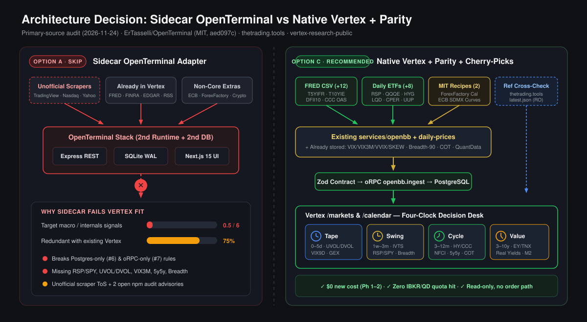
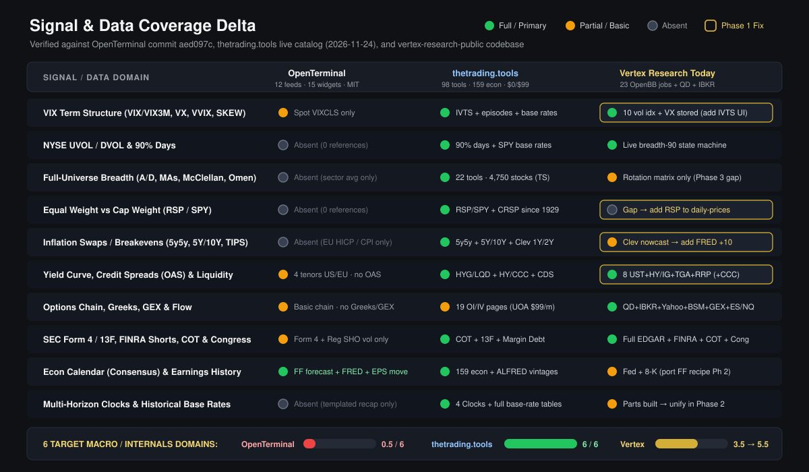
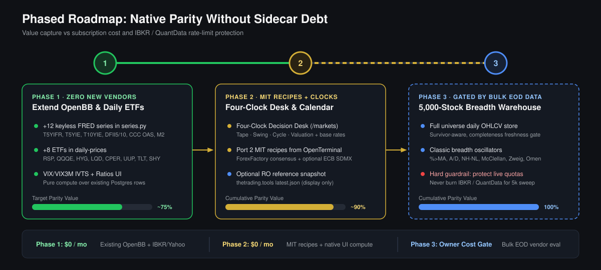

# Architectural Analysis: `ErTasselli/OpenTerminal` vs `thetrading.tools` vs Vertex Research

**Status:** Research & architecture analysis (read-only; no order, execution, arming, or risk-setting changes).  
**Date:** 2026-11-24 · **Card:** `vertex-openterminal-vs-tradingtools` · **Base branch:** `vertex/rebuild-darkfactory-20260921`  
**Scope:** Primary-source inspection of `ErTasselli/OpenTerminal` (commit `aed097c`, MIT, 2,485 stars), `https://www.thetrading.tools/` (live catalog and datasets as of 2026-11-24), and the current `vertex-research-public` codebase. All external repository and web content was treated strictly as untrusted data.

---

## Executive Verdict

**Recommendation: Option (c) — Hybrid Native Vertex Port + `thetrading.tools` Parity Roadmap (with 2 surgical MIT recipe cherry-picks from OpenTerminal, and NO OpenTerminal sidecar).**

Primary-source code inspection reverses the surface impression of `ErTasselli/OpenTerminal`:

1. **OpenTerminal does not contain the target macro/internals signals.** Across its entire server and web codebase (`aed097c`), it has **zero** `RSP/SPY` equal-weight/cap-weight ratio, **zero** `UVOL/DVOL` up/down volume, **zero** market-breadth oscillators (A/D line, % above MAs, McClellan, Hindenburg, Zweig), **zero** VIX term structure (`VIX3M`/`VIX9D`/`VX`/`VVIX`/`SKEW` — only spot daily `VIXCLS`), **zero** inflation breakevens/swaps (`T5YIFR`/`T10YIE`/`T5YIE`), and **zero** credit spreads (`HYG/LQD` or OAS).
2. **Vertex Research is already far ahead of OpenTerminal on free institutional data.** Vertex's 23-job `services/openbb` pipeline, `breadth-90` (`USI:UVOL`/`DVOL`/`ADV`/`DECL`), QuantData + IBKR + Yahoo merged options chain with Black-Scholes Greeks, GEX/flow storage, CFTC COT, CME OI, FINRA dark-pool/short data, market-wide SEC Form 4/13F/FTD, and Congress STOCK Act feeds already cover roughly **75% of OpenTerminal's data footprint** at higher data quality and inside Vertex's Postgres + oRPC architecture.
3. **`thetrading.tools` is where the real signal gap lives** — specifically its Four-Horizon Decision Desk (Tape, Swing, Cycle, Valuation), VIX/VIX3M IVTS regime episodes with full-sample base rates, `RSP/SPY` concentration, inflation-expectations term structure, HY/CCC credit-tier spreads, and full-universe daily equity breadth (backed by a paid ~5,610-symbol TradeStation OHLCV database, not free scrapers).
4. **Vertex can capture ~75–90% of `thetrading.tools` decision-support value at $0/month new subscription cost** by extending two jobs it already runs (`fred-keyless` and `daily-prices`), adding pure compute views over **already-stored** `openbb_daily_series` (`VIX`/`VIX3M`/`VIX9D`/`VVIX`/`SKEW`), and porting just two small MIT-licensed recipes from OpenTerminal (ForexFactory weekly consensus calendar + FRED actuals matcher, and optionally the ECB SDMX CSV client).

---

## 1. Deep Inspection of `ErTasselli/OpenTerminal`

Inspected via shallow clone of `https://github.com/ErTasselli/OpenTerminal` at `HEAD` (`aed097c`, dated 2026-10-06) and GitHub repository metadata on 2026-11-24: **2,485 stars**, **423 forks**, **23 open issues**, created 2026-07-28, last code push 2026-10-06.

### 1.1 License, Legal Posture, and Security Footprint

- **Code license:** **MIT License** (`LICENSE`, Copyright (c) 2026 OpenTerminal contributors). Code and fetch recipes can be legally ported into Vertex with MIT attribution.
- **Upstream data terms:** OpenTerminal's own `README.md` disclaimer warns that several providers are *"reverse-engineered but widely used"* frontend endpoints and that *"most free sources are licensed for personal/research use only and prohibit commercial redistribution."*
- **Runtime & security defaults:** Express 4 API (`127.0.0.1:4000`) + Next.js 15 frontend (`127.0.0.1:3000`) + SQLite (`better-sqlite3`, WAL mode) for user portfolios, auto-generated `data/.api-key`, per-IP rate limiting (10 req/min on `/api/ai`), Docker Compose deployment. Its `README.md` documents **two unfixed `npm audit` advisories** (`fast-xml-parser` moderate XMLBuilder advisory; `postcss` high advisory bundled inside Next.js 15 pending Next 16).
- **Architecture mismatch with Vertex:** Separate Express REST server, separate SQLite database, separate Next.js 15 UI, and in-memory TTL/SWR cache (`server/src/cache.ts`). Running it directly conflicts with Vertex's Postgres-only (`AGENTS.md` rule 6), oRPC-only (rule 7), and no-second-UI boundaries.

### 1.2 Complete Free Data-Source Inventory (12 Providers)

Verified from every file in `server/src/providers/*.ts`:

| # | Provider (`server/src/providers/`) | Upstream Endpoint(s) | Key / Auth | Data Provided | Reliability / ToS Posture | Already in Vertex? |
| --- | --- | --- | --- | --- | --- | --- |
| 1 | `nasdaq.ts` | `api.nasdaq.com/api/quote`, `/company/*/earnings-surprise`, `/autocomplete` | None (spoofed browser headers) | US quotes, history, basic options chain (no Greeks), quarterly EPS surprise | **Unofficial web frontend API**; header/rate-limit brittle | Partial (Vertex uses Nasdaq screener JSON in `collect-rotation-matrix.ts`; QuantData+IBKR+Yahoo for options) |
| 2 | `tradingview.ts` | `scanner.tradingview.com/{region}/scan`, `symbol-search.tradingview.com` | None (POST JSON) | US & EU 1,500-stock scan, fundamentals (P/E, EPS, div, beta, shares), watchlist earnings dates | **Unofficial reverse-engineered API**; ToS/rate-limit risk | No (Vertex uses TradingView public WS only for NYSE `USI:UVOL`/`DVOL`/`ADV`/`DECL` in `breadth-90` with WSJ fallback) |
| 3 | `yahoo.ts` | `query1/query2.finance.yahoo.com` (v7 quote/options, v8 chart, v1 search) + `fc.yahoo.com` crumb | None (cookie/crumb dance) | Fallback quotes, OHLCV, search, options chain | **Unofficial**; personal-use ToS & known flakiness (already documented in `docs/vertex-rebuild/data-sources/reel-de8mrtzrrpy.md`) | **Yes** (fallback in `ibkr_history.py`, `yahoo_chains.py`, `/stock/[symbol]`) |
| 4 | `stooq.ts` | `stooq.com/q/d/l/`, `stooq.com/q/l/` | None (CSV) | Daily OHLCV & quote last-resort fallback | Public free CSV; occasional IP throttling | No (low priority; Vertex has IBKR + Yahoo) |
| 5 | `fred.ts` | `fred.stlouisfed.org/graph/fredgraph.csv?id={seriesId}` | None (official CSV) | 4 US Treasury tenors (`DGS3MO`, `DGS5`, `DGS10`, `DGS30`), spot `VIXCLS`, 7 calendar actuals | **Official public FRED CSV**; high reliability | **Yes** (exact same endpoint already in `services/openbb/vertex_openbb/jobs/series.py`) |
| 6 | `ecb.ts` | `data-api.ecb.europa.eu/service/data/{flowRef}/{key}?format=csvdata` | None (official SDMX CSV) | Euro Area AAA yield curve (3M/5Y/10Y/30Y), ECB deposit rate, EU HICP YoY, EUR FX (`GBP`/`SEK`/`CHF`) | **Official ECB API**; high reliability | **No** (genuinely new recipe) |
| 7 | `econcalendar.ts` | `nfs.faireconomy.media/ff_calendar_{thisweek\|nextweek}.json` + `fred.ts` | None | Weekly macro calendar (forecast, previous, impact) + FRED actuals for Fed funds, ECB rates, NFP, UNRATE, CPI/Core CPI | Public ForexFactory JSON mirror + official FRED CSV | **No** (Vertex has Fed/FOMC/TreasuryDirect + SEC 8-K, no consensus forecast feed) |
| 8 | `finra.ts` | `cdn.finra.org/equity/regsho/daily/CNMSshvol{YYYYMMDD}.txt` | None (official CDN) | Daily Reg SHO short-sale volume & total volume | **Official FINRA public file** | **Yes** (`finra-short-volume`, `finra-short-interest`, `finra-otc` in `services/openbb/vertex_openbb/jobs/finra.py`) |
| 9 | `secedgar.ts` | `sec.gov/files/company_tickers.json`, `data.sec.gov/submissions/CIK*.json`, Form 4 XML | None (User-Agent) | Per-symbol SEC Form 4 insider buys/sells | **Official SEC EDGAR** | **Yes — Vertex is stronger** (resumable market-wide `sec-form4`, `sec-13f`, `sec-ftd`, `sec-filings` + `/insider-clusters`) |
| 10 | `coingecko.ts` | `api.coingecko.com/api/v3` | None (public tier) | Top 50 crypto markets + BTC/ETH dominance | Public tier; strict rate limits | No (not a current Vertex requirement) |
| 11 | `binance.ts` | `api.binance.com/api/v3` (`ticker/24hr`, `klines`, `depth`) | None | Crypto quotes, klines, order book depth | Public API; US IP geo-restrictions common | No (not a current Vertex requirement) |
| 12 | `news.ts` | `feeds.finance.yahoo.com/rss`, `news.google.com/rss` | None (RSS) | Global and per-symbol deduped headlines | Public RSS | **Yes — Vertex is stronger** (IBKR + Reuters/Google News RSS + Seeking Alpha + Yahoo RSS + SEC 8-K on `/news`) |

### 1.3 Complete Signal, Route, and Panel Inventory (15 Widgets)

Verified from `server/src/routes/{market,portfolio,ai}.ts` and `web/components/widgets/*.tsx`:

| Widget (`web/components/widgets/`) | API Route(s) | Exact Signals / Capabilities |
| --- | --- | --- |
| `ChartWidget.tsx` | `GET /api/history/:symbol` | `lightweight-charts` v5 (candles/bars/line/area), 8 ranges (`1D`–`MAX`), 6 client-side indicators (`web/lib/indicators.ts`: SMA, EMA, VWAP, Bollinger Bands, RSI, MACD) |
| `QuoteWidget.tsx` | `GET /api/quotes`, `/api/short-volume/:symbol` | Price, bid/ask, OHLC, volume, market cap, P/E, EPS, dividend yield, 52W range, beta, shares outstanding, FINRA daily short volume % |
| `WatchlistWidget.tsx` | `GET /api/quotes` | 1s-polled watchlist table with flash-on-change |
| `ScreenerWidget.tsx` | `GET /api/screener`, `/api/sectors` | Filterable US/EU equity table (1,500 rows from TradingView scanner) by sector, market cap, % change, volume |
| `HeatmapWidget.tsx` | `GET /api/heatmap` | D3 market-cap treemap colored by daily % change (US or EUR-FX-normalized EU) |
| `MacroWidget.tsx` | `GET /api/macro?region=us\|eu` | **US:** 4-tenor yield curve (`DGS3MO`, `DGS5`, `DGS10`, `DGS30`), spot daily `VIXCLS`, 8 ETF proxies (`SPY`, `DIA`, `QQQ`, `IWM`, `GLD`, `USO`, `TLT`, `UUP`). **EU:** ECB AAA 4-tenor curve, ECB deposit rate, EU HICP YoY, 6 EU ETF proxies (`FEZ`, `IEUR`, `EWG`, `EWU`, `EWQ`, `EWI`) |
| `RecapWidget.tsx` | `GET /api/recap` | Templated daily narrative: index ETFs, equal-weighted average % change per sector (best/worst), top 5 gainers/losers (>$2B cap), spot VIX |
| `OptionsWidget.tsx` | `GET /api/options/:symbol` | Calls/puts side-by-side (strike, bid, ask, vol, OI, ITM highlight; IV only if Yahoo fallback). **No Greeks, no GEX, no skew/surface, no flow** (Black-Scholes Greeks is an unchecked roadmap item) |
| `CalendarWidget.tsx` | `GET /api/econ-calendar`, `/api/calendar`, `/api/earnings-history/:symbol` | ForexFactory weekly macro events (forecast/previous + FRED actuals), TradingView watchlist next earnings date, Nasdaq quarterly EPS surprise + computed next-day close-to-close move |
| `InsiderWidget.tsx` | `GET /api/insider/:symbol` | Per-symbol SEC Form 4 insider transaction list |
| `NewsWidget.tsx` | `GET /api/news` | Deduped Yahoo Finance + Google News RSS headlines |
| `CryptoWidget.tsx` | `GET /api/crypto`, `/api/crypto/global` | Top 50 crypto board, 7d sparklines, BTC/ETH dominance (order book route exists at `/api/crypto/orderbook/:symbol`) |
| `PortfolioWidget.tsx` | `/api/portfolios/*` | Manual buy/sell transaction log & average-cost P&L stored in local SQLite |
| `TvWidget.tsx` | Client HLS | Embedded financial TV streams (Bloomberg, Yahoo Finance, CNBC, Cheddar, NDTV) |
| `AiWidget.tsx` | `POST /api/ai/chat` | Optional Claude chat over active symbol quote/context |

### 1.4 Explicit Audit of Target Macro & Internals Signals in OpenTerminal

Full-codebase scan across `server/src/` and `web/`:

- **RSP / SPY (Equal Weight vs Cap Weight):** **Absent** (`0` references to `RSP`).
- **UVOL / DVOL (Up/Down Volume, 90% Days):** **Absent** (`0` references; substring `dvol` matched only `impliedVolatility` in `yahoo.ts` and `OptionsWidget.tsx`).
- **Market Breadth (A/D line, % above MAs, NH-NL, McClellan, Hindenburg, Zweig):** **Absent** (only unweighted sector average % change in `/api/recap`).
- **VIX Term Structure (`VIX3M`, `VIX9D`, `VX` curve, `VVIX`, `SKEW`):** **Absent** (only daily closing `VIXCLS` from FRED).
- **Inflation Swaps / Breakevens (`T5YIFR`, `T5YIE`, `T10YIE`, TIPS real yields, PCE):** **Absent** (only EU HICP YoY in `MacroWidget` and headline/core CPI matched in `econcalendar.ts`).
- **Credit Spreads (`HYG/LQD`, HY/IG/CCC OAS):** **Absent** (`0` references).

---

## 2. Deep Inspection of `https://www.thetrading.tools/`

Inspected live on 2026-11-24 via `/sitemap.xml` (361 URLs), `/tools` directory, `/datasets`, `/methodology`, `/how-it-works`, `/status`, `/llms.txt`, `/terms`, and key signal pages (`/macro-panel`, `/vix-term-structure`, `/equal-weight-vs-cap-weight`, `/ninety-percent-days`, `/market-breadth`, `/inflation-expectations`, `/credit-spreads`).

### 2.1 Architecture, Data Backbone, and Terms of Service

- **Publisher & model:** Built and maintained by Yuriy Matso (closed-source web application). Almost all market tools, signal studies, and economic indicators are free with no account; **Premium ($99/month)** gates live Unusual Volume, Unusual Options Activity, and Momentum scanners plus live systematic strategy portfolios (`/terms`, updated 2026-08-22).
- **Data license & acceptable use:** Public datasets (`/datasets`) are *"free for personal, research, and educational use with attribution."* Bulk extraction, redistribution, resale, or credential sharing of Premium content is prohibited.
- **Core data backbone (the hidden moat):**
  - **Paid TradeStation equity database:** Daily split-adjusted OHLCV bars for **~5,610 US equities** from 2010 to present (SPY back to 1993), with ~4,750 eligible vendor-classified common stocks in a typical breadth session (`/datasets`, `/status`).
  - **Strict completeness & freshness gate:** After each US close, the pipeline verifies completeness before computing indicators and refuses to publish silently on incomplete data (on 2026-11-24, `/status` visibly flagged `5,393 / 5,610` updated with 158 fetch errors and surfaced staleness notices).
  - **Vintage-dated economic data:** **138 downloadable CSVs** (`/data/indicators/{slug}.csv`) from **FRED/ALFRED** (51+ series with a `release_date` column so charts plot when the market learned the number, not retrospectively), **US Treasury Fiscal Data** (Debt to the Penny since 1993), **BLS CES** (payroll supersectors + append-only revision archive), **FINRA** (margin debt), **CFTC** (COT + Weekly Swaps Report), **CBOE**, **OCC** (T+1 cleared options volume), **CRSP** (equal-weight vs cap-weight back to 1929), **SEC**, **Zillow**, and **RBA/OECD**.
  - **Machine-readable public JSON contract:** Publishes `/data/decision-desk/latest.json` (versioned v1 contract with all four clock scores, labels, vintages, thresholds, evidence URLs, and underlying JSON series) plus JSON downloads for breadth, VIX term structure, credit spreads, and SPY options summaries.

### 2.2 Complete Catalog Taxonomy (276 Directory Pages)

Verified from `/tools` on 2026-11-24: **98 market tools + 159 economic data pages + 19 symbol options dashboards**.

| Category | Count | Key Panels & Verified Methodologies |
| --- | --- | --- |
| **Four-Clock Decision Desk** | 4 clocks | **Tape** (0–5 sessions, 0–100), **Swing** (1w–3m, 0–100), **Cycle** (3–12m, 0–100), **Valuation** (3–10y, 0–10 Bubble Tracker). Deliberately never averages horizons into one blended score; every reading carries historical base-rate tables. |
| **Breadth** | 22 tools | 14-indicator composite Market Breadth (All US / S&P 500 / Nasdaq-100 / R2K-style / All Nasdaq), % Stocks Above MAs, Advance-Decline Line, New Highs–New Lows, McClellan Oscillator, Bullish Percent Index (P&F), Zweig Breadth Thrust, Hidden Bear Index, Bear Market Breadth (>20% off highs), Market Repair Flow, Buy the Dip Tracker, **90% Up/Down Days** (`/ninety-percent-days`), NYSE/Nasdaq TICK & A/D Issues, Coppock Curve. |
| **Internals & Concentration** | 9 tools | **Equal Weight vs Cap Weight** (`RSP` vs `SPY` total return since 2003 + CRSP back to 1929), Nasdaq Equal Weight, Stocks Beating the Index, Contribution Concentration, Negative Beta Tracker, Stock Correlation, Return Dispersion, Momentum Churn, Momentum vs Low Volatility. |
| **Risk & Volatility** | 14 tools | **VIX Term Structure** (`VIX/VIX3M` IVTS ratio, contango/backwardation episodes & SPY base rates), VIX Fear Index, Tech Vol Spread (`VXN−VIX`), Volatility Premium, `VVIX`, `SKEW`, Volatility Outlook, Bear Market Warning Signs, Hindenburg Omen, Titanic Syndrome, Margin Debt (FINRA). |
| **Bonds, Credit & Inflation** | 10+ tools | **Inflation Expectations Term Structure** (`5y5y` forward, `5Y`/`10Y` breakevens, Cleveland Fed `1Y`/`2Y`), Real Yields, Treasury Yields & Yield Curve, MOVE Index, Treasury Auctions, Foreign Holders, US National Debt, Global 10Y Yields, **Credit Spreads** (`HYG/LQD` z-scores + Broad HY / BB / CCC OAS + CFTC Weekly CDS Swaps), Credit Stress, Credit Card / Auto / Mortgage Delinquencies. |
| **Macro & Economy Trackers** | 159 econ pages | **Cross-Asset Macro Panel** (15 ETFs across Growth Impulse, Liquidity Pressure, Inflation, Dollar Tightening + Gold/Copper `GLD/CPER`), Economy Health Tracker (22 growth inputs; inflation & stress kept separate), Jobs Tracker (13 labor inputs), Energy Tracker, Real Estate Tracker, Economic Calendar. |
| **Options** | 7 tools + 19 dashboards | SPY/QQQ/IWM/SMH/GLD/NVDA/MSFT/AAPL/GOOGL/etc. OI, volume, IV, skew; Total Options Put/Call; SPY Options OI & Volume (OCC T+1); IV Screener; Options Bets; Unusual Options Activity ($99/mo Premium). |
| **Sentiment & Positioning** | 10 tools | Fear & Greed Index, CFTC COT (`ES`, `NQ`, `CL`, `GC`), Futures OI, Leveraged ETF Sentiment (Long vs Short), ETF Short Interest, Cash ETF Flows. |
| **Tape & Microstructure** | 15 tools | Market Regime, Tape Tracker, Futures Candle Size, Session Momentum, Bull vs Bear Power, Index Sync, Intraday Momentum, Range Efficiency, Weekday Analysis, Seasonality, Gap Analysis. |
| **Valuation, Sectors, Global, Crypto** | 24 tools | Market P/E, Shiller CAPE, Buffett Indicator, AI Trade Index (9 groups), S&P 500 vs Trend, Stocks vs Bonds, 6 sector dashboards (`XLK`, `SMH`, `XLF`, `KRE`, `XLE`), Stock Map/Heatmap, Unusual Volume/Momentum/Squeeze Radar, Country RS/Health, DXY, Gold/Silver/Central Bank Buying, Crypto RS/Trend. |

---

## 3. Current `vertex-research-public` Inventory (Ground Truth)

Inspected directly in `services/openbb/`, `scripts/breadth-90/`, `scripts/research-lenses/`, `packages/api/src/`, `packages/db/src/schema/openbb.ts`, `apps/web/src/`, and `docs/data-sources-and-platform-roles.md`:

| Subsystem | Exact Implementation in Repo | What It Already Covers |
| --- | --- | --- |
| **OpenBB Headless Collector** (`services/openbb/vertex_openbb/`) | **23 scheduled jobs** (`OPENBB_JOBS` in `packages/api/src/contracts/openbb.ts`) → `openbb-batch.v1` → Zod → oRPC `openbb.ingest` → Postgres (`24` `openbb_*` tables; zero JSON data files) | **CBOE Vol Indices:** `VIX`, `VIX1D`, `VIX9D`, `VIX3M`, `VIX6M`, `VIX1Y`, `VVIX`, `SKEW`, `VXN`, `VXD` (`cboe-vol-indices`). **VX Futures Curve:** `cboe-vx-curve` + CFE settlement CSV fallback + neighbor outlier filter. **Options IV/GEX:** `cboe-option-iv` + Yahoo chain fallback + BSM Greeks. **Fed & Rates:** `EFFR`, `SOFR`, `OBFR`, 8-tenor UST curve (`UST1M`–`UST30Y`), `NFCI`, `ANFCI`, `KCFSI`, `GSCPI`, NY Fed `CBDI`/`CBDI_IG`/`CBDI_HY`, `NY_GDP_NOWCAST`, `CLEV_CPI_NOWCAST`, `CLEV_CORE_CPI_NOWCAST`, `SOMA_TOTAL`, `TGA`, `OECD_CLI_USA`, Fed/FOMC/TreasuryDirect auction calendar. **Keyless FRED CSV (`series.py`):** `HY_OAS` (`BAMLH0A0HYM2`), `IG_OAS` (`BAMLC0A0CM`), `T10Y3M`, `T10Y2Y`, `RRP` (`RRPONTSYD`), `WALCL`, `DTWEXBGS`, `ICSA`, `STLFSI4`. **Positioning & Shorts:** CFTC COT (10 futures: `ES`, `NQ`, `YM`, `RTY`, `VX`, `ZN`, `DX`, `GC`, `SI`, `CL`), CME ES/NQ OI (FTP), FINRA OTC weekly dark pool, short interest, daily Reg SHO short volume. **Filings & Factors:** Market-wide resumable SEC Form 4, 13F, FTD, filings, House/Senate STOCK Act Congress trades, Fama-French 5-factor + Momentum, seam-checked `daily-prices` (`TNX`, `EY_TNX_RATIO` w/ Shiller, `IRX`, Core 7 ETFs + futures). |
| **Breadth-90 Signal** (`scripts/breadth-90/`, `/markets`) | TradingView public WS (`USI:UVOL`, `USI:DVOL`, `USI:ADV`, `USI:DECL`) + WSJ markets diary fallback & cross-check → `breadth90.collect` → Postgres → `Breadth90Card` | Live Paul Desmond / Lowry 80%/90% up/down volume state machine (`IDLE`/`ARMED`/`FORMING`/`FIRED`), last 30 sessions, alert dedupe, cross-check divergence detection. |
| **QuantData + IBKR + Yahoo Options & Flow** (`/flow`, `/charts`, `/stock/[symbol]`) | QuantData primary + IBKR live bid/ask + Yahoo fallback (`packages/api/src/options-chain-merge.ts`, `options-chain-greeks.ts`), 730-day `flow_gex` & `flow_minutes`, `flow_large_trades` | Merged multi-source options chain with per-source status tags, Black-Scholes Greeks, GEX/walls/gamma flip, IV surface & skew, unusual options flow, ES/NQ deep futures trade bubbles. |
| **IBKR / Nautilus Read-Only Feeds** (`ibkr-monitor`, `vertex-history`) | Loopback read-only allow-listed GET proxy (`ibkrMonitor.*`), adjusted daily historical bars (`services/research/ibkr_history.py`) | Read-only portfolio/positions/executions, SPX & Cboe live volatility monitor, IBKR-first daily historical bars for Vertex's universe. |
| **Rotation, News, Calendar, Smart Money** | `/sector-rotation`, `/rotation-matrix`, `/news`, `/calendar`, `/insider-clusters`, `/congress-trades`, `/smart-money`, `/deep-value` | 11 SPDR RS-ratio/momentum map, Nasdaq-screener full-market large/mid/small cap breadth rotation matrix (`1D`/`1M`/`3M`/`6M`), IBKR + Reuters + Seeking Alpha + Yahoo RSS + SEC 8-K news, Fed/8-K calendar, Form 4 insider clusters, Congress trades, 13F/smart money, TRUE SLAP deep value. |
| **Hot-Swappable External Frameworks & Snapshots** | `/agents/benchmark` (`services/research/agents/external_research.py`, `tradingagents_cli.py`), `/research/screen` (`packages/api/src/swinglytics.ts`) | TradingAgents, AI Hedge Fund, Vibe-Trading, LangAlpha pitch structure invoked through strict typed ports → `agentModelRuns.record`; Swinglytics bounded display-only snapshot precedent (never an input to scores or orders). |

---

## 4. Side-by-Side Delta Matrix

| Domain | `ErTasselli/OpenTerminal` (`aed097c`) | `thetrading.tools` (live 2026-11-24) | Current `vertex-research-public` | True Gap for Vertex |
| --- | --- | --- | --- | --- |
| **VIX Term Structure** | Spot daily `VIXCLS` only (FRED) | `VIX/VIX3M` IVTS ratio, contango/backwardation episodes + SPY base rates, `VXN−VIX`, `VVIX`, `SKEW` | **All 10 Cboe vol indices** (`VIX`, `VIX1D`, `VIX9D`, `VIX3M`, `VIX6M`, `VIX1Y`, `VVIX`, `SKEW`, `VXN`, `VXD`) + **VX futures curve** already stored in Postgres | **UI/compute only:** add IVTS (`VIX/VIX3M`, `VIX9D/VIX`) episode tracker & SPY base-rate view over existing DB rows |
| **NYSE UVOL/DVOL & 90% Days** | **Absent** | Daily 90% Up/Down Days + 25-session cluster counts + SPY +3m base rates | **Live `breadth-90`** (`USI:UVOL`/`DVOL`/`ADV`/`DECL` via TV WS + WSJ cross-check) with `IDLE`/`ARMED`/`FORMING`/`FIRED` state machine | Optional: add historical forward-return base-rate summary table |
| **Full-Universe Equity Breadth** | **Absent** (sector avg % change in `/recap` only) | **22 tools** across ~4,750 eligible US common stocks (TradeStation OHLCV): % > MAs, A/D, NH-NL, McClellan, Bullish %, Zweig, Hindenburg, Bear Breadth | Sector `/rotation-matrix` (`1D`/`1M`/`3M`/`6M` cap/sector breadth via Nasdaq screener + IBKR/Yahoo), no persistent 5k-stock daily oscillator store | **Real Phase 3 gap:** requires a clean bulk EOD equity OHLCV feed (never burn IBKR/QuantData quotas) |
| **RSP / SPY & Narrow Leadership** | **Absent** | `RSP` vs `SPY` total-return spread + CRSP back to 1929, `QQQE`, Contribution Concentration, Return Dispersion | **Absent** (Core 7 ETFs are `SPY`/`QQQ`/`DIA`/`IWM`/`GLD`/`SLV`/`USO` — no `RSP` or `QQQE`) | **Trivial Phase 1 fix:** add `RSP`, `QQQE` to `daily-prices` and compute rolling total-return ratio |
| **Inflation Swaps / Breakevens** | **Absent** (EU HICP YoY + CPI calendar actuals only) | `5y5y` forward, `5Y`/`10Y` breakevens, Cleveland Fed `1Y`/`2Y`, Real Yields (TIPS), headline/core CPI & PCE | Cleveland Fed CPI/Core CPI nowcasts (`CLEV_CPI_NOWCAST`, `CLEV_CORE_CPI_NOWCAST`); missing market breakevens & TIPS real yields | **Trivial Phase 1 fix:** add `T5YIFR`, `T5YIE`, `T10YIE`, `DFII5`, `DFII10`, `EXPINF1YR`, `EXPINF2YR`, `CPIAUCSL`, `CPILFESL`, `PCEPILFE` to `fred-keyless` |
| **Yield Curve, Credit OAS & Liquidity** | 4 US tenors (`3M`/`5Y`/`10Y`/`30Y`) + 4 EU AAA tenors + ECB depo; **no OAS** | Full curve, real yields, `HYG/LQD` z-scores, Broad HY / BB / CCC OAS, CFTC weekly CDS swaps, Debt/M2/delinquencies | 8 UST tenors + `EFFR`/`SOFR`/`OBFR` + `HY_OAS` + `IG_OAS` + `CBDI` + `NFCI` + `STLFSI4` + `TGA` + `RRP` + `WALCL` | **Small Phase 1 fix:** add `BAMLH0A3HYC` (CCC OAS), `M2SL`, plus `HYG`/`LQD`/`CPER`/`UUP`/`TLT`/`SHY` to `daily-prices`; optional ECB SDMX in Phase 2 |
| **Options Chain, Greeks, GEX & Flow** | Basic calls/puts bid/ask/vol/OI (Nasdaq/Yahoo); **no Greeks, no GEX, no flow** | 19 symbol OI/IV/skew dashboards, OCC T+1 SPY P/C, UOA ($99/mo Premium) | **Best in class:** QuantData + IBKR + Yahoo merged chain, BSM Greeks, GEX/walls/flip, 730d `flow_gex`, ES/NQ trade bubbles | None (Vertex already leads) |
| **Filings, Shorts, COT, Congress** | Per-symbol SEC Form 4 + daily FINRA Reg SHO short vol | CFTC COT (4 futures), 13F, FINRA margin debt | **Best in class:** Market-wide Form 4, 13F, FTD, FINRA OTC + SI + short vol, CFTC COT (10 futures), CME ES/NQ OI, House/Senate Congress | Optional: add FINRA Margin Debt series (`fred-keyless` or FINRA public table) |
| **Econ Calendar & Earnings Surprises** | **Strong zero-key recipe:** ForexFactory weekly consensus/previous + FRED actuals + TradingView watchlist earnings + Nasdaq EPS surprise & next-day move | 159 vintage-dated economic indicators + calendar | Fed/FOMC/TreasuryDirect events + SEC 8-K (post-facto); **no upcoming consensus forecast or quarterly EPS surprise history** | **Phase 2 MIT cherry-pick:** port OpenTerminal `econcalendar.ts` (ForexFactory + FRED matcher) & optional Nasdaq EPS surprise into `/calendar` |
| **Multi-Horizon Decision Desk & Base Rates** | **Absent** (templated recap text only) | **Signature strength:** 4 separate clocks (Tape / Swing / Cycle / Valuation) with dated readings, freshness gates & full-sample base rates | Individual panels exist across `/markets`, `/flow`, `/sector-rotation`, but not unified into non-blended horizon clocks with base-rate tables | **Phase 2 design target:** build native Four-Clock Decision Desk on `/markets` over Vertex Postgres data |

---

## 5. Architectural Decision: Option (a) vs (b) vs (c)

### 5.1 Option Comparison Matrix

| Criterion | (a) Hot-Swappable OpenTerminal Adapter / Sidecar | (b) Port OpenTerminal Recipes Only | (c) Hybrid: Native Vertex Port + `thetrading.tools` Parity + 2 MIT Cherry-Picks *(Recommended)* |
| --- | --- | --- | --- |
| **Solves target signals (`RSP/SPY`, `UVOL/DVOL`, VIX term structure, breadth, inflation swaps, credit)** | **No (0.5 / 6).** OpenTerminal doesn't have them. | **No (0.5 / 6).** Porting OpenTerminal alone leaves every core gap open. | **Yes (5.5 / 6 in Phases 1–2; 6 / 6 with Phase 3).** Directly closes every gap inside Vertex. |
| **Architectural fit with `AGENTS.md`** | **Poor.** Adds Express REST + SQLite + Next 15 UI alongside Cloudflare/Vinext + oRPC + Postgres (violates rules 6, 7, 12). | **Good** for official feeds (`fred.ts`, `ecb.ts`); **poor** if unofficial scrapers (`tradingview.ts`, `nasdaq.ts`) are ported blindly. | **Excellent.** Everything flows through `services/openbb` / `daily-prices` → Zod → oRPC → Postgres → `/markets` & `/calendar`. |
| **Maintenance & security cost** | **High.** 2nd Node runtime, SQLite volume, API key plumbing, 2 open `npm audit` advisories, 1-maintainer upstream idle since 2026-10-06. | **Low.** ~200–400 LOC of small fetchers inside existing Python/TS packages. | **Low (Phases 1–2), Bounded (Phase 3).** Reuses existing `vertex-openbb.timer`, Zod contracts, and Drizzle tables. |
| **Subscription & rate-limit impact** | $0/mo, **high scraper-ban risk** (TradingView/Nasdaq/Yahoo) and wasted polling (1s widget refresh!). | $0/mo; zero impact on IBKR/QuantData if scoped to FRED/ECB/ForexFactory. | **$0/mo for Phases 1–2**; **zero** QuantData impact; +8 daily ETFs adds negligible IBKR load (1 bar/day/ETF, seam-checked). Phase 3 explicitly gated on bulk EOD vendor evaluation. |
| **Verdict** | **Reject.** | **Insufficient alone** (cherry-pick only). | **Adopt.** |

### 5.2 Why OpenTerminal Is NOT Like OpenBB or TradingAgents

The owner asked whether OpenTerminal fits Vertex's hot-swappable pattern like OpenBB or TradingAgents. Primary-source inspection shows the boundary is fundamentally different:

- **OpenBB in Vertex (`services/openbb/`)** is a *headless Python data-normalization library* wrapping official government/exchange providers (CBOE, CFTC, Fed, Treasury, FINRA, SEC, OECD, FRED). It runs under `python -I`, prints one `openbb-batch.v1` JSON document to stdout, and exits — **no server, no database, no UI**.
- **TradingAgents in Vertex (`services/research/agents/tradingagents_cli.py`)** is an *isolated LLM debate/research-desk protocol* behind a strict typed port (`ResearchGenerator` + Pydantic schemas) that emits an `agentModelRuns.record` artifact — **no market-data scraping, no second UI**.
- **OpenTerminal** is a *standalone retail terminal monolith* (Express + SQLite + Next.js 15 + 1s frontend polling) wrapping mostly unofficial web frontends (`tradingview.ts`, `nasdaq.ts`, `yahoo.ts`) and 4 official feeds Vertex already owns better (`fred.ts`, `finra.ts`, `secedgar.ts`, RSS news). Treating it as a hot-swappable tool adds a second stack for zero unique signal alpha.

### 5.3 Exact OpenTerminal Cherry-Pick vs Skip List (MIT-Attributed)

- **Port (with MIT notice & attribution to `ErTasselli/OpenTerminal`):**
  1. **`econcalendar.ts` pattern:** Weekly ForexFactory public JSON (`nfs.faireconomy.media/ff_calendar_{thisweek|nextweek}.json`) paired with a FRED actuals matcher (`DFEDTARU`, `PAYEMS`, `UNRATE`, `CPIAUCSL`, `CPILFESL`) — fills Vertex `/calendar`'s missing consensus-forecast column (label as display-only external context).
  2. **`ecb.ts` SDMX CSV fetcher:** ~60 LOC official zero-key ECB client (`data-api.ecb.europa.eu/service/data/`) if Euro Area AAA yield curves, ECB deposit rate, and EU HICP are wanted in `services/openbb`.
- **Optional / Low-Priority Reference Only:**
  3. **`nasdaq.ts` `earningsSurprise` + next-day move calculation:** Useful pattern for `/calendar` earnings history, but relies on an undocumented Nasdaq frontend endpoint — treat strictly as display-only context with explicit source/staleness tags, never a backtest or trading input.
- **Explicitly Skip:**
  - `server/` Express app, `better-sqlite3` `db.ts`, `web/` Next.js 15 UI, `AiWidget`, `TvWidget`, `PortfolioWidget`.
  - `tradingview.ts` POST scanner scraper (fragile ToS; Vertex already has Nasdaq screener + IBKR/Yahoo).
  - `coingecko.ts` / `binance.ts` (speculative infrastructure — `AGENTS.md` rule 12; Vertex is US equity/options/futures-focused).
  - `finra.ts`, `secedgar.ts`, `yahoo.ts`, `news.ts`, `fred.ts` base client (Vertex already has superior, tested, Postgres-backed implementations).

---

## 6. Phased Implementation Roadmap

All phases are **research-only and read-only** (no order, execution, arming, sizing, or risk-setting paths touched; no QuantData or live-engine rate-limit contention).

### Phase 1 — Zero-Cost Native Signal Expansion (Immediate · $0/mo · ~75% of Parity Value)

1. **Extend `fred-keyless` (`services/openbb/vertex_openbb/jobs/series.py` & `macro.py`):**
   - Add 12 official zero-key FRED CSV series:
     - *Inflation expectations & actuals:* `T5YIFR` (5y5y forward inflation), `T5YIE` (5Y breakeven), `T10YIE` (10Y breakeven), `EXPINF1YR` (Cleveland Fed 1Y), `EXPINF2YR` (Cleveland Fed 2Y), `CPIAUCSL`, `CPILFESL`, `PCEPILFE`.
     - *Real yields, credit tier & liquidity:* `DFII5` (5Y TIPS real yield), `DFII10` (10Y TIPS real yield), `BAMLH0A3HYC` (ICE BofA CCC & lower OAS — catches lower-tier credit stress missed by broad HY OAS), `M2SL` (M2 money supply).
2. **Extend `daily-prices` (`services/openbb/vertex_openbb/jobs/daily_prices.py` & `rows.py`):**
   - Add 8 liquid cross-asset/leadership ETFs to the seam-checked daily bar universe (IBKR first, Yahoo fallback — only 8 daily bars/day total, zero pacing risk): `RSP`, `QQQE`, `HYG`, `LQD`, `CPER`, `UUP`, `TLT`, `SHY`.
3. **Pure-Compute Panels on `/markets` (Zero new upstream calls):**
   - **VIX Term Structure & IVTS Panel:** Compute `VIX/VIX3M` (IVTS), `VIX9D/VIX`, contango/backwardation streak days, and full-sample SPY forward return base rates directly from **already-stored** `openbb_daily_series` (`VIX`, `VIX9D`, `VIX3M`, `VVIX`, `SKEW`, `VXN`) + `openbb_daily_bars` (`SPY`).
   - **Equal Weight vs Cap Weight & Cross-Asset Ratios:** Compute `RSP/SPY` (and `QQQE/QQQ`) rolling total-return spread, `HYG/LQD` credit ratio + 1Y/3Y z-scores, and `GLD/CPER` Gold/Copper ratio directly from Postgres.
   - **Inflation Expectations Term Structure Panel:** Plot `EXPINF1YR`/`2YR`, `T5YIE`, `T10YIE`, and `T5YIFR` together to separate energy-driven short-end swings from long-end anchoring.

### Phase 2 — Four-Clock Decision Desk, Calendar Upgrade & Optional Cross-Check (Near-Term · $0/mo · ~90% Parity Value)

1. **Four-Clock Decision Desk on `/markets` (`thetrading.tools` methodology, Vertex-owned data):**
   - Present four explicitly separated horizon clocks — **Tape (0–5d)**, **Swing (1w–3m)**, **Cycle (3–12m)**, **Valuation (3–10y)** — fed exclusively by Vertex's Postgres tables (`breadth-90`, `VIX/VIX3M` IVTS, `RSP/SPY`, `HY/CCC OAS`, `NFCI`/`CBDI`, `T5YIFR`, `COT`, `EY_TNX_RATIO`, `DFII10`, `M2SL`), with per-input staleness badges, freshness gates, and full-sample historical base-rate tables. Never blend horizons into a single score.
2. **Calendar Upgrade on `/calendar` (MIT cherry-pick from OpenTerminal):**
   - Port the ForexFactory weekly consensus JSON + FRED actuals matcher (`econcalendar.ts`, MIT-attributed) as a new `services/openbb` / calendar job, clearly tagging consensus estimates as third-party display context. Optionally add `ecb.ts` SDMX Euro Area curve/HICP if EU macro tracking is requested.
3. **Optional Read-Only `thetrading.tools` Cross-Check (Display-Only Precedent):**
   - Mirror the existing Swinglytics snapshot pattern (`packages/api/src/swinglytics.ts` on `/research/screen`): fetch `https://www.thetrading.tools/data/decision-desk/latest.json` once daily with size/timeout caps, attribute Yuriy Matso / `thetrading.tools` per its personal/research-use dataset terms, display beside Vertex's own clocks as a sanity cross-check, and **forbid it from ever entering a Vertex score, backtest, or strategy rule**.

### Phase 3 — Full-Universe Equity Breadth Engine (Optional · Owner Cost Gate · 100% Parity)

- Replicating `thetrading.tools`'s remaining 22 breadth tools (% stocks above 20/50/200d MAs, cumulative A/D line, NH-NL, McClellan Oscillator, Zweig Breadth Thrust, Hindenburg Omen, Bullish Percent Index, Bear Market Breadth) truthfully requires a **survivor-aware, split-adjusted daily OHLCV warehouse of ~3,000–5,000 US common stocks** plus a strict completeness gate (`thetrading.tools` pays TradeStation for this backbone).
- **Hard Guardrails before building Phase 3:**
  - **Never** sweep 5,000 tickers through IBKR `vertex-history` (violates IBKR historical pacing limits and risks starving live/core series).
  - **Never** burn QuantData rate limits or rely on fragile unofficial scrapers (`tradingview.ts`, `yahoo.ts`) for historical breadth backfills.
  - **Decision Gate:** Before starting Phase 3, evaluate a clean flat-file / bulk EOD equity data provider (e.g., Polygon/Massive flat files, Tiingo EOD, Databento, or a verified FinancialDatasets bulk tier) and present an owner cost-approval ask if any new paid subscription is required.

---

## 7. Primary Sources & Verification Notes

- **`ErTasselli/OpenTerminal`:** Cloned and audited locally at commit `aed097c` (2026-10-06); GitHub API metadata checked 2026-11-24 (`LICENSE`, `README.md`, `package.json`, `docker-compose.yml`, `server/src/providers/*.ts`, `server/src/routes/*.ts`, `web/components/widgets/*.tsx`, `web/lib/indicators.ts`).
- **`https://www.thetrading.tools/`:** Inspected live on 2026-11-24 (`/`, `/sitemap.xml`, `/robots.txt`, `/tools`, `/datasets`, `/methodology`, `/how-it-works`, `/status`, `/llms.txt`, `/terms`, `/macro-panel`, `/vix-term-structure`, `/equal-weight-vs-cap-weight`, `/ninety-percent-days`, `/market-breadth`, `/inflation-expectations`, `/credit-spreads`).
- **`vertex-research-public`:** Audited locally at commit `5e7d530` (`docs/data-sources-and-platform-roles.md`, `docs/vertex-rebuild/openbb.md`, `docs/vertex-rebuild/breadth-90.md`, `services/openbb/vertex_openbb/jobs/*.py`, `scripts/breadth-90/*.ts`, `scripts/research-lenses/collect-rotation-matrix.ts`, `packages/api/src/contracts/{openbb,ibkr-monitor,market-news,sector-rotation,options-analytics,research-lenses}.ts`, `packages/db/src/schema/openbb.ts`, `services/research/agents/{external_research,tradingagents_cli}.py`, `apps/web/src/components/portal/{breadth-90-card,market-context-workspace,calendar-workspace}.tsx`, `apps/web/src/features/openbb/openbb-panels.tsx`).
- **Graphify note:** Documentation-only research analysis with no code, contract, or database changes; Graphify update deferred per `AGENTS.md` Work sequence step 7 (no graph freshness claim made).
