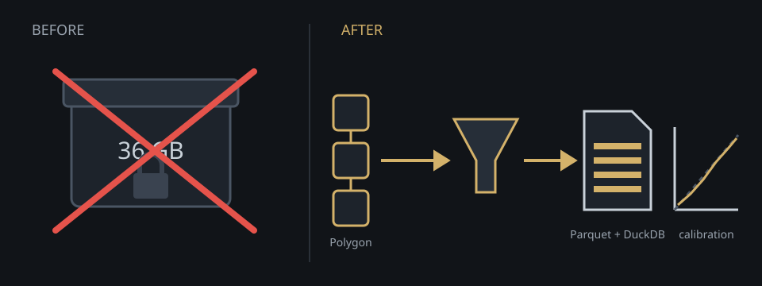

# Polymarket On-Chain Calibration Sample



* Status: implemented with tests on branch `ws/prediction-market-dataset` (card `vertex-prediction-market-dataset-run`); first run done on 2026-11-26 (see [Results](#results)). EGM consolidated review done on 2026-11-26.
* Owner decision: owner answer of 2026-11-25 in the private job channel of the card: "Yes: accept PublicNode terms, Polymarket-only on-chain run". The card `vertex-prediction-market-dataset-run` in the tracker links that message.
* Scope: research only. The run gives no trading signal, order, account access, arming, risk setting or trading authority.

## Terms

* **Polygon**: the public blockchain on which Polymarket settles trades.
* **ConditionalTokens (CTF)**: the Gnosis contract that holds Polymarket outcome tokens. A **condition** is one market question; it has outcome slots (two for a yes/no market) and is resolved by an **oracle** contract, which reports a **payout** per slot.
* **Position id / token id**: the number of one outcome token (an ERC-1155 token id). It is computed from the collateral token, the condition id and the outcome slot.
* **CTF Exchange**: Polymarket's order-matching contract. The **NegRisk** exchange and adapter serve markets that group several yes/no conditions under one question; their tokens use a wrapped collateral token instead of USDC.e.
* **Maker-order row and taker-aggregate row**: in one matched trade the exchange writes one `OrderFilled` log per maker order and one more for the taker order, in which the `taker` field is the exchange itself.
* **Gamma and CLOB APIs**: Polymarket's web APIs for market data and the order book.
* **Rig**: the owner's research workstation, where the run and the data files stay.

## Problem

The calibration code in `services/research/providers/prediction_markets.py` (a port of [Jon-Becker/prediction-market-analysis](https://github.com/Jon-Becker/prediction-market-analysis), MIT) had run only on synthetic rows.

* **Why the upstream archive is blocked**: the planned input was the upstream pre-collected archive `data.tar.zst` (36,020,641,508 bytes, about 36 GB). It holds Kalshi data, and the [Kalshi Data Terms of Use](https://kalshi-public-docs.s3.amazonaws.com/kalshi-data-terms-of-service.pdf) prohibit copying, downloading and compiling Kalshi Data without prior written authorization ([upstream-candidates-20261030.md, Open Questions](upstream-candidates-20261030.md#open-questions)). The Polymarket part cannot be taken alone: the archive is one file, so a download transfers the Kalshi data too.
* **Why a pull from the Polymarket API is not used**: the [Polymarket Terms of Use](https://polymarket.com/tos) (checked 2026-11-25) prohibit using "any data mining tools, robots, crawlers, or similar data gathering and extraction tools to scrape or otherwise remove data from the Site, any other Interface, or Features", and they apply to anyone who connects "via an API". No written permission exists.

## Goals

* Run the existing Polymarket calibration (win rate by price, Brier score, log loss, expected calibration error) on real Polymarket fills.
* Add a pinned DuckDB Parquet reader whose report equals the in-memory report for the same rows (the task's parity requirement).
* Decide the gate of [upstream-candidates-20261030.md](upstream-candidates-20261030.md) (Risks: "the module gets its reader and first run, or it is removed") on evidence. Success criterion: window A gives at least 100 resolved conditions with positions in 1..99 cents, and the reported counts explain every dropped row. Then the module stays with its reader; otherwise the module and its reader are removed in the same change.
* Window B and the maker-only results are sensitivity checks, reported for research, not gate requirements.

## Non-Goals

* No Kalshi data; Kalshi stays blocked until Kalshi gives written consent.
* No Polymarket web or API data, and so no market titles or categories.
* No history older than the endpoint serves without a key (about 2,000,000 blocks).
* No trading signal, order, account access or risk setting; the numbers are a research measurement.
* No publication of the data files; they stay on the rig, outside the repository.

## Open Questions

None. The method choices without an outside answer are recorded in [Decision Log](#decision-log).

## Data Source and Rights Basis

* **Rights basis**: the [PublicNode Terms of Service](https://www.publicnode.com/terms) (checked 2026-11-25) and the owner's acceptance of them for this use (2026-11-25). The terms allow automated access by "scripts, bots, indexers and AI agents, for development and production purposes" without prior authorization. They say "Blockchain data returned by the Endpoints is not Service Content", allow its use in the user's own applications, and prohibit resale of the endpoints or the data as a standalone product.
* **Polymarket terms**: they say that the company does not own or control the Polygon network "nor the activity or data thereon". This is a disclaimer, not a license; it shows that the chain logs are not Polymarket site or API content. The endpoint is a PublicNode service, not a Polymarket interface.
* **Endpoint**: `https://polygon-bor-rpc.publicnode.com`, no key, no account, no cost.
* **History limit** (probe of 2026-11-25): `eth_getLogs` answers for about the latest 2,000,000 blocks. At about 1.5 seconds per block (block 1,900,000 below the head was mined on 2026-10-24) that is about 35 days. Older ranges return "Archive requests require a personal token"; a token needs an Allnodes account, which is out of scope.
* **Data handling**: the files stay on the rig under `~/.local/share/vertex-research/prediction-market/`. The repository holds only code, synthetic test rows, two public chain logs with synthetic wallet addresses and hashes, and summary numbers.

## Chain Facts Used

Facts from chain logs were checked on 2026-11-25; event layouts come from contract source.

| Contract | Role | Address | Event |
| --- | --- | --- | --- |
| CTF Exchange v1 | fills (none in the probes) | `0x4bfb41d5b3570defd03c39a9a4d8de6bd8b8982e` | `OrderFilled` v1 |
| NegRisk CTF Exchange v1 | fills | `0xc5d563a36ae78145c45a50134d48a1215220f80a` | `OrderFilled` v1 |
| CTF Exchange v2 | fills | `0xe111180000d2663c0091e4f400237545b87b996b` | `OrderFilled` v2 |
| NegRisk CTF Exchange v2 | fills | `0xe2222d279d744050d28e00520010520000310f59` | `OrderFilled` v2 |
| ConditionalTokens | resolutions | `0x4d97dcd97ec945f40cf65f87097ace5ea0476045` | `ConditionResolution` |

```text
OrderFilled v1: (bytes32 indexed orderHash, address indexed maker, address indexed taker,
                 uint256 makerAssetId, uint256 takerAssetId, uint256 makerAmountFilled,
                 uint256 takerAmountFilled, uint256 fee)
OrderFilled v2: (bytes32 indexed orderHash, address indexed maker, address indexed taker, uint8 side,
                 uint256 tokenId, uint256 makerAmountFilled, uint256 takerAmountFilled, uint256 fee,
                 bytes32 builder, bytes32 metadata)            side 0 = BUY, 1 = SELL
ConditionResolution: (bytes32 indexed conditionId, address indexed oracle, bytes32 indexed questionId,
                      uint256 outcomeSlotCount, uint256[] payoutNumerators)
```

* The v2 event is declared in [Polymarket/ctf-exchange-v2 `src/exchange/interfaces/ITrading.sol`](https://github.com/Polymarket/ctf-exchange-v2/blob/main/src/exchange/interfaces/ITrading.sol) (Business Source License; only the event layout is used, no code). In 100-block probes at 1.9 M, 1.0 M, 0.45 M and 0.1 M blocks below the head, only the v2 exchanges emitted fills (about 25 to 90 logs per block).
* In both versions `makerAmountFilled` is what the order maker gives and `takerAmountFilled` is what the maker receives. A BUY maker gives collateral and receives outcome tokens; a SELL maker gives outcome tokens and receives collateral.
* Token ids follow `CTHelpers.getCollectionId` of [gnosis/conditional-tokens-contracts](https://github.com/gnosis/conditional-tokens-contracts/blob/master/contracts/CTHelpers.sol) with no parent collection: hash `conditionId ‖ indexSet` with Keccak-256; read it as an x coordinate on the curve alt_bn128 (y² = x³ + 3 over its field prime) and step x up by one until x³ + 3 has a square root; choose the root whose parity equals the top bit of the hash; store the root's parity in bit 254 of x. The position id is `uint256(keccak256(collateral ‖ collectionId))`. Index set 1 is outcome 0; index set 2 is outcome 1.
* Collateral: standard markets use USDC.e (`0x2791bca1f2de4661ed88a30c99a7a9449aa84174`); NegRisk markets use the wrapped collateral `0x3a3bd7bb9528e159577f7c2e685cc81a765002e2` (returned by `wcol()` of the NegRisk adapter `0xd91e80cf2e7be2e162c6513ced06f1dd0da35296`). A `ConditionResolution` log does not name the collateral, so both are tried.
* Check: for the 2,414 resolutions in the latest 2,000 blocks and the 4,420 token ids traded on the v2 exchanges in the same blocks, the method matched 466 token ids with USDC.e and 18 with the wrapped collateral. A plain Keccak hash without the curve step matched none. Most resolutions had no fill in those 2,000 blocks, so most ids did not appear.

## Proposed Architecture

```text
PublicNode JSON-RPC ──eth_getLogs──▶ polymarket_chain_sample.py ──decode──▶ polymarket_chain.py
   (network, rig only)                     │ write (DuckDB)                     (pure, no I/O)
                                           ▼
                     ~/.local/share/vertex-research/prediction-market/window-*/{trades,markets}.parquet
                                           │ read (DuckDB, batches)
                                           ▼
                     prediction_market_parquet.py ──rows──▶ prediction_markets.py (unchanged scoring)
                                           │
                                           ▼  text report (pasted into Results)
```

* `providers/polymarket_chain.py`: pure decoders and token ids; imports only the standard library and, inside one function, `Crypto.Hash` (a test checks this).
* `providers/polymarket_chain_sample.py`: the only module with network access; writes files only outside the repository.
* `providers/prediction_market_parquet.py`: reads files; no network.
* CI: a new prediction run in `scripts/ci/research-python.sh` with its own hash lock, as for the numeric and gs-quant extras.

## Method

* **Row shape** (the upstream shape, so the scoring code does not change):

| File | Column | DuckDB type | Content |
| --- | --- | --- | --- |
| trades | `maker_asset_id`, `taker_asset_id` | VARCHAR | base-10 text, no leading zeros; `0` = collateral; v2 BUY → (`0`, tokenId), SELL → (tokenId, `0`) |
| trades | `maker_amount`, `taker_amount`, `fee` | VARCHAR | base-10 text (256-bit values do not fit BIGINT, HUGEINT or DECIMAL(38)) |
| trades | `block_number`, `block_time`, `log_index` | BIGINT | block, Unix time, log index |
| trades | `transaction_hash`, `exchange`, `maker`, `taker` | VARCHAR | lower-case `0x` hex |
| trades | `version` | INTEGER | 1 or 2 |
| markets | `condition_id`, `collateral` | VARCHAR | lower-case `0x` hex |
| markets | `closed` | BOOLEAN | always true |
| markets | `outcome_prices` | VARCHAR | JSON pair of payout fractions as text, for example `["1.0", "0.0"]` |
| markets | `clob_token_ids` | VARCHAR | JSON pair of base-10 token ids as text |
| markets | `block_number`, `block_time` | BIGINT | resolution block and time |

* **Market rows**: each resolved condition with two outcome slots and a payout sum above zero gives one row per collateral (two rows). The sampler keeps only rows whose token ids appear in a sampled fill, so memory follows traded markets. The scoring rule (one price above 0.99 and the other below 0.01) drops split payouts such as 50/50. Trades join markets by token id.
* **Windows**: two windows, A and B, each 28 slices of 100 blocks (2,800 blocks) spread evenly, one slice every 14,400 blocks (about 6 hours), over a span of 403,200 blocks (about 7 days). Window A starts 1,850,000 blocks below the head (about 32 days before the run), window B 900,000 blocks below (about 16 days). The fill spans do not overlap. The head is the latest block minus 256 confirmation blocks.
* **Resolution horizon**: resolutions are read from the first fill block to the last fill block plus H = 403,200 blocks (about 7 days). The reader keeps a fill only when its token resolved within H blocks after the fill block, so every fill in both windows had the same time to resolve. Fills whose token did not resolve within H are counted as not joined.
* **Results per window**: primary = all fill rows (the upstream rule); sensitivity = maker-order rows only (rows whose `taker`, in lower case, is not one of the four exchange addresses), so each matched trade counts once.
* **Uncertainty**: fills of one condition share one outcome, so they are not independent. The report gives the number of conditions and a bootstrap that resamples whole conditions (200 draws, seed 0) for 95 % percentile intervals of Brier score, log loss and ECE.
* **Counts reported**: fill logs decoded and skipped, traded tokens, resolution logs, conditions left out for more than two outcomes or zero payouts, market rows kept, positions in range and out of range, skipped trade rows, and file SHA-256.

## Alternatives Considered

### Alternative 1: Kalshi written consent

Kalshi data would allow both venues. Consent was not requested in this card and is not available to the job; it is a Non-Goal.

### Alternative 2: Polymarket Gamma or CLOB API

The APIs give titles, categories and price history. Rejected: the Polymarket Terms of Use prohibit automated extraction through any interface, including the API, without written permission.

### Alternative 3: An Allnodes API key or another provider's archive access

A key would give history older than about 35 days. Rejected: it needs an account, and the owner approved only the keyless endpoint.

### Alternative 4: Own Polygon archive node

Full history without third-party terms. Rejected: no host with the multi-terabyte disk and days of sync is available to this job.

### Alternative 5: Plain CSV files without DuckDB

Fewer dependencies. Rejected: the card's acceptance check asks for a pinned DuckDB Parquet reader with parity tests.

### Alternative 6: Token ids from an exchange registration event

The v1 exchange emits `TokenRegistered`, which would avoid the curve step. Rejected: the v2 exchange emits no such event, and registrations older than the history limit cannot be read.

### Alternative 7: A repeated, append-only collector

Running the sampler every few weeks would build history past 35 days and keep fills until their markets resolve. Deferred: it needs a scheduled unit and a retention policy; one sample answers the decision gate.

## Risks & Mitigations

| Risk | Impact | Mitigation |
| --- | --- | --- |
| Only markets that resolve within H after a fill enter; short markets (hourly crypto up-or-down markets) dominate | Results describe that mix, not all of Polymarket | Same H for every fill; the report states the mix and the number of conditions |
| Markets that resolve YES early but NO only at a deadline can enter more often as YES | Win rates can lean toward YES | Same H for both windows; the report shows both windows and names this limit |
| Fills of one condition are correlated | Narrow intervals would overstate precision | Bootstrap by condition; condition counts in the report |
| The endpoint changes its history limit, rate limits or terms | A run fails or must stop | Fills are fetched oldest first with a margin of 150,000 blocks; the archive-token error stops the run; a refused range halves the block step; HTTP 429 and 5xx back off |
| A short or empty answer from the endpoint | Silent sample bias | The report gives log counts per window; deviations against the probe rates (25-90 fills per block) are checked |
| Reorganized blocks near the head | Rows that later disappear | The run stops 256 blocks below the head and drops logs marked `removed` |
| A future exchange version 3 | Its fills are missed | Unknown logs are counted as skipped; the probe found only v2 |
| Data files reach the repository | Unwanted publication | The sampler refuses an output folder inside the repository and existing files |
| Fees and the v1 to v2 collateral change | Prices differ slightly from what traders paid | Prices use amounts before fees, as upstream; stated in Results |

## Decision Log

* Knowledge-base consult (2026-11-25): the window-censoring and double-count questions went to the kb-chat agents QuantFinanceToGo, Josh Oldmixon and DeepEdge Intelligence; none had material on them. The method above is decided from first principles: keep the upstream row rule for comparability, add the maker-only sensitivity, use one fixed resolution horizon, and resample by condition.
* EGM consolidated review (2026-11-26): eight Goldfish reviewers plus a Stage 8 zoom-out. Decisions the review changed:
  * Kalshi reader removed: Kalshi data is a Non-Goal, so the code had no caller.
  * One resolution horizon H for every fill: without it, the two windows differed in both time and time-to-resolve.
  * Bootstrap by condition: fills of one market share one outcome.
  * DuckDB and Parquet kept: the card's acceptance check asks for them.
  * `outside_repository` is a small local copy: importing it from `strategies/flow_control/download.py` would make `providers` depend on `strategies`. The shared `adapters.http.HttpsTransport` needs endpoint policies, a secret resolver and a host admission gate, which a keyless one-off pull does not have.
  * The point report comes from the unchanged upstream path (the parity requirement); the bootstrap only adds intervals. The run commands in Phase 6 pass the same H to the sampler and the reader.

## Results

First run on 2026-11-26 (UTC) on the rig, with the commands of Phase 6 (`--horizon-blocks 403200 --bootstrap 200`). Only exchange version 2 fills appeared in both windows. No log was skipped as undecodable, and no condition had more or fewer than two outcomes or a zero payout.

### Samples

| | Window A | Window B |
| --- | --- | --- |
| Fill blocks (28 x 100) | 96,122,744 .. 96,511,643 (2026-10-25 .. 2026-10-31) | 97,073,369 .. 97,462,268 (2026-11-10 .. 2026-11-17) |
| Resolution blocks | to 96,914,843 (2026-11-07) | to 97,865,468 (2026-11-24) |
| Fill rows (traded tokens) | 178,109 (17,720) | 185,775 (15,451) |
| Resolution logs read | 621,475 | 362,358 |
| Market rows kept (conditions with a sampled fill) | 7,879 | 7,095 |
| RPC calls | 625 | 625 |
| `trades.parquet` SHA-256 | `1e0a2ca4912f102a1f705b67bb7b5573ed06f174d8f44aff653520cda1464e57` | `fc3d4bf9a31589713e049a9babb91ae5a51478bfaa0af99e76a051187372a074` |
| `markets.parquet` SHA-256 | `868a210a0369704027318ff68ded8bbb2e31bc4e912ba88aa833a69119a6a024` | `aaca5a590a7cda169880b23b28bde41718fd65bb66ef2e7a4a96a4c09851ae37` |

The fill counts (about 64 and 66 per block) agree with the probe rates.

### Row accounting (all fill rows)

| | Window A | Window B |
| --- | --- | --- |
| Rows read | 178,109 | 185,775 |
| Dropped by the horizon (token not resolved within H, or no resolved binary market) | 18,775 | 16,930 |
| Not joined to a clear winner (split payout) | 35 | 337 |
| Skipped for unreadable values | 0 | 0 |
| Joined rows (two positions each) | 159,299 | 168,508 |
| Positions in 1..99 cents / out of range | 302,547 / 16,051 | 322,211 / 14,805 |

Rows read = dropped + not joined + skipped + joined, in both windows. Taker-aggregate rows are 65,759 (A) and 68,463 (B).

### Scores

| Result | Conditions | Brier (95 % interval by condition) | Log loss (interval) | ECE (interval) |
| --- | --- | --- | --- | --- |
| A, all rows (primary) | 6,746 | 0.1723 (0.1446 .. 0.2065) | 0.5166 (0.4373 .. 0.6127) | 0.0461 (0.0360 .. 0.0920) |
| A, maker-order rows | 6,746 | 0.1721 (0.1440 .. 0.2059) | 0.5161 (0.4373 .. 0.6102) | 0.0471 (0.0363 .. 0.0918) |
| B, all rows | 5,920 | 0.1711 (0.1543 .. 0.1922) | 0.5054 (0.4640 .. 0.5540) | 0.0311 (0.0300 .. 0.0660) |
| B, maker-order rows | 5,920 | 0.1695 (0.1529 .. 0.1899) | 0.5013 (0.4601 .. 0.5483) | 0.0309 (0.0300 .. 0.0660) |

### Win rate by price band (all rows)

| Band (cents) | A positions | A win rate % | B positions | B win rate % |
| --- | --- | --- | --- | --- |
| 1-10 | 39,261 | 7.20 | 34,222 | 3.61 |
| 11-20 | 25,889 | 14.94 | 22,917 | 14.02 |
| 21-30 | 25,495 | 26.35 | 26,936 | 22.27 |
| 31-40 | 26,904 | 42.80 | 31,242 | 39.32 |
| 41-50 | 36,053 | 51.05 | 50,125 | 48.42 |
| 51-60 | 35,130 | 49.16 | 45,460 | 52.34 |
| 61-70 | 26,321 | 58.25 | 30,213 | 61.84 |
| 71-80 | 25,174 | 75.46 | 26,730 | 78.71 |
| 81-90 | 26,772 | 85.79 | 22,750 | 87.02 |
| 91-99 | 35,548 | 93.36 | 31,616 | 96.87 |

### Reading the results

* The sample is dominated by very short markets: the median time from fill to resolution of joined rows was 376 blocks (about 9 minutes) in window A and 246 blocks (about 6 minutes) in window B; the 90th percentile was about 45,600 and 22,600 blocks (about 19 and 9 hours).
* Brier scores near 0.17 match the upstream note for a calibrated market with trades at all price levels. The maker-only filter changes the scores by less than 0.002. The two windows differ inside the bootstrap intervals.
* Gate decision (Goals): window A gives 6,746 conditions (at least 100 required) and the row counts explain every dropped row, so the module stays with its reader.
* Limits: see [Risks & Mitigations](#risks--mitigations). The numbers describe short Polymarket markets in two weeks of late 2026. They are a research measurement and carry no trading recommendation.

## Detailed Implementation Plan

### Files

| Path | Action | Change |
| --- | --- | --- |
| `services/research/pyproject.toml` | Modify | extra `prediction = ["duckdb==2.0.1", "pycryptodome==4.6.0"]` and block `[tool.vertex.optional-backends.prediction-market-parquet]` (`state`, `extra`, `requirements-lock`, `runtime-qualified = false`, `reason`) |
| `services/research/uv.lock` | Modify | `uv lock` adds the two packages and the extra |
| `services/research/requirements-prediction-linux-py312.lock` | Create | base pins plus the two cp312 Linux x86_64 wheels with SHA-256 from the PyPI JSON API |
| `services/research/NOTICE.txt` | Modify | one paragraph for DuckDB and pycryptodome |
| `services/research/providers/polymarket_chain.py` | Create | decoders, token ids, market rows, maker-order predicate |
| `services/research/providers/polymarket_chain_sample.py` | Create | JSON-RPC client and sampler command |
| `services/research/providers/prediction_market_parquet.py` | Create | DuckDB reader, horizon filter, condition bootstrap, report command |
| `services/research/providers/prediction_markets.py` | Modify | `report_from_totals` split out of `calibration_by_price` (same results); docstring test status |
| `services/research/tests/polymarket_fixtures.py` | Create | shared fixtures, skip rule, fake JSON-RPC node |
| `services/research/tests/test_polymarket_chain.py`, `test_polymarket_chain_sample.py`, `test_prediction_market_parquet.py` | Create | tests below |
| `services/research/tests/ci-suites.txt`, `ci-suites-prediction.txt` | Modify, Create | list the new tests |
| `scripts/ci/research-python.sh` | Modify | seventh run with the new lock and `VERTEX_REQUIRE_PREDICTION=1`; header comment |
| `docs/upstream-modules.md`, `docs/vertex-rebuild/upstream-candidates-20261030.md`, `CHANGELOG.md` | Modify | callers, decision gate closed, run recorded |

### Commands

```text
python -m providers.polymarket_chain_sample --out DIR --fills-back BLOCKS
    [--fills-span 403200] [--slices 28] [--slice-blocks 100] [--horizon-blocks 403200] [--rpc URL]
python -m providers.prediction_market_parquet --markets M.parquet --trades T.parquet
    [--maker-rows-only] [--horizon-blocks N] [--bootstrap DRAWS]
```

Client rules: redirects are refused; HTTP 429, 5xx and network errors back off and retry at the same range; a JSON-RPC error about the size of a range or result halves the block step, down to one block; the archive-token error and any other error stop the run. The constants (steps, spacing, tries, timeout) are in the module.

### Phases and checks

1. Dependency, lock, NOTICE. Check: `pip install --require-hashes -r services/research/requirements-prediction-linux-py312.lock` in a Python 3.12 venv.
2. `polymarket_chain.py` and its tests: topic hashes equal Keccak-256 of the signatures; the token id of the fixture condition equals a token traded on chain; v1 and v2 decoding, BUY and SELL, bad side, wrong topic count, short data, wrong contract; resolution decoding; market rows for 2 outcomes, 3 outcomes and zero payouts; import allowlist.
3. `prediction_market_parquet.py` and its tests: the Parquet report equals the in-memory report for the same rows, including 77-digit token ids, bad rows, the maker-only filter and the horizon; argument checks; bootstrap and command output.
4. `polymarket_chain_sample.py` and its tests against a fake node: range halving, removed logs, archive-token stop, retry and give-up, output-folder and overwrite refusal, duplicate logs.
5. CI wiring. Check: `VERTEX_RESEARCH_PYTHON="$(uv python find 3.12)" bash scripts/ci/research-python.sh`.
6. Run windows A and B on the rig, run the report with and without `--maker-rows-only` (both with `--horizon-blocks 403200 --bootstrap 200`), and write the numbers into [Results](#results).
