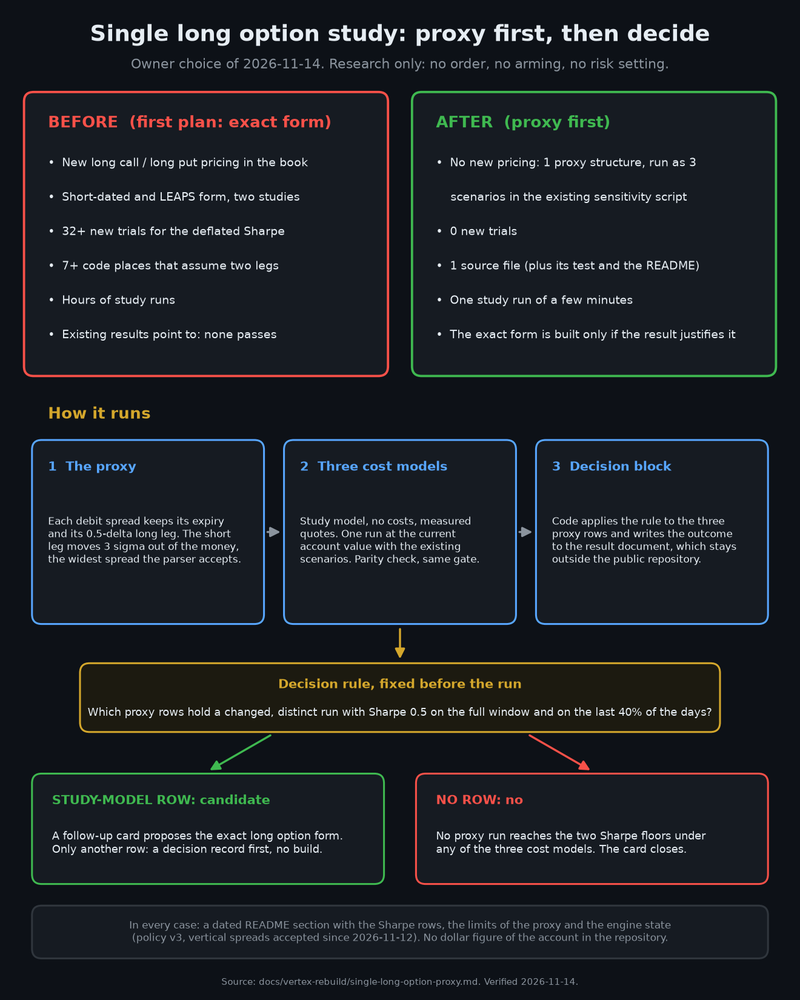
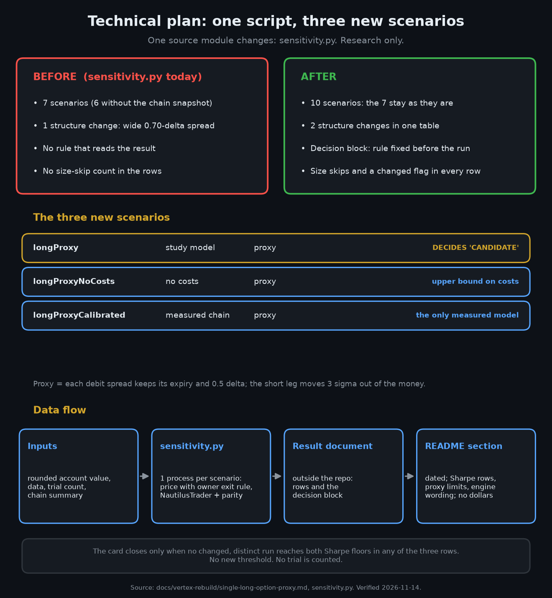

# Single long option proxy in the allocation sensitivity study

- **Author:** Jeff Scott Ward
- **Status:** Implemented. Study run on 2026-11-14: outcome `no` (see "Long option proxy" in `research/backtests/allocation/README.md`).
- **Date:** 2026-11-14
- **Card:** `vertex-single-long-option-form`



--------------------------------------------------------------------------------

## Overview

The allocation study of 2026-11-11 (`research/backtests/allocation/`) tested 19 library candidates and two hosts as vertical option spreads. None passed the gate. Its README names one gap: no study has tested the same strategies as single long options, because the research option book prices spreads only.

This design tests a stand-in for the long option before anyone builds the real pricing. It adds one proxy structure to the existing sensitivity script and runs it as three scenarios. In the proxy, every debit vertical keeps its own expiry rule and its 0.5-delta long leg, and its short leg moves 3 standard deviations out of the money, which is the widest spread the option parser accepts. The script runs once at the current account value, with the existing scenarios in the same run. A decision rule that is fixed before the run then says if the exact long option form is worth a second job.

The work is research only. It places no order, changes no risk setting and no order policy, and adds no option pricing code.

## Terms

- **Card**: the tracker item `vertex-single-long-option-form` that asked for this study.
- **Gate**: the checks of `allocation.gate_checks` (see "Gate" in the allocation README): at least 30 trades; Sharpe of 0.5 on the full window and on the last 40% of the days (the out-of-sample Sharpe); deflated Sharpe of 0.95; two Monte Carlo checks; max drawdown of at most 25%; Sharpe above the always-on baseline. The decision rule of this design reads the two Sharpe floors only.
- **Study model**: the option model of `options.py` without changes. It is the scenario `base` of the sensitivity script.
- **Proxy**: a debit vertical whose short leg is 3 standard deviations of the move to expiry away from the long strike (`widthSigma` 3).
- **Exact form**: real single-option pricing (`longCall`, `longPut`) in the option book. This design does not build it.
- **Distinct run**: a candidate row with role `strategy` whose equity curve is not equal to an earlier row of the same scenario (`duplicateOf` is empty). 16 of the 21 candidates have role `strategy`; all 16 hold debit verticals. The other five hold put credit verticals, which the proxy does not change.
- **Result document**: the JSON file that the script writes. It stays outside the repository.
- **Report**: the owner-facing summary built from the result document. It stays outside the repository.
- **Engine**: the live order-placing service on the execution host. Its order policy is the constant `ORDER_POLICY` in `infra/quant-vps/exec-node/runtime/nautilus/arm_gate.py`.

## The Problem

The owner wants to know if a library strategy does better as one long option than as a spread. Three facts shape the answer:

1. **The existing results point to "no" in the study model.** The best vertical candidate has a Sharpe of 0.42 in the study model; the gate needs 0.5. Under other option-model assumptions the best run reaches 0.52 to 0.82, but no run passes the whole gate in any of the 7 scenarios, including the no-cost scenario.
2. **The exact form needs code changes and adds permanent trials.** At least 7 code places assume two legs (source: the design review of the first plan, 2026-11-14). Each new run would count as a trial of the deflated Sharpe, which makes that check harder for every later study (61 trials are counted in the allocation study today).
3. **The reason for the card changed.** The card was written on 2026-11-11, when the engine refused spreads, so a single long option was the only form it could place. A read-only check of the execution host on 2026-11-14 (the deployed `ORDER_POLICY` and the environment of the trading container) shows order policy `options_only_defined_risk_v3` with the vertical-spread switch on since 2026-11-12. Calendar spreads are still refused.

The owner chose "proxy first, then decide" on 2026-11-14. The proposed solution: test the stand-in inside the existing diagnostic script, without raising the trial count of this study, and build the exact form only if the result justifies it.

## Goals

- Add one proxy structure to `research/backtests/allocation/sensitivity.py` and run it as three scenarios: under the study model, without costs, and under the measured chain snapshot.
- Run the script once for the study, at the current account value (rounded down to a multiple of 1,000). The owner set this capital on 2026-11-14 because the account is smaller than at the earlier study. The existing scenarios run in the same invocation, so the proxy rows are compared with the `base` rows of the same run.
- Keep the trial count of this study unchanged. The scenarios are diagnostics, as the existing scenarios are, and make no strategy eligible.
- Apply the decision rule below, which is fixed before the run.
- Record the result in a dated section of `research/backtests/allocation/README.md`, with the limits of the proxy and the engine state on the check date.

### Decision rule

The rule reads the three proxy scenarios. A run counts when it is a distinct run, when the proxy changed its definition, and when it reaches both Sharpe floors of the gate (the two "G4" checks that every row already carries).

| Outcome | Condition | What follows |
| --- | --- | --- |
| `candidate` | at least one run counts in the study-model scenario | A follow-up card proposes the exact form. The record shows the run's other gate checks, including the deflated Sharpe. |
| `no` | no run counts in any of the three scenarios | The card closes with: "no short-dated proxy run of an allocation candidate reaches the two Sharpe floors under any of the three cost models". |
| `model-dependent` | no run counts in the study-model scenario, and at least one counts in another | The card does not close by itself. A decision record shows the rows and their gate checks. The decision follows the rule for trading research questions (trading knowledge bases; no new threshold). |
| `incomplete` | no run counts in the scenarios that ran, and a proxy scenario is missing | The study run is repeated with `--chain`. |

The rule has this shape because the study model is the harshest of the three cost models and is still a model; the measured snapshot is the only evidence of prices one could trade at. A decision record of 2026-11-14 holds the answers of the trading knowledge bases behind this choice. It is kept with the job report, outside the repository.

## Non-Goals

- The exact form, a structure registry in `book.py`, long-option baselines or a trial ledger. They belong to a second job.
- A LEAPS proxy (365 days or more). A 30-day volatility index cannot price a 365-day option, and no long-dated quote is measured.
- A position-size table of real long options. It matters only when the exact form is built.
- Any change to the options-forms study (`research/backtests/options-forms/`).
- Any order, deployment request, preset, database row, arming or risk setting.
- Any change to the DSL contract, the TypeScript options engine, the go-live drafts, the order policy or `book.STRUCTURES`.
- A new gate threshold or a new trial.
- A dollar figure in the repository that reveals the account value.
- A claim that a proxy result makes a strategy eligible or placeable.

## Open Questions

- None.

## Critical User Journeys (CUJs)

### CUJ 1: No proxy run reaches the Sharpe floors

- **Given**: the data directory of the allocation study, the rounded current account value, the trial count and variance of `run.py`, and the chain snapshot summary.
- **When**: the operator runs `sensitivity.py` once with `--chain`.
- **Then**: the result document holds the seven existing scenarios and the three proxy scenarios, every run passes the parity check between the ledger and NautilusTrader, and `longOptionProxy.outcome` is `no`. The README gets the dated section. The card closes.

### CUJ 2: A proxy run reaches the Sharpe floors

- **Given**: the same inputs.
- **When**: a run counts in the study-model scenario (`candidate`), or only in another proxy scenario (`model-dependent`).
- **Then**: the README section states the outcome and that a proxy result makes no strategy eligible. For `candidate`, a follow-up card for the exact form is opened; that job decides how it counts the proxy look in its trials. For `model-dependent`, a decision record is written before anything is built.

### CUJ 3: A reader checks what the engine accepts

- **Given**: the allocation README.
- **When**: the reader looks for the reason the long option form was studied.
- **Then**: the new section states the engine state on 2026-11-14 (order policy `options_only_defined_risk_v3`, vertical-spread switch on since 2026-11-12, calendars refused) and marks the two older sentences about the refusal of spreads as the state on 2026-11-11.

## Technical Plan (Architecture)



### What exists

`research/backtests/allocation/sensitivity.py` runs every candidate of the allocation study again under named scenarios. A scenario is a small dict in `SCENARIOS`. Its keys change the option model of one worker process (`costs`, `skew`) or the option structure (`structure`). For the structure, `restructure(definition, scenario)` copies the strategy definition and merges an override into the `options` block of every debit vertical. One scenario uses it today: `realisticWideItm` (0.70 delta, 2 sigma wide). Each scenario runs in its own process, prices the trades with the owner exit rule (`allocation.owner_rule_trades`: a winner may run to expiry, a loser closes 3 days before expiry), runs them on NautilusTrader with the parity check (`run.nautilus_run`) and applies the gate checks. Runs with an identical equity curve inside one scenario are marked with `duplicateOf`.

### What changes

One source module changes: `sensitivity.py`. A test file, one line in the CI suite list and a README section come with it.

1. **Structure overrides become a table.** `restructure` looks the scenario's `structure` up in a table with the entries `wideItm` (values unchanged) and `longProxy` (`widthSigma` 3). An unknown name raises an error. A debit vertical keeps every key the override does not name, so the proxy keeps the candidate's own days to expiry (60/45 or 30/21) and its 0.5 delta. Credit verticals stay as they are. The override is inside the limits of `book.parse_options`; 3 is the maximum of `widthSigma`. The DSL normaliser (`nautilus_backtest.signals.normalize_definition`) does not check this value; a test runs the proxy block through `allocation.owner_rule_trades`.

2. **Three new scenarios.**

    | Scenario | Option model | Role |
    | --- | --- | --- |
    | `longProxy` | study model | decides `candidate` |
    | `longProxyNoCosts` | no commission, no spread | upper bound of the proxy on costs |
    | `longProxyCalibrated` | measured chain snapshot (needs `--chain`) | the only measured model (one snapshot day, monthly expiries 37 and 65 days out) |

3. **Row fields.** Every row gets `sizeSkips` (already computed by `run.run_stats`) and `restructured` (the proxy changed the definition).

4. **Decision block.** After the scenarios finish, a pure function applies the decision rule to the three proxy scenarios and writes `longOptionProxy` to the result document. It reads the check flags the rows already carry. It defines no threshold.

### Data flow

```text
 rounded account value          data dir, trials + variance of run.py, chain summary
          |                                        |
          v                                        v
   sensitivity.py --- one worker process per scenario (7 existing + 3 proxy) ---+
          |              restructure -> owner_rule_trades -> nautilus_run       |
          |              (parity check) -> gate checks                          |
          v                                                                     v
   decision block  <------------------------------------- rows per scenario and candidate
          |
          v
   result document (outside the repository): scenarios, longOptionProxy {outcome, runs}
          |
          +--> README section (Sharpe rows, proxy minus base, outcome, limits; no dollars)
          +--> report (outside the repository)
```

## Risks & Mitigations

| Risk | Effect | Mitigation |
| --- | --- | --- |
| The proxy is not a long option: it pays commission and half-spread on a second leg | Extra entry cost: at least the commission and the minimum half-spread of `options.py` per side | Stated in the README. The no-cost scenario removes it. |
| The 3-sigma width raises the max loss per contract (the worst closing cost of the book grows with the width) | Fewer contracts; a trade can fall from one contract to none. The effect on the Sharpe is not measured. | `sizeSkips` per row in the result document; the README compares the trade count of each proxy row with its `base` row. |
| Call and put side differ | For calls the short leg is near zero. For puts the skew prices the short leg higher, and it caps the crash payoff. A put proxy is skipped ("no strikes") when the short strike would be at or below zero; at 60 days this needs an at-the-money volatility of about 80%. | Stated in the README. One candidate (`futures-trend-carry`) holds put debit verticals. |
| The short leg collects the skew premium in the real spread; the proxy gives most of it up | The proxy result depends on the skew assumption | Stated in the README. The measured scenario uses measured skew slopes. |
| The at-the-money volatility level (a 30-day index for options of 21 to 65 days) is not varied by any scenario | A long option carries an error in that level in full, so a "no" holds for the study volatility level only | Stated in the README as an untested assumption. |
| The scenarios keep the trial count of `run.py` | The deflated Sharpe of a proxy row is overstated | Stated in the README. A proxy result makes no strategy eligible. |
| Published statistics depend on the capital through whole contracts | A reader could estimate the capital by running the public code at many capitals. The existing README tables have the same exposure. | Accepted. No dollar figure, contract count or skip count goes into the repository. |
| A scenario fails (parity check, chain file) | The script stops and writes no document | Fix the cause and run again. A second run keeps the rule text; the README records the reason for it. |
| The refactor of `restructure` changes an existing scenario | Wrong numbers under old names | The regression run of the implementation plan. |

## Alternatives Considered

The concept brief of 2026-11-14 and the review reports are kept with the job report, outside the repository.

### Alternative A: Build the exact short-dated form now

- **Pros**: it measures the real structure, with one leg and its own cost rule.
- **Cons**: at least 16 new trials that stay in every later deflated Sharpe; at least 7 code places that assume two legs must change (estimates of the first design review).
- **Reason for Rejection**: the cost is permanent and the existing results point to "no". The exact form comes back when the decision rule says `candidate`.

### Alternative B: Exact short-dated and LEAPS forms on both studies

- **Pros**: it answers the question for long-dated options too.
- **Cons**: at least 32 new trials; a 365-day option would be priced from a 30-day volatility index for 6 of the 7 core ETFs (SPY has a term structure to 182 days); no quote is measured beyond 65 days.
- **Reason for Rejection**: the LEAPS numbers would rest on a model without a measured quote.

### Alternative C: Stop and close the card

- **Pros**: no cost. The engine accepts vertical spreads since 2026-11-12.
- **Cons**: the gap named in the README stays open.
- **Reason for Rejection**: one run of a few minutes can close the gap.

### Alternative D: New pricing code for the proxy

- **Pros**: the stand-in could drop the second leg.
- **Cons**: it needs the same changes as Alternative A: new pricing code and the two-leg assumptions.
- **Reason for Rejection**: `sensitivity.restructure` already rewrites the options block of every debit vertical for a scenario.

### Alternative E: The proxy in the options-forms study too

- **Pros**: 36 more daily forms get a proxy row.
- **Cons**: one daily run takes about 55 minutes (its README); that study counts its runs as trials and has no scenario mechanism.
- **Reason for Rejection**: new code in a second study before the first result is known.

### Alternative F: A margin on the Sharpe floors, or a deflated-Sharpe trigger

- **Pros**: a run right at the floor is hard to tell apart from no edge.
- **Cons**: a margin is a new threshold. A deflated-Sharpe trigger at the trial count of the exact form needs a guessed count and a variance that does not exist yet.
- **Reason for Rejection**: the rule keeps the gate's own floors. A run that reaches them starts no build by itself: the record shows its deflated Sharpe check.

### Alternative G: The study run at the capital of the earlier study, or a second run at a large capital

- **Pros**: the proxy rows would sit beside the published tables at the same capital; a large capital separates the edge from affordability.
- **Cons**: the account is smaller now, and the owner set the current value as the capital.
- **Reason for Rejection**: the README shows the `base` rows of the same run beside the proxy rows, so the comparison is inside one run.

### Alternative H: A LEAPS proxy and a position-size table in this study

- **Pros**: a first look at long-dated options and at affordability.
- **Cons**: neither feeds the decision rule. The LEAPS put side drops out when the at-the-money volatility passes about 32%. The size table needs option pricing code, which this design excludes.
- **Reason for Rejection**: the design review and the trading knowledge bases (decision record of 2026-11-14) put both after the proxy result.

--------------------------------------------------------------------------------

## Detailed Implementation Plan

### Target Files to Create/Modify

#### 1. `research/backtests/allocation/sensitivity.py` (Modify)

- **Type / Scope**: Python study script (research only, no service, no database).
- **Proposed Changes**:
  - Replace the constant `WIDE_ITM` with the table `STRUCTURE_OVERRIDES = {"wideItm": {"longDelta": 0.7, "widthSigma": 2.0}, "longProxy": {"widthSigma": 3.0}}`. Why: two overrides need one lookup. The name differs from `book.STRUCTURES`, which is the registry of option structures.
  - `restructure(definition, scenario)`: a scenario without the key `structure` returns the definition object unchanged, as today. A known name merges a deep copy of its override into every `options` block whose structure ends in `DebitVertical` (the top-level block and each portfolio leg). An unknown name raises `ValueError` with the name. Why: a misspelled structure name must stop the run.
  - `SCENARIOS`: append after `calibrated`, in this order: `"longProxy": {"structure": "longProxy"}`, `"longProxyNoCosts": {"costs": "none", "structure": "longProxy"}`, `"longProxyCalibrated": {"costs": "measured", "structure": "longProxy"}`. The seven existing entries keep their names, order and content.
  - `PROXY_SCENARIOS = ("longProxy", "longProxyNoCosts", "longProxyCalibrated")`.
  - New function `scenario_names(chain: Path | None) -> list[str]`: the names of `SCENARIOS` in order, without the scenarios whose `costs` is `measured` when `chain` is `None`. `main` calls it. The help text of `--chain` becomes "summary.json of fetch_chain_snapshot.py (adds the scenarios with measured costs)".
  - `STAT_KEYS`: add `sizeSkips`.
  - `scenario_rows`: each row also gets `"restructured": made != item["definition"]`.
  - New constant `PROXY_RULE`: a short statement of the rule for the result document: one sentence for the counting condition and one per outcome (`candidate`, `no`, `model-dependent`, `incomplete`). The "What follows" column of the table above is described in this document and in the README, not in the constant.
  - New pure function `proxy_decision(scenarios: Mapping[str, Mapping[str, Mapping]]) -> dict`, where `scenarios` is the `scenarios` block of the result document. A private helper `_counts(row)` holds the counting condition: `role == "strategy"`, `duplicateOf is None`, `restructured` true (a row without the key counts as unchanged), and exactly two checks whose name starts with `"G4"`, both with `pass` true. For each name of `PROXY_SCENARIOS` that is present, `runs[name]` is the list, in row order, of `{"key", "sharpe", "oosSharpe", "deflatedSharpe", "failed"}` for the rows that count; `failed` lists the names of the row's other checks that did not pass. The rows of this script carry the gate checks without the baseline check (`al.gate_checks(stats, None)`), so `failed` never names it. `outcome` is `"candidate"` when `runs["longProxy"]` is not empty; else `"model-dependent"` when another list is not empty; else `"no"` when all three scenarios are present; else `"incomplete"`. It returns `{"rule": PROXY_RULE, "floors": {"sharpe": al.GATE["minSharpe"], "oosSharpe": al.GATE["minOosSharpe"]}, "scenarios": [names present], "runs": runs, "outcome": outcome}`. Why: the rule is applied by tested code, and it reuses the flags of `allocation.gate_checks` (finite value at or above the floor).
  - `main` writes `document["longOptionProxy"] = proxy_decision(document["scenarios"])` and, in `assumptions`, `"structures": STRUCTURE_OVERRIDES` in place of `"wideItm"` (no code reads that key).
  - Module docstring: the three proxy scenarios, the proxy structure with its four main differences from a long option (second-leg costs, larger max loss, capped profit, the skew premium), and a pointer to `PROXY_RULE`. The full list of limits is in the README section.

#### 2. `services/research/tests/test_allocation_sensitivity.py` (Create)

- **Type / Scope**: Unit tests, core lane (synthetic inputs; no network, no database). The script is loaded with `importlib.util.spec_from_file_location("allocation_sensitivity", <script>)` and registered under that name, as `test_idle_budget.py` loads its script. The import chain needs no NautilusTrader: `run.py` imports `strategies.qc_ports.nautilus_runner`, which loads the NautilusTrader classes on first use, and `test_idle_budget.py` imports `run` the same way in the core lane.
- **Proposed Changes**: test cases:
  - `restructure` with `longProxy`: a call and a put debit vertical keep `dte` and `longDelta` and get `widthSigma` 3.0; a put credit vertical is unchanged; portfolio legs are rewritten; the input definition is not mutated; two rewritten blocks do not share one override object.
  - `restructure` with `wideItm` gives `longDelta` 0.7 and `widthSigma` 2.0; an unknown structure name raises `ValueError`; a scenario without `structure` returns the same object.
  - The `longProxy` block of a debit candidate passes `book.parse_options`; a 30/21-day block (`ideas.HOST_CALL`) keeps its days to expiry. `allocation.owner_rule_trades` prices the library definition `gold-fed-model/B` (an always-on monthly roll of the GLD call vertical) with and without the proxy on synthetic market data (built with `pf.dataset_from_rows` and `tests.qc_ports_synthetic.trading_days`, as `test_idle_budget.py` does): same trades and long strikes, a wider spread, a higher entry price and max loss.
  - The proxy scenarios reuse the cost settings of `noCosts` and `calibrated`.
  - `scenario_names(None)` leaves out `calibrated` and `longProxyCalibrated` and keeps the order; `scenario_names(Path("x"))` returns all ten names. The seven existing `SCENARIOS` entries equal their literal values, and `sizeSkips` is in `STAT_KEYS` (added after the code review).
  - The expression behind the row flag `restructured`: `restructure(definition, proxy) != definition` is true for a definition with a debit vertical and false for a credit-only or option-free one. A second test runs `scenario_rows` with stubbed pricing and engine calls and reads the flag and `sizeSkips` from the rows.
  - `proxy_decision` on hand-built rows: `candidate`; `no` with three empty lists; `model-dependent` when only the no-cost or the calibrated scenario has a run; `incomplete` when a scenario is missing and nothing counts; a row is left out when it fails one G4 check, has no Sharpe value, is a duplicate, has another role, or has `restructured` false; `failed` lists the other failed checks. One test pins the two literal G4 check names of `allocation.gate_checks`.

#### 3. `services/research/tests/ci-suites.txt` (Modify)

- **Type / Scope**: CI suite list.
- **Proposed Changes**: append the path of the new test file, relative to `services/research`, as the last line of the file. Why: `scripts/ci/research-python.sh` stops when a test file is missing from this list.

#### 4. `research/backtests/allocation/README.md` (Modify)

- **Type / Scope**: Study documentation.
- **Proposed Changes**:
  - Files table: the `sensitivity.py` row names the long option proxy; a new row for the test file.
  - New section `## Long option proxy (<run date>)` after the sensitivity section, with:
    - the engine state and the method (the proxy, the three scenarios, the decision rule with its four outcomes, fixed in the commit that adds `proxy_decision`);
    - one table with a row per cost model and structure (`base`, `longProxy`, `noCosts`, `longProxyNoCosts`, `calibrated`, `longProxyCalibrated`, all of the same run): number of distinct strategy runs, runs at both Sharpe floors, median and best Sharpe, best out-of-sample Sharpe, best deflated Sharpe, runs that pass the gate;
    - one table of the distinct strategy runs: Sharpe and out-of-sample Sharpe under `base` and under `longProxy`, the change of the Sharpe, the proxy without costs, the Sharpe of the vertical and of the proxy in the measured model, and the trades;
    - the outcome and what the rows show;
    - the limits of the proxy (the risks table of this document) and what was not tested (from the Non-Goals);
    - a sentence that the capital is the rounded account value (not stated) and that these rows are not comparable with the tables of 2026-11-11.
  - Engine paragraph inside the new section: the engine state on 2026-11-14 as in CUJ 3, with the source (the deployed `ORDER_POLICY` and the container environment, read on that date).
  - The sentence in the sensitivity findings that starts "The engine's order policy (`options_only_defined_risk_v2`) refuses combos" and the sentence in the lower-bar pie section "the order policy refuses them today" each get the sentence `(State on 2026-11-11; see "Long option proxy".)` after them. The older text and tables do not change.

#### 5. `docs/vertex-rebuild/single-long-option-proxy.md`, `docs/assets/single-long-option-proxy-plan.png`, `docs/assets/single-long-option-proxy-technical.png` (Create; untracked in the working tree when this plan was approved)

- **Type / Scope**: this design document and its two pictures.
- **Proposed Changes**: after the study run, add the run date and the outcome under "Status". Neither picture holds a dollar figure.

No other file changes, including none under `services/research/strategies/`, `packages/`, `apps/`, `infra/` or `research/backtests/options-forms/`.

### Phases

Each phase leaves the tree buildable and tested.

1. **Code and tests** (one commit: files 1, 2, 3, and this document with its pictures). Check: from `services/research`, `python -m pytest` passes on the new test file, `services/research/tests/test_idle_budget.py` and `services/research/tests/test_qc_ports_allocation.py` (given as paths relative to `services/research`).
2. **Regression run** (no commit). On the rig, in the Python environment built from `services/research/requirements-nautilus-linux-py312.lock`:
    `python research/backtests/allocation/sensitivity.py --data <allocation work dir>/data --capital <capital of the stored result document> --trials 61 --trial-variance <trials.dailySharpeVariance of the stored results.json> --chain <allocation work dir>/chain/summary.json --out <temporary file>`.
    `<allocation work dir>` is the work directory of the allocation report of 2026-11-11 on the rig; it holds `data/`, `chain/summary.json`, `results.json` (with `capital` and `trials`) and `sensitivity.json`. Check: for each of the seven existing scenario names, every row of `scenarios.<name>` in the new file equals the row in the stored `sensitivity.json` on every key the stored row has (exact equality of the JSON values).
3. **Study run and documentation** (one commit: file 4 and the status line of file 5). Read the account value from the read-only portfolio monitor on the execution host (`infra/quant-vps/portfolio/`, snapshot `summary.NetLiquidation`) and round it down to a multiple of 1,000. Run the command of phase 2 with `--capital <rounded account value>` and `--out <job report dir>/sensitivity-long-proxy.json`. Check: exit code 0; ten scenario keys; `longOptionProxy.outcome` is not `incomplete`. Write the README section from the result document and build the report outside the repository.

### Verification Plan

- **Unit Tests**: the focused command of phase 1; the core lane of `scripts/ci/research-python.sh` in CI.
- **Static Analysis & Linting**: `bun run verify:prepush` (it runs on `git push`).
- **Regression of the existing scenarios**: phase 2.
- **E2E/Integration**: phase 3. Every run passes the parity check between the ledger and NautilusTrader (`run.nautilus_run` raises otherwise).
- **Acceptance**:
  - `git diff --name-only origin/vertex/rebuild-darkfactory-20260921...HEAD` lists the files of this plan only.
  - `sensitivity.py` counts no trial: the proxy scenarios use the `--trials` and `--trial-variance` values passed in, and `run.py` is unchanged.
  - `git grep -n -E "[0-9]{3},?000" -- docs/vertex-rebuild/single-long-option-proxy.md research/backtests/allocation/README.md` shows no account figure.
  - The outcome is recorded: the card is closed (`no`), a follow-up card exists (`candidate`), or a decision record exists (`model-dependent`).

--------------------------------------------------------------------------------

Drafted with EGM.
