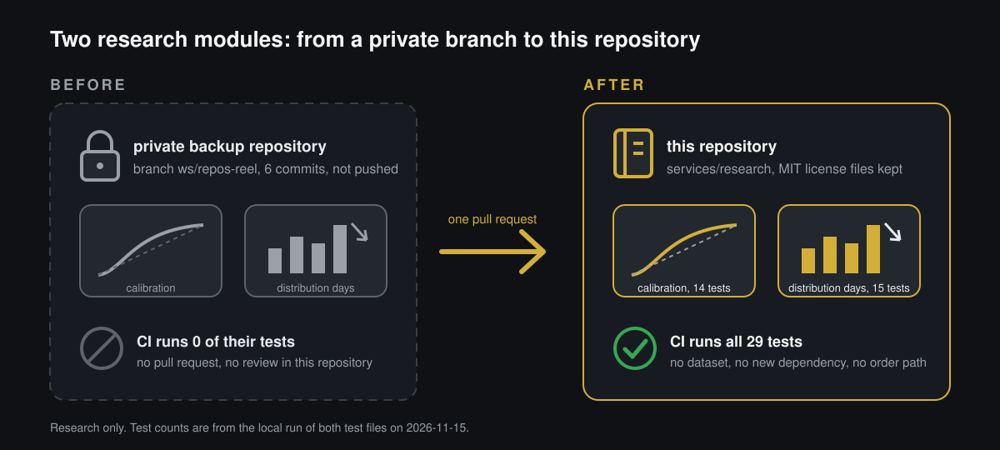
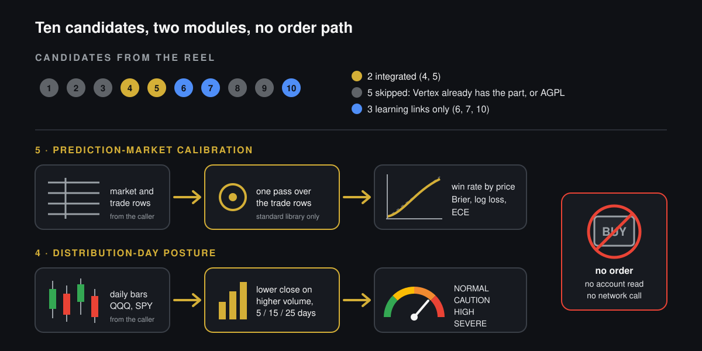

# Upstream candidates from reel DfDt0GDR8Oa: decisions and two research modules

* **Author:** Jeff Scott Ward
* **Status:** Approved (design review resolved 2026-11-15)
* **Date:** 2026-11-15





Scope: research only. Nothing here creates, sizes, sends or blocks an order.

--------------------------------------------------------------------------------

## Overview

The owner sent a short video (Instagram reel `DfDt0GDR8Oa`) that names ten open-source trading projects. The owner request of 2026-10-30 (tracker card `vertex-repos-reel`, private channel) was: evaluate the projects and integrate the worthwhile ones into Vertex Research (this repository's product) as modules. An evaluation on 2026-10-30 gave each project a decision: WORTH (Vertex takes a part of it) or SKIP. Two projects had a part that Vertex did not have:

* A calibration check for prediction markets (Kalshi and Polymarket): does a contract that trades at 30 cents win about 30% of the time?
* A distribution-day count for index funds: how many recent sessions closed lower on higher volume, and what market-risk level that count gives.

Both parts were written as Python research modules with tests on 2026-10-30, in a checkout of the private repository `vertex-research`. That repository was the development repository until 2026-11-04. Since then, development is in this public repository, and the private repository is a read-only backup with unrelated history ([`ci-cutover.md`](ci-cutover.md)). The two modules were never pushed, so they are in neither repository's remote, in no pull request and in no CI run.

This document records the ten decisions and plans the move of the two modules into this repository. The move adds the two modules, their tests, the upstream license files and the CI registration. It does not add a data download, a new dependency, a user interface or an order path.

## The Problem

State before this change:

* The decisions for the ten projects, with their reasons and pinned commits, are not in this repository. A later request about the same projects would repeat the evaluation.
* The owner asked for the worthwhile parts as Vertex modules. The two modules exist only as six local commits on the branch `ws/repos-reel` of one private checkout. They are not reviewed in this repository, and a disk fault or a worktree cleanup would lose them.

## Goals

* The decision (WORTH or SKIP) for each of the ten projects is in this repository, with the license, the pinned commit and the reason.
* The prediction-market calibration module and the distribution-day module are in `services/research` with their upstream MIT license files.
* The CI step `scripts/ci/research-python.sh` runs every test of both modules. Acceptance: pytest reports 31 passed and 0 skipped for the two test files, neither test file contains a skip marker or `importorskip`, and the completeness check of the CI script passes.
* Each module docstring states that the module reads only what the caller passes in: no order, no account read, no network call.
* The six private commits, which include the Parquet reader that this change leaves out, are kept in a second place (a git bundle in the owner's private report store).

## Non-Goals

* No download of the prediction-market dataset (36 GiB compressed). The owner answered "Later" on 2026-10-30 (private channel; tracker card `vertex-prediction-market-dataset-run`).
* No DuckDB dependency and no Parquet reader ([Alternative A](#alternative-a-add-the-duckdb-parquet-reader-now)).
* No wiring of either module to a data feed, a timer, an API route or a page.
* No exposure advice. The upstream distribution-day skill recommends a leveraged-fund exposure; that recommendation is a trading action and is not adapted.
* No new rows in the Vertex Papers library in this change ([Future Improvements](#future-improvements)).

## Open Questions

* **Dataset rights**: the upstream code is MIT, but the pre-collected dataset has no license statement and holds venue data (Kalshi API data and Polymarket chain events). This change ships no data and no download, so the question does not block it. A rights check is the first step of the dataset run and gates any download (tracker card `vertex-prediction-market-dataset-run`).

## Critical User Journeys (CUJs)

### CUJ 1: A researcher scores the calibration of a venue

* **Given**: An iterable of market rows and an iterable of trade rows for Kalshi or Polymarket, in the upstream column names (see [Prediction-market calibration](#prediction-market-calibration)).
* **When**: The caller runs `kalshi_calibration(markets, trades)` or `polymarket_calibration(markets, trades)`.
* **Then**: The result (`CalibrationReport`) holds the win rate for each price from 1 to 99 cents that has a position, the Brier score, the log loss, the expected calibration error (ECE), the number of skipped trade rows and the number of positions outside 1 to 99 cents.

### CUJ 2: Empty or mis-joined input

* **Given**: Rows where no trade belongs to a resolved market.
* **When**: The caller runs one of the two calibration functions.
* **Then**: `CalibrationReport.available` is `False` and the three scores are `None`. The result cannot be read as a perfect score.

### CUJ 3: A researcher reads the market posture of an index fund

* **Given**: Daily bars (date, high, close, volume) for QQQ and SPY, one bar for each session, oldest first, supplied by the caller.
* **When**: The caller runs `index_posture` for each symbol and `combine_index_risks` on the two results.
* **Then**: Each result holds the active distribution days within 5, 15 and 25 sessions, the moving-average filter and a level NORMAL, CAUTION, HIGH or SEVERE. The combined level follows the upstream policy.

### CUJ 4: Bars in the wrong order

* **Given**: Fewer than two bars, or bars that are not in strictly increasing date order.
* **When**: The caller runs `index_posture`.
* **Then**: The module raises `DistributionDayError`.

### CUJ 5: Short history or a bad bar

* **Given**: Fewer than 50 bars, or a bar with a missing, non-finite or non-positive close or volume.
* **When**: The caller runs `index_posture`.
* **Then**: The result still has a level. `audit_flags` holds `insufficient_lookback` for a short history and `insufficient_data_for_moving_average` when an average is unknown (a short history, or a bad close within the last 50 sessions), and `skipped_dates` lists each day pair that was not evaluated. The reader must not take a NORMAL level with a flag as a full-history result.

## Technical Plan (Architecture)

### Method of the evaluation (2026-10-30)

* Sources: the reel audio transcript (five repositories) and the reel caption (five learning links). Two names in the audio were ambiguous. The video frames show the exact repositories: candidate 3 is `himself65/finance-skills` and candidate 5 is `Jon-Becker/prediction-market-analysis`.
* For each repository, the GitHub API supplied stars, license, last push and the default-branch commit on 2026-10-30. The README was read. For the two WORTH repositories, the adapted source files were read at the pinned commit.
* Overlap checks covered `services/research` (Python) and `packages/api/src` (TypeScript).
* Integration rules: adapt only the missing parts. Keep the upstream license file next to the adapted module. The caller passes all input in. Do not import a vendor SDK in domain code. Do not add an order path. AGPL code stays out of Vertex source.

### Decisions

Decision values: WORTH means Vertex takes a part of the project; for both WORTH rows the part was written on 2026-10-30 and moves into this repository with this change. SKIP means nothing is taken. "Library link" marks learning material that is a candidate link for the Vertex Papers library (the list of papers and articles on the Papers page of the portal). Stars and last push are the values read on 2026-10-30.

| # | Repository | License | Stars | Last push | Pinned commit | Decision | Reason |
| --- | --- | --- | --- | --- | --- | --- | --- |
| 1 | [OpenByteInc/QuantDinger](https://github.com/OpenByteInc/QuantDinger) | Apache-2.0 (backend; the frontend is source-available) | 13.3k | 2026-10-29 | `6a073893` | SKIP | Vertex has the parts that it would use: `services/research/backtesting/optimizer.py` (grid, random, tree-structured Parzen estimator (TPE), evolution and NSGA-II (a multi-objective genetic search), walk-forward, probability of backtest overfitting, deflated Sharpe) and `packages/api/src/backtest-analytics.ts` (block bootstrap, Monte Carlo, `probabilityOfProfit`, `riskOfRuin`). The rest is a full trading system (Flask, Redis, Kafka, live brokers). |
| 2 | [TraderAlice/OpenAlice](https://github.com/TraderAlice/OpenAlice) | AGPL-3.0 | 7.4k | 2026-10-24 | `57b2f811` | SKIP | It duplicates the Vertex research agents, research chat and Todos, and it covers position entry and exit. AGPL code could run only as a separate network service, and the evaluation found no missing capability that needs that service. |
| 3 | [himself65/finance-skills](https://github.com/himself65/finance-skills) | MIT | 3.5k | 2026-10-25 | `a0850786` | SKIP | Most skills are prompts that call yfinance, social readers or paid APIs. Vertex uses its own licensed providers. A possible later adaptation is `stock-liquidity` (Amihud ratio, spread estimates) as an indicator. |
| 4 | [tradermonty/claude-trading-skills](https://github.com/tradermonty/claude-trading-skills) | MIT | 3.5k | 2026-10-26 | `c9b84196` | WORTH (one skill) | The distribution-day monitor fills a gap: Vertex had no distribution-day signal. Not taken: the journal and weekly digest (`tradeStats` in `backtest-analytics.ts` and `forward-drift.ts` already give profit factor, expectancy and win rate), screeners that need a paid data API, and the leveraged-fund exposure policy. |
| 5 | [Jon-Becker/prediction-market-analysis](https://github.com/Jon-Becker/prediction-market-analysis) | MIT (code); the dataset has no separate license | 3.9k | 2026-10-29 | `2d69f733` | WORTH (calibration logic) | Vertex had no prediction-market data logic. The pre-collected Polymarket and Kalshi dataset is 36 GiB compressed. |
| 6 | [jpmorganchase/python-training](https://github.com/jpmorganchase/python-training) | Apache-2.0 | 14.3k | 2026-10-23 | `0c536090` | SKIP (library link) | Python and pandas course notebooks; learning material only. |
| 7 | [quantopian/research_public](https://github.com/quantopian/research_public) | none stated | 2.9k | 2020-11-03 | `e183ecd0` | SKIP (library link) | Lecture notebooks that need the retired Quantopian platform. No license is stated, so no code is copied. |
| 8 | [mhallsmoore/qstrader](https://github.com/mhallsmoore/qstrader) | MIT | 3.5k | 2024-06-30 | `4c59e158` | SKIP | It duplicates the Vertex backtest engines. No push since 2024. |
| 9 | [optuna/optuna](https://github.com/optuna/optuna) | MIT | 15.0k | 2026-10-30 | `fffa3cdb` | SKIP | `services/research/backtesting/optimizer.py` uses only the standard library and already has the search methods named in row 1. Optuna would add a second optimizer convention. |
| 10 | [firmai/financial-machine-learning](https://github.com/firmai/financial-machine-learning) | none stated | 8.8k | 2025-01-03 | `a0fda6ac` | SKIP (library link) | Curated link list; learning material only. |

### Parts and placement

| Part | File | Imports |
| --- | --- | --- |
| Prediction-market calibration | `services/research/providers/prediction_markets.py` | Python standard library only |
| Distribution-day posture | `services/research/strategies/distribution_days.py` | Python standard library and the first-party [`indicators`](../../services/research/indicators/core.py) package (`ema`, `sma`) |

`providers` is the package for the row shapes and rules of external data sources ([`ports.py`](../../services/research/providers/ports.py)). The calibration module holds the row rules of the two venues, so it is placed there ([Alternative E](#alternative-e-put-the-calibration-module-in-analytics)).

`strategies` holds the native research sleeves ([`__init__.py`](../../services/research/strategies/__init__.py)) and also the rule modules over market series, for example `strategies/sma_timing.py` (a moving-average market-timing rule) and `strategies/regime_flags/` (regime flags over daily closes). The distribution-day module is a rule of the second kind: it returns a dated event list and a level, not one value for each bar ([Alternative G](#alternative-g-put-the-distribution-day-module-in-indicators)).

Neither package `__init__.py` is changed or re-exports the new modules; a caller imports the module by name. Both modules are offline library code of the research package, which is the Python research exception of [`AGENTS.md`](../../AGENTS.md); no web route or second control API is added.

### Prediction-market calibration

* Upstream sources adapted: `src/analysis/kalshi/win_rate_by_price.py` and `src/analysis/polymarket/polymarket_win_rate_by_price.py` at commit `2d69f7330fdee142d2cf75d901841f9174fdbbd2`.
* Input: plain iterables of row mappings that the caller passes in. The columns are the upstream columns:
  * Kalshi markets: `ticker`, `status`, `result`. Kalshi trades: `ticker`, `yes_price`, `no_price` (integer cents), `taker_side`.
  * Polymarket markets: `closed`, `outcome_prices` and `clob_token_ids` (each a JSON list of two values). Polymarket trades (`OrderFilled` rows of the Conditional Token Framework, CTF): `maker_asset_id`, `taker_asset_id`, `maker_amount`, `taker_amount` (integers).
* No named port type is defined. The first version had a four-method protocol (`PredictionMarketRows`) whose only implementer was the Parquet reader that this change leaves out; the design review removed it. The two entry functions take the iterables directly.
* Order and memory: each function reads the markets iterable fully, then the trades iterable once. It holds one map entry for each resolved Kalshi market or two for each resolved Polymarket market, plus one counter pair for each price (at most 99). Trades and positions are not held.
* Kalshi: a market counts when its status is `finalized` and its result is `yes` or `no`. Each trade on such a market gives two positions: the taker at the taker-side price and the maker at the other price.
* Polymarket: a closed two-outcome market counts as resolved when one outcome price is above 0.99 and the other is below 0.01. Each trade row gives the buyer's position at `100 * usdc_amount / token_amount` cents and the counterparty's position at 100 minus that value. Each side is rounded half away from zero after the multiplication, which is the behavior of DuckDB `ROUND` in the upstream SQL. At an exact half cent the two sides therefore sum to 101 (30.5 gives 31 and 69.5 gives 70), as upstream. Rows are not de-duplicated, as upstream.
* Unit: one trade gives two positions. `total_trades` (the upstream column name) counts positions, so the curve is mirror-symmetric by construction. Each position has weight 1; contract count and notional are not used.
* Scores: the forecast of a position is its price divided by 100 and the outcome is whether the position won. The Brier score is the mean squared difference, the log loss is the mean negative log likelihood, and the ECE is the mean absolute difference between win rate and price over the price buckets, weighted by positions. The log loss clips the probability to 0.000001 from 0 and 1, as upstream. The three scores are rounded to 4 decimals.
* Output: `CalibrationReport` with one bucket (`PriceBucket`) for each price from 1 to 99 cents that has a position (`price_cents`, `total_trades`, `wins`, `win_rate_pct` in percent), `total_trades`, the three scores, `skipped_rows`, `out_of_range_positions` and the property `available`.
* Row contract:
  * Counted in `skipped_rows`: a Kalshi trade on a resolved market with a taker side other than yes or no, or with a missing, fractional or unreadable price; a Polymarket trade with a missing, fractional, unreadable or non-positive amount, or with amounts too large for a 64-bit float; a trade row with another value that cannot be read (for example a number with more digits than the interpreter converts). Polymarket amounts are checked before the token join. The two calibration functions always count; a direct call of `kalshi_positions` or `polymarket_positions` counts only when the caller passes the optional `skipped` argument.
  * Left out without a count: a market row that is not resolved or cannot be parsed (as upstream), a market row without a ticker or with a value that cannot be read, a trade without a ticker or token id, and a trade on a market or token that is not resolved (the inner join of the upstream SQL). A missing join key is `None` or NaN; it never joins.
  * Counted in `out_of_range_positions`: a position with a price outside 1 to 99 cents.
  * Value contract: the values are the scalars that a JSON or row reader gives (text, numbers, booleans, null) and two-item lists for the two Polymarket list fields. Each row is read inside one guard: a row with a value that cannot be read is skipped, so a bad scalar does not stop the run. The tests cover missing, fractional, boolean, infinite, oversized and unreadable values. A number is read only from an integer, a float without a fraction or a string of digits. Other value types (for example arrays) are outside the contract.
* Deviations from upstream:
  * A Kalshi trade with an invalid taker side is skipped and counted. Upstream counts it: with a missing taker side both sides are losses, and with another value the taker loses and the maker wins. A Kalshi trade with a missing price is also skipped and counted; the upstream analysis stops on it.
  * Two market rows for one Kalshi ticker give one resolution entry (the later row). The upstream SQL join gives the positions of each trade once for each market row.
  * Prices outside 1 to 99 cents are left out for both venues. Upstream keeps them in the Kalshi table and leaves them out of its chart and of the Polymarket table.
  * Empty input gives `None` scores. Upstream gives 0.0.
* Not adapted: legacy fixed-product-market-maker (FPMM) trades of 2020 to 2022, the collectors (venue API and blockchain) and the charts.

### Distribution-day posture

* Upstream sources adapted: `skills/ibd-distribution-day-monitor/scripts/distribution_day_tracker.py`, `risk_classifier.py`, `models.py`, the moving-average filter and its audit flag of `ibd_monitor.py` and the `insufficient_lookback` flag of `history_utils.py` at commit `c9b84196a44a56a553293114fdae1f30bdd08c58`. "IBD" is Investor's Business Daily, the publisher of the distribution-day method. The rule version is `ibd_dd_v1.0`.
* Input: daily bars with an ISO 8601 date (`YYYY-MM-DD`), high, close and volume, one bar for each session, oldest first. The module cannot detect a session without a bar; the comparison then spans the gap.
* Rule: a distribution day closes at least 0.2% lower than the prior close on higher volume. It stops counting when a later high reaches 5% above its close, or when it is older than 25 sessions.
* Bad bars: a day pair is not evaluated when the close or volume of either of its two bars is missing, not finite or not positive. The date of the later bar of the pair is listed in `skipped_dates`. One bad bar therefore removes two day pairs.
* Moving-average filter: `market_below_ma` is true when the close is not above the 21-session exponential average and not above the 50-session simple average (as upstream; `close_above_ema` and `close_above_sma` hold the two comparisons). The periods are the parameters `ema_period` and `sma_period` of `index_posture`. The averages use the trailing run of valid closes. `market_below_ma` is `None` when an average is unknown: that run is shorter than the period, because the history is short or a close within the last 50 sessions is bad.
* Level from the counts of active distribution days within 5, 15 and 25 sessions (`d5`, `d15`, `d25`), first match from the top:

  | Level | Default condition |
  | --- | --- |
  | SEVERE | `d25` ≥ 6, or `d15` ≥ 4, or `market_below_ma` is true and `d25` ≥ 5 |
  | HIGH | `d25` ≥ 5, or `d15` ≥ 3, or `d5` ≥ 2 |
  | CAUTION | `d25` ≥ 3 |
  | NORMAL | otherwise |

* Short history: `audit_flags` uses the upstream flag names. `insufficient_lookback` is set for fewer than 50 bars (the larger of the two average periods and the expiry window plus 2). `insufficient_data_for_moving_average` is set when an average is unknown; the moving-average SEVERE condition is then off.
* Result fields: `IndexPosture` holds `symbol`, `as_of` (the date of the last bar), `is_distribution_day_today`, the three counts, the three filter values, `risk_level`, `distribution_days`, `skipped_dates`, `audit_flags` and `rule_version`. Each `DistributionDay` holds `date`, `age_sessions`, `close`, `pct_change`, `volume_change_pct`, `high_since`, `invalidation_price`, `invalidation_date`, `status` (active, invalidated or expired) and `expires_in_sessions`.
* Errors: `DistributionDayError` for fewer than two bars (`index_posture`), bars out of order or with equal dates (`distribution_days` and `index_posture`), an invalidation source other than `high` or `close`, an empty list or an unknown level in `combine_index_risks`, and a symbol that appears twice.
* `combine_index_risks` gives one level for a set of index results with the upstream policy, in this order: any SEVERE gives SEVERE; QQQ HIGH gives HIGH; QQQ NORMAL with SPY HIGH gives HIGH; QQQ CAUTION with SPY CAUTION or HIGH gives HIGH; otherwise the highest level. The symbols `QQQ` and `SPY` are matched exactly; any other symbol takes part only in "any SEVERE" and "the highest level".
* Configuration: `DistributionDayRule` and `RiskThresholds` keep the fields and defaults of upstream `models.py`. The defaults are the rule `ibd_dd_v1.0`. One test and the differential run cover a non-default value.
* Deviations from upstream: the moving averages use the trailing run of valid closes, so a bad bar that is older than the average period does not make the filter unknown. The averages are not bit-identical with the upstream functions, so a close that is equal to an average can compare differently. A close, volume or high that is not finite is a bad value; upstream rejects only a missing or non-positive value. Input checks raise `DistributionDayError` where upstream gives a result (one bar) or fails later (an unknown invalidation source or level). A symbol may appear only once in `combine_index_risks`. `insufficient_lookback` does not use the upstream fetch window of 80 sessions.
* Not adapted: the paid data client, caching, the Japanese report text and the leveraged-fund exposure recommendation.

### Check against the upstream code (2026-11-15)

The upstream code at the two pinned commits was run outside CI on generated rows and bars and compared with the two modules:

| Check | Cases | Result |
| --- | --- | --- |
| Kalshi buckets, rows with valid taker sides | 4,000 trades | equal |
| Kalshi buckets, rows with invalid taker sides | 4,000 trades | differs only by the stated deviation (the difference is rebuilt exactly from the skipped rows) |
| Polymarket buckets and the three scores, clean rows and rows with bad markets and amounts | 2 × 4,000 trades | equal |
| Distribution days (date, age, status, invalidation date, expiry), counts and skipped dates, with bad bars, both invalidation sources | 3,000 bar series, 17,339 distribution days | equal |
| `classify_risk` | 1,536 count combinations | equal |
| `combine_index_risks` | 120 symbol and level combinations | equal |
| Moving-average filter | 1,500 bar series | equal |

This check shows that the modules follow the upstream code at the pinned commits on generated data. It does not track later upstream changes, and it does not test real dataset rows. The generated amounts are integers up to 1,000,000; the price is a 64-bit floating-point division, and amounts above 2^53 are not checked.

### Licenses and notices

This change adds:

* The upstream MIT license text next to each module: `services/research/providers/PREDICTION_MARKET_ANALYSIS_LICENSE.txt` and `services/research/strategies/TRADERMONTY_LICENSE.txt`. This is the convention of the existing [`services/research/backtesting/AI_HEDGE_FUND_LICENSE.txt`](../../services/research/backtesting/AI_HEDGE_FUND_LICENSE.txt). Both files are byte-identical to the upstream `LICENSE` at the pinned commit.
* Both license files as package data in [`services/research/pyproject.toml`](../../services/research/pyproject.toml), so a built package ships them.
* One entry for each module in [`services/research/NOTICE.txt`](../../services/research/NOTICE.txt) and in the repository root [`NOTICE`](../../NOTICE), which lists the adapted third-party sources of the product.
* One row for each module in [`docs/upstream-modules.md`](../upstream-modules.md).

### CI registration

[`scripts/ci/research-python.sh`](../../scripts/ci/research-python.sh) reads [`services/research/tests/ci-suites.txt`](../../services/research/tests/ci-suites.txt), a flat list of test files, and runs them with pytest in a virtual environment built from the hash-pinned requirements file `services/research/requirements-linux-py312.lock` (pytest, pydantic, tzdata). The script stops when a `test_*.py` file under `services/research` is missing from the list. Other lists and lock files exist for optional backends; each of them is one more CI run.

This change adds both new test files to `ci-suites.txt`. They need only the existing lock, so no new lock file and no new CI run is added. The distribution-day module itself imports only the standard library and `indicators`, but an import of `strategies.distribution_days` also runs `strategies/__init__.py`, which loads the other strategy modules; those need pydantic.

## Alternatives Considered

### Alternative A: Add the DuckDB Parquet reader now

* **Pros**: The calibration module could read the upstream dataset layout on the first day the dataset exists.
* **Cons**: DuckDB is not a dependency of this repository. The reader's two tests skip when DuckDB is missing, so CI would not run them unless a new hash-pinned lock and a new CI run are added. No caller exists, because the dataset download is deferred.
* **Reason for Rejection**: A dependency, a lock file and a CI run for code without a caller and without data conflicts with rule 12 of [`AGENTS.md`](../../AGENTS.md) ("No speculative infrastructure"). The reader (64 lines, commit `cfacaf06` of the private branch, file `prediction_markets_parquet.py` in the `providers` package) is kept in the git bundle and is added with the dataset run.

### Alternative B: Leave both modules outside this repository until a caller exists

* **Pros**: No change in this repository. No code without a caller.
* **Cons**: The request to integrate the worthwhile parts as modules stays open. The modules stay outside review and CI.
* **Reason for Rejection**: The owner request is the current requirement for the two modules. The cost is small: two modules of about 250 lines each, two test files, two license files and five registration edits; no dependency, lock file, CI run, service, table or route. The modules are the stated exception to "code without a caller", limited by the gate in [Risks & Mitigations](#risks--mitigations).

### Alternative C: Run the upstream projects as separate services

* **Pros**: No adapted code to maintain.
* **Cons**: The prediction-market project needs DuckDB, its collectors and the 36 GiB dataset. The distribution-day skill needs a paid data API key. Each would be a new service, credential and failure mode.
* **Reason for Rejection**: Each needed part is under 300 lines of logic without input or output, and both upstream licenses (MIT) allow an adaptation with attribution.

### Alternative D: Write the two modules in TypeScript in `packages/api`

* **Pros**: They would be callable from oRPC services without a Python process.
* **Cons**: Offline research logic and its market-data helpers (`indicators`) are in `services/research`. A TypeScript version needs its own moving averages or a second indicator convention, and no oRPC caller exists.
* **Reason for Rejection**: The research package is the home of offline research rules. A contract and a TypeScript caller are designed when a feature needs the result.

### Alternative E: Put the calibration module in `analytics`

* **Pros**: Calibration scores are analysis, and `analytics` holds research analysis.
* **Cons**: `analytics` is the cross-asset risk report over one port (`SeriesAnalytics`) with its own command. The calibration module mainly holds the row rules of two venues, which is what `providers` holds.
* **Reason for Rejection**: The venue row rules are the larger part of the module, and a split into two packages would separate 250 lines that change together.

### Alternative F: Land only the decision record and archive the six commits

* **Pros**: The smallest change. The decision record answers the question of which projects Vertex uses, and a bundle protects the work against loss.
* **Cons**: The two modules stay outside review and CI, and a later change to `indicators` could break the distribution-day module without a failing check when it is taken out of the archive.
* **Reason for Rejection**: It does not deliver the requested modules. The bundle is made anyway, because it also protects the reader that Alternative A leaves out.

### Alternative G: Put the distribution-day module in `indicators`

* **Pros**: The module is derived from daily bars, like the indicators.
* **Cons**: Every function in `indicators` takes plain number sequences and returns a list aligned to the input. The distribution-day module returns dated events, counts and a classified level, and it raises on bad input order.
* **Reason for Rejection**: The result is a rule output, like `strategies/sma_timing.py` and `strategies/regime_flags/`, not a series.

### Alternative H: Push the branch `ws/repos-reel` to the private repository

* **Pros**: The six commits would be on a remote.
* **Cons**: [`AGENTS.md`](../../AGENTS.md) defines the private repository as a read-only backup since 2026-11-04. A push would make it a second place of development.
* **Reason for Rejection**: A git bundle gives the same protection without a write to the backup repository.

## Risks & Mitigations

| Risk | Mitigation |
| --- | --- |
| The calibration module was tested only with generated rows. Real dataset rows can have shapes that the tests do not cover. | A bad scalar value does not stop the run; bad trade rows are counted, and the result reports `available = False` when nothing joins. A run on the real dataset is a later work item ([Future Improvements](#future-improvements)). The module docstring states this test status. |
| Dataset rights are unknown ([Open Questions](#open-questions)). | This change ships no data and no download. The module docstring states the rights status. A rights check gates the dataset run. |
| A reader takes the posture level as a trading instruction, or takes a level from a short history as a full result. | The module returns a description only; its docstring says that the result is not an order, an exposure change or a trading authorization. The exposure recommendation of the upstream skill is not adapted. `audit_flags` marks a short history (CUJ 5). |
| The adapted rules do not follow later upstream changes. | Accepted. The docstrings and this document pin the upstream commits; the check against the upstream code was made once at those commits. Upstream changes are not tracked. |
| Code without a caller stays unused. | The scope is two modules without input or output, with tests. The calibration module has a decision gate: when the owner decides about the dataset download (tracker card `vertex-prediction-market-dataset-run`), the module gets its reader and first run, or it is removed in the same change. The distribution-day module gets its caller with the posture item in [Future Improvements](#future-improvements). |
| The six private commits are lost. | A git bundle of `ws/repos-reel` (commits `cfacaf06` to `a7a0ad68`) is in the owner's private report store. The pull request diff is the source of truth for the moved files. |

## Non-Functional Requirements

* **Security and privacy**: no secret, account data, network call or file write. The modules read only the rows and bars that the caller passes in. A test checks the imports of each module.
* **Performance**: see "Order and memory" above for the calibration module. The distribution-day module reads each bar once for detection; for each distribution day it also reads the bars since that day (`high_since`) and at most 25 bars for invalidation. No performance target is set, because no runtime uses the modules.
* **Rollout and rollback**: no runtime uses the modules. A revert of the merge commit removes them.

--------------------------------------------------------------------------------

## Additional Resources

* [`docs/upstream-modules.md`](../upstream-modules.md): the list of integrated upstream modules.
* [`AGENTS.md`](../../AGENTS.md): repository rules (research-only default, no speculative infrastructure, the Python research exception).
* [`ci-cutover.md`](ci-cutover.md): the public repository, the private backup and the scan steps for work that moves between them.
* Upstream: [prediction-market-analysis](https://github.com/Jon-Becker/prediction-market-analysis), [claude-trading-skills](https://github.com/tradermonty/claude-trading-skills).

## Future Improvements

Tracker cards are entries of the owner's work tracker; the card id is the reference.

* **Dataset run** (card `vertex-prediction-market-dataset-run`): check the dataset rights, download the dataset, add the DuckDB Parquet reader with a pinned lock and a CI run, and run the calibration on real rows. Starts when the owner asks for the download.
* **Posture on real bars**: feed `index_posture` with daily QQQ and SPY bars (for example from [`ibkr_history.py`](../../services/research/providers/ibkr_history.py)) and show the level with its audit flags on a research page.
* **Library links** (card `vertex-repos-reel-library-links`): add the three learning links (candidates 6, 7 and 10) to the Vertex Papers library. The route that adds a row needs an operator session.

--------------------------------------------------------------------------------

## Detailed Implementation Plan

Starting state: the base branch `vertex/rebuild-darkfactory-20260921` has none of the created files. Source of the six files under `services/research`: the private branch `ws/repos-reel` at commit `a7a0ad686b8e` (tip of the six commits; local checkout of `vertex-research`, archived as a git bundle). The private branch is provenance only; the reviewed pull request diff is the source of truth. This plan lists every difference from that source. Nothing changes in the private repository.

The change has two phases. Each phase leaves the CI script green. Fixes from the code review are further commits on the same branch.

### Phase 1: modules, licenses, tests and CI registration

Checkpoint: the unit test command and the CI script of the [Verification Plan](#verification-plan) pass.

#### 1. `services/research/providers/prediction_markets.py` (Create)

* **Type / Scope**: Python module, standard library only.
* **Proposed Changes**: Take the source file and make these changes:
  * Remove `Venue`, `PredictionMarketDataError`, `PredictionMarketRows` and `venue_calibration`.
  * Add `kalshi_calibration(markets, trades)` and `polymarket_calibration(markets, trades)`. Each builds the resolution map, streams the positions into `calibration_by_price` and returns the report with `skipped_rows` set.
  * `kalshi_resolution`: leave out a row without a ticker (no `KeyError`).
  * `_int_or_none`: return an `int` only for a whole number (an integer type, a float without a fraction or a string of digits); return `None` for every other value (missing, boolean, fractional, infinite, unreadable text or another type).
  * `_json_pair`: accept only a JSON string, a list or a tuple with two items.
  * A missing ticker, asset id or token id (`None` or NaN) never joins (it is not turned into text). Each market row and each trade row is read inside one guard (`_ROW_ERRORS`): a trade row that cannot be read is skipped and counted, and a market row that cannot be read is left out.
  * Docstrings: state the unit (positions), the weighting, the rounding at a half cent, the row contract, the deviations from upstream and the test status.
* Public classes and functions after the change: `Position`, `SkippedRows`, `PriceBucket`, `CalibrationReport`, `kalshi_resolution`, `kalshi_positions`, `polymarket_token_resolution`, `polymarket_positions`, `calibration_by_price`, `kalshi_calibration`, `polymarket_calibration`. Constants: `RESOLVED_HIGH`, `RESOLVED_LOW`, `LOG_LOSS_EPSILON`.

#### 2. `services/research/providers/PREDICTION_MARKET_ANALYSIS_LICENSE.txt` (Create)

* **Type / Scope**: License text.
* **Proposed Changes**: The source file unchanged. It is byte-identical to `LICENSE` of Jon-Becker/prediction-market-analysis at the pinned commit.

#### 3. `services/research/strategies/distribution_days.py` (Create)

* **Type / Scope**: Python module, standard library and the first-party `indicators` package.
* **Proposed Changes**: Take the source file and make these changes:
  * Add the field `audit_flags: tuple[str, ...] = ()` to `IndexPosture`, before `rule_version`.
  * `distribution_days` checks the date order and equal dates itself (the source checked only in `index_posture`). `combine_index_risks` raises `DistributionDayError` for an unknown level.
  * `index_posture` sets `insufficient_lookback` when `len(bars) < max(ema_period, sma_period, rule.expiration_sessions + 2)` and `insufficient_data_for_moving_average` when `close_above_ema` or `close_above_sma` is `None`, in this order.
  * Docstrings: state the bar contract (ISO 8601 dates, one bar for each session), no file, account or network read, the upstream origin of the configuration fields, the audit flags and the test status.
* Public classes and functions after the change: `DistributionDayError`, `DailyBar`, `DistributionDayRule`, `RiskThresholds`, `DistributionDay`, `IndexPosture`, `distribution_days`, `count_active`, `classify_risk`, `index_posture`, `combine_index_risks`. Constants and types: `RULE_VERSION`, `EPSILON`, `DEFAULT_RULE`, `DEFAULT_THRESHOLDS`, `RiskLevel`, `Status`.

#### 4. `services/research/strategies/TRADERMONTY_LICENSE.txt` (Create)

* **Type / Scope**: License text.
* **Proposed Changes**: The source file unchanged. It is byte-identical to `LICENSE` of tradermonty/claude-trading-skills at the pinned commit.

#### 5. `services/research/tests/test_prediction_markets.py` (Create)

* **Type / Scope**: pytest unit tests. Imports: `ast`, `pathlib.Path`, `pytest` and names of `providers.prediction_markets`. No `importorskip`.
* **Proposed Changes**: Take the source file and make these changes:
  * Delete the last two test functions (`test_parquet_adapter_matches_in_memory_rows`, `test_parquet_adapter_rejects_missing_dataset`). They test the DuckDB Parquet reader of Alternative A. No import, fixture or helper is used only by them.
  * Delete the helper class `Rows` and call the two calibration functions with the fixture lists.
  * Rename `test_venue_calibration_reads_through_the_port` to `test_venue_calibration_reads_each_iterable_once_and_counts_skipped_rows` and pass iterators.
  * Add `test_bad_rows_do_not_stop_the_run`, `test_rows_without_a_join_key_never_join`, `test_fractional_boolean_and_oversized_numbers_are_skipped_and_counted`, `test_only_whole_numbers_of_plain_types_are_read_as_prices`, `test_oversized_outcome_price_is_not_resolved`, `test_market_fields_of_another_shape_are_not_resolved` and `test_polymarket_half_cent_sides_sum_to_101_as_upstream`.
* Sixteen tests:
  1. `test_kalshi_taker_and_maker_positions_on_resolved_markets_only`
  2. `test_polymarket_resolution_and_positions_match_upstream_rounding` (12.5 gives 13, 87.5 gives 88)
  3. `test_polymarket_half_cent_prices_round_like_upstream_sql` (57.5 gives 58, 42.5 gives 43)
  4. `test_calibration_scores_from_hand_computed_values` (Brier 0.125, ECE 0.35)
  5. `test_empty_or_out_of_range_input_is_unavailable_not_a_perfect_score`
  6. `test_no_resolved_markets_gives_unavailable_scores`
  7. `test_venue_calibration_reads_each_iterable_once_and_counts_skipped_rows`
  8. `test_invalid_kalshi_rows_are_skipped`
  9. `test_bad_rows_do_not_stop_the_run`
  10. `test_rows_without_a_join_key_never_join`
  11. `test_fractional_boolean_and_oversized_numbers_are_skipped_and_counted`
  12. `test_only_whole_numbers_of_plain_types_are_read_as_prices`
  13. `test_oversized_outcome_price_is_not_resolved`
  14. `test_market_fields_of_another_shape_are_not_resolved`
  15. `test_polymarket_half_cent_sides_sum_to_101_as_upstream`
  16. `test_domain_module_has_no_io_vendor_or_order_imports` (the top-level packages that the module imports are a subset of `__future__`, `json`, `math`, `numbers`, `collections`, `dataclasses`, `typing`)

#### 6. `services/research/tests/test_distribution_days.py` (Create)

* **Type / Scope**: pytest unit tests.
* **Proposed Changes**: Take the source file, make tests 3 and 4 exact (the invalidation date; age 25 active and age 26 expired) and add seven tests (9 to 15). Fifteen tests:
  1. `test_detects_active_day_with_age_and_window_counts`
  2. `test_decline_on_lower_volume_or_small_decline_is_not_counted`
  3. `test_five_percent_gain_after_the_day_invalidates_it`
  4. `test_days_older_than_25_sessions_expire`
  5. `test_cluster_raises_risk_level`
  6. `test_classify_and_combine_follow_upstream_policy`
  7. `test_short_history_has_unknown_ma_filter_and_bad_order_is_rejected`
  8. `test_old_bad_close_keeps_ma_filter_and_duplicate_symbols_are_rejected`
  9. `test_short_history_sets_the_upstream_audit_flags`
  10. `test_non_default_rule_and_thresholds_follow_the_upstream_fields`
  11. `test_module_imports_only_the_standard_library_and_indicators`
  12. `test_exact_minimum_decline_counts`
  13. `test_bars_out_of_order_or_with_equal_dates_are_rejected_by_both_functions`
  14. `test_market_below_ma_needs_a_close_below_both_averages`
  15. `test_unknown_level_is_rejected`

#### 7. `services/research/tests/ci-suites.txt` (Modify)

* **Type / Scope**: CI suite list (flat, one path for each line).
* **Proposed Changes**: Append these two lines after the last line of the file (the `test_trend_trio_nautilus.py` suite). The paths are relative to `services/research`:

  ```text
  tests/test_prediction_markets.py
  tests/test_distribution_days.py
  ```

#### 8. `services/research/pyproject.toml` (Modify)

* **Type / Scope**: Package metadata.
* **Proposed Changes**: In `[tool.setuptools.package-data]`, after the line `backtesting = ["AI_HEDGE_FUND_LICENSE.txt"]`, add the lines `providers = ["PREDICTION_MARKET_ANALYSIS_LICENSE.txt"]` and `strategies = ["TRADERMONTY_LICENSE.txt"]`.

### Phase 2: notices and documents

Checkpoint: `bun run verify:prepush` passes and the scan steps of the [Verification Plan](#verification-plan) report no hit in the changed files.

#### 9. `services/research/NOTICE.txt` (Modify)

* **Type / Scope**: Notice text.
* **Proposed Changes**: In the list under `Exceptions:`, after the entry for `adapters/vibe_trading_framework.py`, add these lines:

  ```text
  - providers/prediction_markets.py adapts Jon-Becker/prediction-market-analysis
    code (upstream commit 2d69f733) under the MIT license
    (providers/PREDICTION_MARKET_ANALYSIS_LICENSE.txt; repository root NOTICE).
  - strategies/distribution_days.py adapts tradermonty/claude-trading-skills code
    (skills/ibd-distribution-day-monitor, upstream commit c9b84196) under the MIT
    license (strategies/TRADERMONTY_LICENSE.txt; repository root NOTICE).
  ```

#### 10. `NOTICE` (Modify)

* **Type / Scope**: Repository notice of adapted third-party sources.
* **Proposed Changes**: After the `calibrain-harness` block and before the `Vibe-Trading` block, add one block for `prediction-market-analysis` and one for `claude-trading-skills`, in the form of the existing blocks: project name, URL, full commit, license line with the path of the license file under `services/research`, the adapted upstream files and a `Changes:` paragraph that lists the deviations of this document. The `licenses/` folder is not changed: each license text has one copy, next to its module.

#### 11. `docs/upstream-modules.md` (Modify)

* **Type / Scope**: Documentation table.
* **Proposed Changes**: After the `Vibe-Trading` row (the last row of the table), add these two rows:

  ```markdown
  | [prediction-market-analysis](https://github.com/Jon-Becker/prediction-market-analysis) | Calibration of Kalshi and Polymarket prices (win rate by price, Brier score, log loss, expected calibration error) for offline research. No dataset is included. See [`vertex-rebuild/upstream-candidates-20261030.md`](vertex-rebuild/upstream-candidates-20261030.md) | `services/research/providers/prediction_markets.py` | Adapted logic over rows that the caller passes in. Standard library only. No caller yet. | Upstream commit `2d69f733` (in the module docstring) |
  | [claude-trading-skills](https://github.com/tradermonty/claude-trading-skills) | Distribution-day counts and a market-posture level (NORMAL to SEVERE) for index funds, rule `ibd_dd_v1.0`. No exposure advice. See [`vertex-rebuild/upstream-candidates-20261030.md`](vertex-rebuild/upstream-candidates-20261030.md) | `services/research/strategies/distribution_days.py` | Adapted logic over daily bars that the caller passes in. No caller yet. | Upstream commit `c9b84196` (in the module docstring) |
  ```

#### 12. `CHANGELOG.md` (Modify)

* **Type / Scope**: Changelog.
* **Proposed Changes**: Add this entry as the first item under `## [Unreleased]`, `### Added`:

  ```markdown
  - Two research modules from the evaluation of ten upstream projects of 2026-10-30 (Vertex, research only; card vertex-repos-reel): prediction-market calibration (`services/research/providers/prediction_markets.py`) and distribution-day market posture (`services/research/strategies/distribution_days.py`). Both are adapted from MIT-licensed projects and have tests in CI. The change adds no dataset, dependency, caller or order path. The decisions for all ten projects are in `docs/vertex-rebuild/upstream-candidates-20261030.md`.
  ```

#### 13. `docs/vertex-rebuild/upstream-candidates-20261030.md` (Create)

* **Type / Scope**: This document.
* **Proposed Changes**: The document in its reviewed form, with **Status** `Approved`.

#### 14. `docs/vertex-rebuild/upstream-candidates-20261030-before-after.svg` (Create)

* **Type / Scope**: Figure.
* **Proposed Changes**: The first figure of this document. Its test counts are the counts of the Verification Plan.

#### 15. `docs/vertex-rebuild/upstream-candidates-20261030-data-flow.svg` (Create)

* **Type / Scope**: Figure.
* **Proposed Changes**: The second figure of this document.

### Verification Plan

* **Unit Tests**: from `services/research`, `uv run --no-project --python 3.12 --with pytest==9.0.3 --with pydantic==2.13.4 --with tzdata==2026.2 python -m pytest -q -rs tests/test_prediction_markets.py tests/test_distribution_days.py`. Expected: 31 passed, no skipped test.
* **CI script**: from the repository root, `VERTEX_RESEARCH_PYTHON="$(uv python find 3.12)" bash scripts/ci/research-python.sh`. Expected: exit 0.
* **Pre-push gate**: `bun run verify:prepush` (runs on `git push`). Expected: exit 0. It includes the Markdown lint and the documentation checks for the three changed Markdown files. No Python linter is configured in this repository.
* **Public-repository scan** (the steps of [`ci-cutover.md`](ci-cutover.md); the scripts are on the owner's machine, and the agent that opens the pull request runs them): export the tree of the branch head to a temporary folder `<dir>`, then run:
  1. `python3 ~/Documents/reports/vertex-public-audit/scan_tree.py <dir> <out.json>`. Expected: no file of this change is listed in `<out.json>`.
  2. `gitleaks dir <dir> --redact --report-format json --report-path <report.json>`. Expected: no finding in a file of this change.
  3. `python3 ~/Documents/reports/vertex-public-audit/sanitize.py <copy of dir> --allow-placeholder-hosts`. Expected: every file of this change is byte-identical before and after.
* **Test coverage**: the TypeScript coverage gate does not measure Python, and no tool enforces Python coverage. Checked by reading the tests: each of the twelve public functions of the two modules is called by at least one test.
* **E2E/Integration**: none. No runtime, route or page uses the modules.
