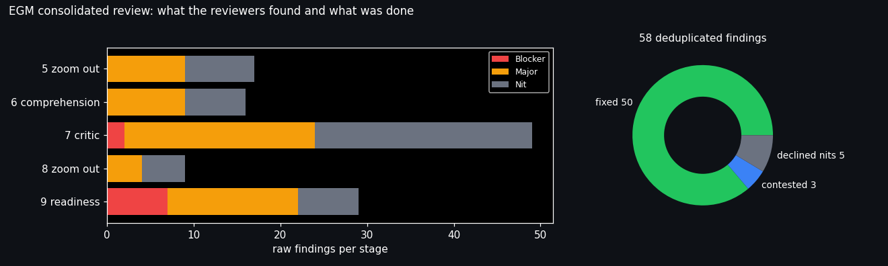
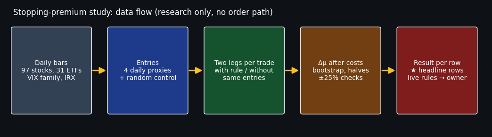

# Consolidated review report: stopping-premium backtests method

Mode: "Consolidated report with all review rubrics" (standing owner choice 2026-11-15). Target:
`research/backtests/stoploss-premium/design.md`. Stages and files:

| Stage | Reviewers | File | Blocker / Major / Nit |
| --- | --- | --- | --- |
| 5 Initial zoom out | egm-zoom-out, egm-inventive-catalyst | `zoom_out_report.md` | 0 / 9 / 8 |
| 6 Comprehension | egm-comprehension | `comprehension_report.md` | 0 / 9 / 7 |
| 7 Critic | egm-design, egm-structural, egm-style | `critic_report.md` | 2 / 22 / 25 |
| 8 Intermediate zoom out (after the first fixes) | egm-zoom-out | `intermediate_zoom_out_report.md` | 0 / 4 / 5 |
| 9 Implementation readiness | egm-implementation-readiness, egm-codebase-details | `implementation_readiness_report.md` | 7 / 15 / 7 |

Resolution: `goldfish_review_report.md` (auto accept; 58 deduplicated findings: 50 fixed, 3 contested with reasons,
5 declined Nits; no escalation).

## Action items by priority

🔴 Blockers (all fixed)

1. Method text on the report page contradicted the code (100% vs 25% premium). Fixed in code.
2. No alternatives section; vendor rejection without a link. Fixed in the document.
3. Incomplete file list, no test plan, decisions only in code, wrong output list, schema missing, Crown inputs not
   hashed. Fixed in the document and code.
4. Test E presented as a backtest. Fixed in the document.

🟡 Majors (fixed unless marked)
5. Comparison rows could pass "adds return" (code).
6. Second conventions beside existing code: loaders, indicators, drawdown, expiries, skew, strike grid, IV carry (code).
7. Ports without a pinned source; ports not checked against the live code (code, tests: golden values).
8. Drawdown test depends on the premium share (results at 6/25/100%).
9. Spread and IV assumptions (half-spread row, IV-index ETF rows); zero rate (now IRX).
10. Entry dependence (random-entry control).
11. Owner routing and live rules (Live column, headline rows, model price = evidence gap).
12. Correlated stop events and drawdown uncertainty (stop days, drawdown cut per half).
13. Multiple testing (exploratory statement, headline rows fixed before the run).
14. Structure, terms, samples, risks and mitigations, data contract, dependency statement (document).
15. Pool brake curves for H (contested), reason codes for "inconclusive" (contested), reuse the income backtest for F
    (contested).

🟢 Nits: applied, except 5 declined (emoji wording, dash style, document placement, per-ETF 10-month results,
removing the Crown reads).

## Traceability

| Raw finding | Action item |
| --- | --- |
| Codebase9 B1 | 1 |
| Design7 B1, Structural7 B1, Structural7 M1 | 2 |
| Readiness9 B1-B3, M5-M8, N10-N12; Codebase9 B2, B4, M5-M9, M13, N14-N17 | 3, 14 |
| Codebase9 B3, Design7 M2, Comprehension6 M2, ZoomOut5 M4, Structural7 N3 | 4 |
| Design7 M3, Codebase9 M12 | 5 |
| ZoomOut5 M3, Codebase9 M10, N15 | 6 |
| ZoomOut5 M2, Readiness9 M4, Codebase9 M11, ZoomOut8 M3 | 7 |
| Catalyst5 F1, ZoomOut8 N2 | 8 |
| Catalyst5 F2, F7, Design7 M7, ZoomOut8 M2 | 9 |
| Catalyst5 F5 | 10 |
| ZoomOut5 M1, Design7 M10, ZoomOut8 M1 | 11 |
| Design7 M5, M6, Catalyst5 F8 | 12 |
| Design7 M4, ZoomOut8 N5 | 13 |
| Structural7 M2-M5, Design7 M8, M9, M11, Comprehension6 M1, M3-M9, N10-N16, Style7 M1-M7, N1-N10, ZoomOut8 M4, N4 | 14 |
| Catalyst5 F3, F4, Design7 B1 (part a) | 15 |
| Catalyst5 F6 | 11 (bias notes) |
